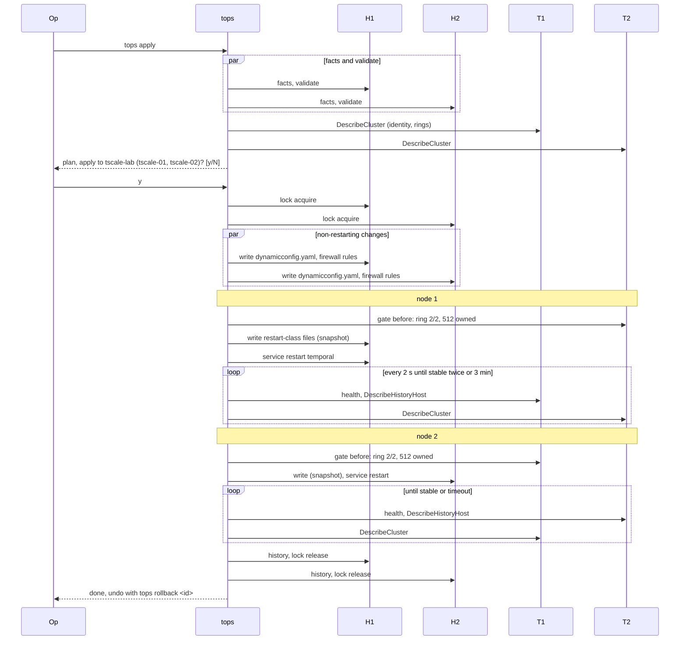
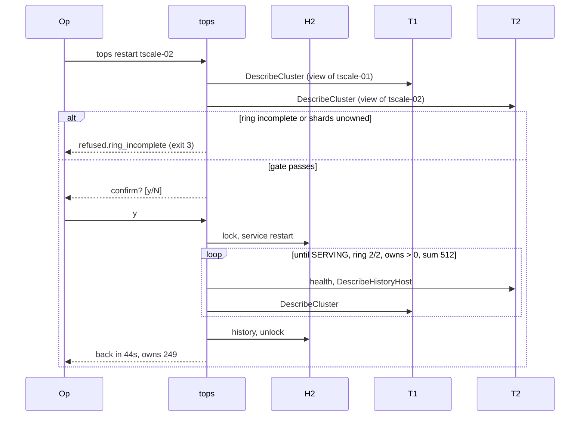
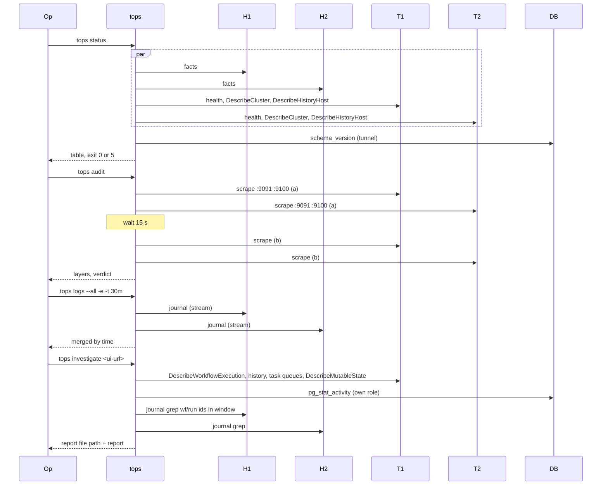
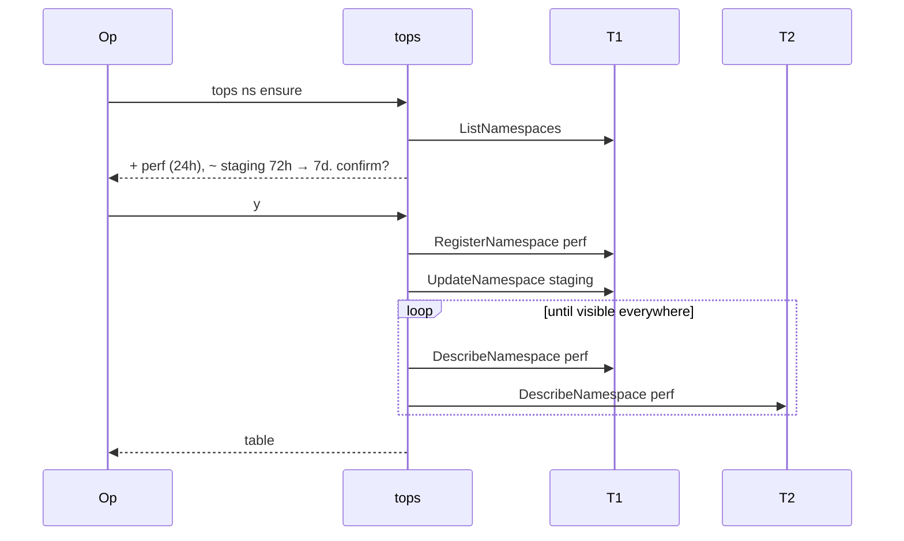

# tops app flow

Project: tops (Temporal Ops), `github.com/2SSK/tops`. Status: draft. Date: 2026-10-10.
Sibling docs: [PRD](prd.md) · [TRD](trd.md) · [Design brief](design-brief.md) · [Backend schema](backend-schema.md) ·
[Implementation plan](implementation-plan.md) · [Concepts](concepts.md)

Operator journeys, step by step, with what tops refuses and what happens when a step fails. Examples use
the temporal-node-scale lab (`tscale-01` 10.78.0.11, `tscale-02` 10.78.0.12, PostgreSQL 10.78.0.20).

Participants in the diagrams:

| Name      | Is                                                                     |
| --------- | ---------------------------------------------------------------------- |
| Op        | The operator at the workstation                                        |
| tops      | The CLI on the workstation                                             |
| H1, H2    | The helper on node 1 / node 2 (`sudo tops node <op>` over SSH)          |
| T1, T2    | Temporal on node 1 / node 2, reached through SSH tunnels to loopback   |
| DB        | PostgreSQL, reached through a tunnel from a node (reads) or by the schema tool on a node (writes) |

Common prelude of every command that touches nodes (not repeated below):

1. Load `cluster.yaml`, apply defaults, validate; load `secrets.env` (mode 0600).
2. Connect to every node in parallel: strict host key, auth, `sudo -n true`, a test tunnel.
3. `hello`; upload the helper if missing or different (sha256), then `hello` again.

| Prelude failure            | Result                                                           | Exit |
| -------------------------- | ---------------------------------------------------------------- | ---- |
| Spec or secrets invalid    | Every error listed with path and line                            | 4    |
| Host key unknown / changed | Refuse; print fingerprints and the `ssh-keyscan` line            | 1    |
| sudo asks for a password   | Refuse (`ssh.sudo_password`)                                     | 1    |
| Forwarding disabled        | Refuse (`ssh.forwarding_disabled`)                               | 1    |
| A node unreachable         | Mutating commands refuse before any change; read commands show the node as unreachable and go on | 1 / 5 |

## 1. First-time bootstrap

Precondition: fresh Ubuntu 24.04 hosts (`make reset && make up` in the lab), an empty PostgreSQL that
admits every node, host keys in `ssh.knownHosts` (the lab's `make up` writes them).

1. `tops init` writes a commented `cluster.yaml` and `secrets.env` (0600) if they do not exist.
2. Operator edits them; `tops validate` checks them offline (schema, immutables present, headroom, secrets mode).
3. `tops bootstrap`: prelude.
4. Preflight, all nodes in parallel: OS is Ubuntu 24.04; host fits the profile (effective cores and memory,
   TRD "Host limits"); required ports free (6933-6939, 7233-7243, 7936, 9091, 9100, 80, 8080 on `ui.node`);
   `temporal.service` not present (unless resuming, below); clock synced (warning only).
5. Preflight, datastore (tunnel via node 1): reachable with the spec's credentials; `temporal` database
   absent, or present without rows in `cluster_metadata_info`, or holding this spec's cluster (resume);
   `max_connections` against the connection budget (warning only, backend-schema "Temporal persistence").
6. Print the plan (every file per node, packages, releases, databases, namespaces); confirm.
7. Lock all nodes.
8. Stage in parallel: `temporal` user and dirs, apt `nginx` and `prometheus-node-exporter`, Temporal server
   and CLI releases, ui-server on `ui.node` (downloads verified against checksums the workstation fetched).
9. Schema from node 1 with the staged `temporal-sql-tool`: create both databases if missing, `setup-schema
   -v 0.0`, `update-schema --schema-name postgresql/v12/{temporal,visibility}`.
10. Render every node; `validate` with the staged binary on every node.
11. Write firewall, journald, rsyslog and nginx files on all nodes in parallel; start `temporal-firewall`.
12. Start Temporal on node 1; wait SERVING, ring 1/1 (all four services), 512 of 512 shards owned.
13. For each further node in spec order: write, start, wait ring N/N, node owns shards > 0, sum 512.
14. Start the UI on `ui.node`; check `http://127.0.0.1:8080` through a tunnel.
15. `ns ensure`: create the spec's namespaces; wait until each is visible on every node's frontend.
16. History records on every node; unlock.
17. Print what tops does not do: add the nodes to the load balancer pool with `/health` on :80; generate
    scrape targets with `tops targets`; take a first datastore backup.

```mermaid
sequenceDiagram
    participant Op
    participant tops
    participant H1
    participant H2
    participant DB
    participant T1
    participant T2
    Op->>tops: tops bootstrap
    tops->>H1: hello, facts (preflight)
    tops->>H2: hello, facts (preflight)
    tops->>DB: via tunnel: cluster_metadata_info empty?
    tops-->>Op: plan, confirm?
    Op->>tops: y
    tops->>H1: lock acquire
    tops->>H2: lock acquire
    par stage
        tops->>H1: stage (user, packages, releases, ui-server)
        tops->>H2: stage (user, packages, releases)
    end
    tops->>H1: schema ensure (temporal, temporal_visibility)
    H1->>DB: temporal-sql-tool create/setup/update
    par validate
        tops->>H1: validate (render-config, dynamic config, iptables --test)
        tops->>H2: validate
    end
    tops->>H1: write (firewall, nginx, host files)
    tops->>H2: write (firewall, nginx, host files)
    tops->>H1: write temporal files, service enable-now
    loop until SERVING, ring 1/1, 512 owned
        tops->>T1: health, DescribeCluster, DescribeHistoryHost
    end
    tops->>H2: write temporal files, service enable-now
    loop until ring 2/2, tscale-02 owns > 0, sum 512
        tops->>T1: DescribeCluster
        tops->>T2: health, DescribeCluster, DescribeHistoryHost
    end
    tops->>H1: service enable-now temporal-ui
    tops->>T1: RegisterNamespace (per spec namespace)
    tops->>H1: history write, lock release
    tops->>H2: history write, lock release
    tops-->>Op: healthy; LB and monitoring steps
```

| Fails at                         | tops does                                                                                     | State left                                  |
| -------------------------------- | --------------------------------------------------------------------------------------------- | ------------------------------------------- |
| 4 profile larger than host       | Refuse (`refused.profile_too_large`)                                                          | Nothing changed                             |
| 4 ports in use (e.g. a UI container on 8080) | Refuse; names port and process                                                    | Nothing changed                             |
| 4 `temporal.service` exists      | Refuse (`refused.node_in_use`): "tscale-01 already runs Temporal: use `tops plan`/`apply` to adopt it". Not on resume | Nothing changed                             |
| 5 datastore holds a cluster      | Refuse (`refused.datastore_in_use`), names the cluster found                                  | Nothing changed                             |
| 8 download or checksum           | Stop; other nodes' stage finishes; unlock                                                     | Releases partly staged; re-run continues    |
| 9 schema tool fails              | Stop; print the tool's stderr (no secrets)                                                    | Databases may exist; re-run continues (tools are idempotent) |
| 10 validation fails              | Stop before any config write                                                                  | Staged only                                 |
| 12/13 node not healthy in time   | Stop; print journal errors; leave started nodes running                                       | Partial cluster; fix, then `tops bootstrap` again (a datastore that holds this same cluster, with nodes in the spec, is resumed, not refused) |

Re-running `bootstrap` after a failure resumes. Resume = the datastore's `cluster_metadata_info` names this
spec's `cluster`. Then nodes that already run Temporal are accepted (they are skipped if healthy), staged
releases and schema steps are no-ops, and the remaining nodes start in order. It is refused when the
datastore holds a cluster with another name, or the live rings have members outside the spec.

v2 (T6): step 12-13 start nodes in role stages (frontend, history, matching, worker, UI host), each with
its own gate (TRD "Ring gate"). The first history host owns all shards until the next one joins.

## 2. Adopt the cluster the bash scripts built

Precondition: the 2-node lab built by `deploy.sh`, running Temporal 1.31.3 with
`currentClusterName: active` (the bash template's hard-coded name), 512 shards, PostgreSQL. A workflow is
started before the takeover (temporal-node-scale M1 acceptance).

Spec for adoption: `cluster: active`, `temporal.version: 1.31.3`, `shards: 512`, `profile: 2c4g`, the
same IPs, `namespaces` = the lab's `NAMESPACES` with 72h retention.

1. `tops plan`: prelude.
2. Identity checks against the live cluster (`DescribeCluster` on each node): name `active`, 512 shards,
   `postgres12`, ring members = spec nodes, version 1.31.3 on every node. A mismatch refuses
   (`refused.immutable`, `refused.version_change`, `refused.unknown_member`).
3. Each node has no `/var/lib/tops/applied.json`: the plan marks it `adopt (first apply by tops)`.
4. The plan shows the full difference to the bash files. T2 (temporal files only):
   - `temporal.yaml`: env-driven template -> literal values, pprof on loopback, cluster name unchanged.
   - `temporal.env`: `NUM_HISTORY_SHARDS`, `DB_*`, `HOST_IP` … removed; `TOPS_PG_PASSWORD`,
     `GOMAXPROCS`, `GOMEMLIMIT` kept; values of secret keys masked.
   - `temporal.service`, `profile.conf`: unchanged (same content as the bash templates).
   - `/etc/temporal/profile.yaml`: not touched at T2; removed from T3 on (tops owns `/etc/temporal`, assumes Q9).
   - `dynamicconfig.yaml`: unchanged if the cluster repo's file and the profile are unchanged.
   - Every node: `→ restarts temporal`.
   From T3 also: firewall (per-port `+`/`-`, normally none), nginx (UI location only on `ui.node`),
   journald drop-in renamed, UI moves from the Docker container to ui-server.
5. Exit 2. Operator reviews.
6. `tops apply`: confirm, lock, snapshot (the snapshot holds the bash files, so `rollback` can put them back),
   rolling restart with the ring gate, exactly as journey 3.
7. `tops plan` again: exit 0.
8. The workflow started before the takeover completes (`temporal workflow show`).

T3 adoption of the UI: tops refuses while port 8080 on `ui.node` is held by another process. The operator
runs `make ui-down` first (the lab's UI container), then `tops apply` starts `temporal-ui.service`.

Leftovers tops does not own, listed once by the first T3 `plan` as `! not managed by tops: remove by hand`:
`/etc/systemd/journald.conf.d/temporalScale.conf`, `/var/log/temporalScale.log`, `~deploy/temporalScale/`,
the `temporalscale-temporal-ui` container.

| Fails at                              | tops does                                         |
| ------------------------------------- | ------------------------------------------------- |
| 2 spec says `cluster: tscale-lab`     | Refuse: "the live cluster is named `active` and that name is fixed; set `cluster: active`, or rebuild with `make reset && tops bootstrap`" |
| 2 a node runs 1.30.x                  | Refuse: version via `tops upgrade` only           |
| 6 a node does not come back           | Stop at that node; `tops rollback <id>` restores the bash files on the nodes changed so far |

## 3. Plan and apply, rolling across nodes

1. Operator edits `cluster.yaml` or `dynamicconfig.yaml`, commits.
2. `tops plan`: prelude; per node in parallel: `facts`, render, `validate` with the running binary.
3. Safety rules on the plan: immutables, version, unknown ring members, profile vs host, headroom,
   stopped nodes, lock. Any refusal prints the reason and exits 3 (from `apply`) or shows it under
   `refusals` (from `plan`, exit 3).
4. Plan printed per node: file diffs (secrets masked), drift (live differs from what tops last wrote),
   firewall per port group, effect (`→ restarts temporal` / `hot-reload` / `reload nginx` / nothing).
   Exit 0 (no changes) or 2.
5. `tops apply`: steps 2-4 again (never applies a stale plan), prints it, asks
   `apply to tscale-lab (tscale-01, tscale-02)? [y/N]`.
6. Lock all nodes (lease renewed every 30 s).
7. Stage in parallel (only what is missing).
8. Firewall changes on all nodes (adds before restarts).
9. Non-restart changes on all nodes in parallel: dynamic config (Temporal re-reads within 10 s), nginx
   (`nginx -t`, reload), host files.
10. For each node with restart changes, in spec order: gate before; `write` (snapshot first); `restart`;
    gate after (SERVING, rings N/N in every view, owns > 0, sum 512, stable twice).
11. `ns ensure` if namespaces changed.
12. History records; unlock; summary with `tops rollback <apply-id>`.



| Fails at                                  | tops does                                                                                              | Exit |
| ----------------------------------------- | ------------------------------------------------------------------------------------------------------ | ---- |
| 3 version differs                         | Refuse: `tops upgrade <v>`                                                                             | 3    |
| 3 immutable differs                       | Refuse: "build a new cluster"                                                                          | 3    |
| 3 ring member not in spec                 | Refuse; name it                                                                                        | 3    |
| 3 a spec node is stopped (after `node remove`) | Refuse: `tops node add <n>` or delete it from the spec                                            | 3    |
| 6 lock held                               | Refuse; holder, command, age. Expired lease: warn, show the interrupted apply id, take over           | 3    |
| 10 gate before fails (another node is down) | Stop before touching this node                                                                       | 3 if first node, else 1 |
| 10 node not back in time                  | Stop; no further node touched; journal errors; `tops rollback <id>`                                   | 1    |
| Ctrl-C                                    | Finish or abandon the current helper op, release the lock, print where it stopped                     | 130  |
| Workstation dies mid-apply                | At most one node mid-change; the lease expires in 2 min; the next `plan` shows what remains           | -    |

`--node N` limits writes to one node; the gate still reads the whole cluster.

## 4. Safe restart

1. `tops restart tscale-02`: prelude (no plan; nothing is rendered).
2. Gate before: tscale-01 SERVING; every node's view shows both nodes in all four rings; 512 owned.
3. Confirm: `restart temporal on tscale-02? its shards move to the other nodes for ~45s [y/N]`.
4. Lock all nodes.
5. `service restart` on tscale-02 (Temporal drains: frontend fails health 10 s, drains 30 s, per
   `dynamicconfig.yaml`).
6. Gate after; print shards before and after per node.
7. History record (command `restart`, no snapshot); unlock.

`tops restart --all`: steps 2-6 per node in spec order, stopping at the first failure.

`--force` skips step 2 only: tops asks to type the node name; refused with `-y`. Use: the node is the one
broken and the rest of the ring is already incomplete because of it.



Refusal drill (temporal-node-scale D-5): `make kill ARGS=02`, then `tops restart tscale-01` ->
`refused.ring_incomplete: history ring has 1 of 2 nodes: tscale-02 is missing`, exit 3.

## 5. Node add and remove

### Add (`tops node add tscale-03`)

Precondition: `tscale-03` is in `cluster.yaml`, its host is reachable (lab: added to the lab by
temporal-node-scale M2), its host key is known.

1. Prelude for all nodes, including tscale-03.
2. Checks: tscale-03 does not run Temporal; the others are healthy (gate); profile fits tscale-03;
   headroom with N+1 nodes.
3. Plan: tscale-03's full file set; firewall `peers +10.78.0.13` on tscale-01 and tscale-02. Confirm.
4. Lock all nodes (tscale-03 included).
5. Firewall on existing nodes first (they must accept 03's membership traffic before it starts).
6. Stage, validate, write and enable on tscale-03 (firewall included).
7. Record shard counts per node; start Temporal on tscale-03.
8. Wait: ring 3/3 in every view; tscale-03 owns > 0; sum 512. Print time to ring 3/3 and the shards each
   node gave up (do not assert an even split).
9. History records; unlock. Print: add tscale-03 to the LB pool; regenerate targets.

### Remove (`tops node remove tscale-03`)

1. Prelude.
2. Checks: tscale-03 is in the spec; survivors fit the shards (`ceil(512/2) <= maxShardsPerHost`); the
   other nodes are healthy.
3. Confirm with a reminder: `remove tscale-03 from the load balancer pool first. continue? [y/N]`.
4. Lock all nodes.
5. `service disable-now temporal` on tscale-03: graceful stop (health fails, drain, shards released).
6. Wait: ring 2/2 without tscale-03 in every view; 512 owned by tscale-01 and tscale-02.
7. History record on tscale-03 (`node remove`); unlock.
8. Print: delete tscale-03 from `cluster.yaml`, then `tops apply` (removes its address from the other nodes'
   firewall). tops does not edit the spec here: the node list is the operator's.

```mermaid
sequenceDiagram
    participant Op
    participant tops
    participant H1
    participant H3 as H3 (tscale-03)
    participant T1
    participant T3 as T3 (tscale-03)
    Op->>tops: tops node add tscale-03
    tops->>H3: hello, facts (fresh?)
    tops->>T1: gate: ring 2/2, 512 owned
    tops-->>Op: plan, confirm?
    Op->>tops: y
    tops->>H1: lock; write firewall (+10.78.0.13 peers)
    tops->>H3: lock; stage, validate, write
    tops->>H3: service enable-now temporal
    loop until ring 3/3, 03 owns > 0, sum 512
        tops->>T3: health, DescribeHistoryHost
        tops->>T1: DescribeCluster
    end
    tops-->>Op: ring 3/3 in 38s; 01 263→170, 02 249→171, 03 0→171
    Op->>tops: tops node remove tscale-03
    tops->>T1: survivors fit 512? others healthy?
    tops-->>Op: remove from LB pool first. continue?
    Op->>tops: y
    tops->>H3: service disable-now temporal
    loop until ring 2/2, 512 owned by 01+02
        tops->>T1: DescribeCluster, DescribeHistoryHost
    end
    tops-->>Op: delete tscale-03 from cluster.yaml, then tops apply
```

| Fails at                                  | tops does                                                       |
| ----------------------------------------- | --------------------------------------------------------------- |
| add 2: tscale-03 already runs Temporal    | Refuse: it is already a member; use `plan`/`apply`              |
| add 2: tscale-03 not in the spec          | Refuse (`node add` only joins nodes already in the spec)        |
| add 8: not in ring within the timeout     | Stop; tscale-03 left running for diagnosis; `tops node remove tscale-03` cleans up |
| remove 2: survivors above the shard limit | Refuse (`refused.headroom`)                                     |
| remove 2: it is the last node             | Refuse                                                          |
| remove 6: shards not all owned in time    | Stop; report owners; tscale-03 stays stopped                    |
| apply with tscale-03 stopped but still in the spec | Refuse (`refused.node_stopped`, assumes Q10)          |

## 6. Upgrade (`tops upgrade 1.31.3`)

Precondition: every node on 1.30.x (e.g. 1.30.7, schema 1.18/1.13). Follows PRD D5 (separate from apply) and D13 (two supported minors).

1. Prelude; read every node's running version and the schema versions (tunnel via node 1).
2. Path checks: target supported by this tops; same minor or next minor; not a downgrade; nodes on at
   most two versions (resume case: some already on the target).
3. Ask: `a backup of the datastore exists? [y/N]` (with `-y`, `--backup-confirmed` is required).
4. Lock all nodes.
5. Stage 1.31.3 on all nodes in parallel. Render with 1.31.3; `validate` with the 1.31.3 binary on every node.
6. Schema from node 1 with the 1.31.3 `temporal-sql-tool`: `update-schema` temporal 1.18 -> 1.19,
   visibility 1.13 -> 1.14. The 1.30.7 servers keep running on the newer schema.
7. Rolling, in spec order: gate before; `write` (snapshot; `current` -> `releases/1.31.3`; rendered files);
   restart; gate after.
8. Rewrite `temporal.version: 1.31.3` in `cluster.yaml` (comments kept). Print: commit the spec.
9. History records; unlock.

```mermaid
sequenceDiagram
    participant Op
    participant tops
    participant H1
    participant H2
    participant DB
    participant T1
    participant T2
    Op->>tops: tops upgrade 1.31.3
    tops->>H1: facts (current = releases/1.30.7)
    tops->>H2: facts
    tops->>DB: schema_version (1.18, 1.13)
    tops-->>Op: path 1.30.7 → 1.31.3, backup exists? [y/N]
    Op->>tops: y
    tops->>H1: lock
    tops->>H2: lock
    par stage and validate
        tops->>H1: stage 1.31.3, validate with 1.31.3
        tops->>H2: stage 1.31.3, validate with 1.31.3
    end
    tops->>H1: schema update (1.31.3 tool)
    H1->>DB: update-schema temporal → 1.19, visibility → 1.14
    tops->>T2: gate
    tops->>H1: write (current → 1.31.3), restart
    loop until healthy
        tops->>T1: health, rings, shards
    end
    tops->>T1: gate
    tops->>H2: write (current → 1.31.3), restart
    loop until healthy
        tops->>T2: health, rings, shards
    end
    tops->>tops: cluster.yaml temporal.version = 1.31.3
    tops-->>Op: upgraded; commit cluster.yaml
```

| Fails at                          | tops does                                                                 | Next                                    |
| --------------------------------- | ------------------------------------------------------------------------- | --------------------------------------- |
| 2 skips a minor (1.30 -> 1.32)    | Refuse (`refused.upgrade_path`)                                           | Upgrade one minor at a time             |
| 2 downgrade                       | Refuse; binary downgrades are `rollback`'s job, schema never goes down    | `tops rollback <upgrade apply id>`      |
| 2 version not supported by this tops | Refuse; name the supported versions                                    | Install a newer tops                    |
| 3 not confirmed                   | Refuse                                                                    | -                                       |
| 5 validation fails                | Stop; nothing restarted; schema untouched                                 | Fix; re-run                             |
| 6 schema tool fails               | Stop; nothing restarted                                                   | Fix the datastore; re-run (idempotent)  |
| 7 a node does not come back       | Stop; spec unchanged; mixed versions running (supported during a rolling upgrade) | Re-run `tops upgrade 1.31.3` to resume, or `tops rollback <id>` (binary back, schema stays at 1.19: Temporal accepts a newer schema) |

## 7. Rollback

1. `tops rollback list`: history records from all nodes merged by apply id; rollbackable when every
   changed node still has the snapshot (newest 10 kept).
2. `tops rollback 20261010T153012Z-7f3a`: prelude; per node that has the snapshot, diff snapshot vs live.
3. Plan: files and `current` that go back, effect per node. Nodes whose live state already equals the
   snapshot are skipped. Confirm.
4. Lock all nodes.
5. Non-restarting restores in parallel (dynamic config, firewall, nginx).
6. Restart-class restores one node at a time: gate before; `restore` (it snapshots the live state under a
   new apply id first); `daemon-reload` if a unit changed; restart; gate after.
7. History records with `rollbackOf`; unlock.
8. Print: the new apply id (undo the rollback with it) and the spec warning:
   `cluster.yaml still describes the rolled-back change; tops plan shows it as pending. Fix the spec too.`

```mermaid
sequenceDiagram
    participant Op
    participant tops
    participant H1
    participant H2
    participant T1
    participant T2
    Op->>tops: tops rollback 20261010T153012Z-7f3a
    tops->>H1: facts + snapshot manifest
    tops->>H2: facts + snapshot manifest
    tops-->>Op: restores 2 files on each node, restarts both. confirm?
    Op->>tops: y
    tops->>H1: lock
    tops->>H2: lock
    tops->>T2: gate before
    tops->>H1: restore (snapshot live as 20261010T160501Z-c41d), restart
    loop until healthy
        tops->>T1: health, rings, shards
    end
    tops->>T1: gate before
    tops->>H2: restore (same new id), restart
    loop until healthy
        tops->>T2: health, rings, shards
    end
    tops-->>Op: rolled back; undo with tops rollback 20261010T160501Z-c41d
```

| Fails at                          | tops does                                                                    |
| --------------------------------- | ---------------------------------------------------------------------------- |
| 1 no argument                     | Prints the list; changes nothing (no "newest by default"; assumes Q7)        |
| 2 snapshot missing on a changed node (rotated out) | Refuse: not rollbackable; name the node                     |
| 2 apply id prefix ambiguous       | Refuse; list the matches                                                     |
| 6 node does not come back         | Stop as in apply; the rollback is itself undoable                            |
| Rollback of an upgrade            | `current` goes back to the old release; schema stays; `plan` then reports "spec 1.31.3, nodes 1.30.7" until the spec or `upgrade` resolves it |

## 8. Incident: status → audit → top / logs → investigate

The order narrows from "is the cluster whole?" to "which layer?" to "which node?" to "which workflow?".
All read-only, no lock; usable while an `apply` runs.

1. `tops status` (< 3 s): service, version, SERVING, rings, shards, memory, clock per node; shard sum,
   rings, database, firewall. Exit 5 if a check fails. Next step printed (e.g. `tops logs tscale-02 -e`).
2. `tops audit` (15 s window): every node's `:9091` and `:9100` sampled twice; one line per layer
   (servers, frontend, history, matching, workers, database, errors), the first marked line is where to
   start; `-v` for p50/p99 per layer, slowest operations, top backlog queues. A missing metric is
   "metric missing", never green.
3. Narrow to a node:
   - `tops top tscale-01 -w 2`: cgroup CPU vs cores, memory vs MemoryHigh/MemoryMax, Go heap vs GOMEMLIMIT,
     pressure, OOM kills, restarts.
   - `tops logs --all -e -t 30m`: errors from every node merged by time; `-q` hides task-queue chatter;
     `-s` counts per message; `-g <text>` filters.
4. Narrow to a workflow: paste the UI URL into `tops investigate '<url>'`: describe, owning shard and
   history host, history summary, pending activities, pollers and backlog of its task queue, namespace,
   visibility row, database connections and slow statements (PostgreSQL), log lines from every node in the
   workflow's window. Written to `./investigate-<workflow>-<time>.md` and printed.



| Situation                         | Behaviour                                                                     |
| --------------------------------- | ----------------------------------------------------------------------------- |
| A node unreachable                | `status`: row marked `✗ unreachable`, the rest still shown, exit 5. `audit`: node shown unreachable; layers computed from the rest |
| Frontend down on every node       | `status` still reports systemd and journal facts via the helper; Temporal rows show `-`; exit 5 |
| Datastore unreachable             | `status`: database row `✗`; `investigate`: the SQL section says so and continues |
| URL is not a workflow URL         | Exit 4 with the expected shape `/namespaces/<ns>/workflows/<id>[/<run>]`      |
| Workflow not found                | Exit 1, the server's message; nothing written                                  |

## 9. Namespace ensure

1. `tops ns` (= `ns list`): every namespace with state, retention, running workflows, and `spec`,
   `system` or `unmanaged`.
2. `tops ns ensure`: diff against `namespaces[]`: `+` create, `~` retention change. Unmanaged namespaces
   are listed and never deleted or changed. Confirm.
3. Lock all nodes (every mutating command takes the lock; assumes Q8); the API calls go to one node's frontend.
4. `RegisterNamespace` or `UpdateNamespace` per change.
5. Wait until `DescribeNamespace` succeeds on every node's frontend (namespace cache refresh, ~10 s).
6. Print the table again.

`apply` runs the same step after its rollout when namespaces differ, inside its lock.



| Fails at                         | tops does                                                             |
| -------------------------------- | --------------------------------------------------------------------- |
| Retention below 1h               | `validate` error (exit 4)                                             |
| Spec removes a namespace         | Listed as `unmanaged` from then on; never deleted                     |
| Not visible on a node in 60 s    | Exit 1 naming the node; the namespace exists (re-run is a no-op)      |

## What tops refuses (index)

| Refusal                                                      | Journeys       | Code                         |
| ------------------------------------------------------------ | -------------- | ---------------------------- |
| No TTY and no `-y`                                           | all mutating   | `refused.no_tty`             |
| Restart while another node is out of a ring or shards unowned | 3, 4, 5, 6, 7 | `refused.ring_incomplete`    |
| Immutable differs from the live cluster (incl. v2 keyspace, DC, RF, index) | 2, 3 | `refused.immutable`          |
| Persistence address reaches a store without the live cluster | 3             | `refused.store_identity`     |
| Profile larger than the host's effective limits, or `MemoryMax` >= them | 1, 3, 5 | `refused.profile_too_large`  |
| Shard headroom with one node down                            | validate, 3, 5 | `refused.headroom`           |
| Version change through `apply`                               | 2, 3           | `refused.version_change`     |
| Upgrade skipping a minor, downgrading, unsupported           | 6              | `refused.upgrade_path`       |
| Ring member not in the spec                                  | 2, 3           | `refused.unknown_member`     |
| Lock held by a live run                                      | all mutating   | `lock.held`                  |
| Bootstrap into a datastore that holds another cluster        | 1              | `refused.datastore_in_use`   |
| Bootstrap on a node that already runs Temporal; `node add` of a member | 1, 5 | `refused.node_in_use`      |
| `apply` to a node stopped by `node remove` (Q10)             | 3, 5           | `refused.node_stopped`       |
| `node remove` leaving survivors over the shard limit, or of the last node | 5 | `refused.headroom`         |
| `--force` with `-y`                                          | 4              | `refused.force_with_yes`     |
| Rollback without a complete snapshot                         | 7              | `refused.not_rollbackable`   |
| Upgrade without backup confirmation                          | 6              | `refused.no_backup`          |
