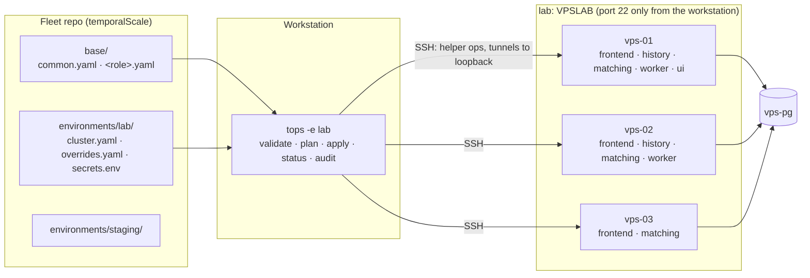

# tops design brief

Project: tops (Temporal Ops), `github.com/2SSK/tops`. Status: draft. Date: 2026-10-23.
Sibling docs: [PRD](prd.md) · [TRD](trd.md) · [App flow](app-flow.md) · [Backend schema](backend-schema.md) ·
[Implementation plan](implementation-plan.md) · [Concepts](concepts.md) · [Roadmap](roadmap.md)

How tops looks and reads in a terminal. tops has no dashboards; its interface is its command grammar, its
output and its errors. Per-command flows and output skeletons are in the [app flow](app-flow.md); this file
sets the rules every command follows and shows rendered examples. What exists today is implemented in
`internal/term` (marks, colour detection, `UserError`, `PrintError`, `WriteErrorJSON`, `Reported`).

## Principles

| #  | Principle                                                    | In practice                                                                                   |
| -- | ------------------------------------------------------------ | --------------------------------------------------------------------------------------------- |
| P1 | Say what will happen before it happens                       | `plan` and every confirmation list the effect per role: `→ restarts history`, `hot-reload`    |
| P2 | Name things the operator can act on                          | Environment, cluster, node, role, file, field, line; never "an error occurred"                |
| P3 | Every failure ends with the next command                     | `fix:` line on errors; `next:`, `apply with:`, `undo with:` lines on results                  |
| P4 | Never claim health you did not measure                       | A missing metric is `metric missing`; an unreachable node is `unreachable`, not omitted       |
| P5 | One line per fact, aligned                                   | Tables without borders; one step per line; no paragraphs in output                           |
| P6 | Scriptable by default                                        | Stable exit codes; one `--json` document on stdout; results on stdout, chatter on stderr      |
| P7 | Colour adds, never carries, meaning                          | Every coloured mark is also a symbol or a word                                                |
| P8 | Dangerous things need more than a keystroke                  | Environment named in every prompt; `--force` and the upgrade backup question need typed input that `-y` cannot answer |
| P9 | Quiet when nothing is wrong                                  | `drift` with no drift: one line per node and exit 0; no banners, no tips on success           |

## Operating model



Intent lives in git, one directory per environment; reality lives on the nodes and in Temporal. tops reads
both every time, shows the difference, and changes reality one role on one node at a time.

## Command grammar

`tops [-e <env>] <verb> [object] [args] [flags]`. Verbs are short, lowercase, and conventional for
infrastructure tools (`plan`/`apply` from Terraform, `status`/`restart` from systemd, `top`/`logs` from the
shell, `rollback` from Helm).

| Group     | Commands                                                                                              |
| --------- | ----------------------------------------------------------------------------------------------------- |
| Spec      | `init`, `validate`, `knobs`, `diff`, `promote`                                                         |
| Change    | `capacity`, `plan`, `bootstrap`, `apply`, `restart`, `rollback`, `upgrade`, `node add`, `node remove`, `ns ensure` |
| Look      | `status`, `drift`, `top`, `logs`, `audit`, `pprof`, `investigate`, `ns list`                           |
| Integrate | `targets`, `version`, `completion`                                                                     |
| Hidden    | `node <op>`: the helper; refuses unless root with a JSON request on stdin                              |

| Thing          | Form                                             | Example                                  |
| -------------- | ------------------------------------------------ | ---------------------------------------- |
| Environment    | `-e <name>`, a directory under `environments/`   | `tops -e lab status`                     |
| Two environments | Positional, source first                       | `tops diff lab staging`, `tops promote lab staging` |
| Node           | Spec name, exact                                 | `--node vps-02`, `tops -e lab node add vps-03` |
| Role           | `frontend`, `history`, `matching`, `worker`, `ui` | `tops -e lab restart history`, `--role matching` |
| All            | `--all`, never `*`                               | `tops -e lab restart --all`              |
| Apply id       | `YYYYMMDDTHHMMSSZ-xxxx`, unique prefix accepted  | `tops -e lab rollback 20261023T1530`     |
| Versions       | Bare semver                                      | `tops -e lab upgrade 1.31.3`             |
| Durations      | Go durations plus `d`                            | `--window 30s`, `-t 2h`                  |
| Sub-verbs      | Second word                                      | `tops -e lab ns ensure`, `tops -e lab rollback list` |

`tops -e lab ns` = `ns list`; `tops -e lab rollback` = `rollback list` and changes nothing.

## Flags

### Global

| Flag            | Default | Meaning                                                                             | Since |
| --------------- | ------- | ----------------------------------------------------------------------------------- | ----- |
| `-e, --env`     | none    | Environment directory under `<root>/environments/`. Required by commands that read a cluster; refused by commands that take none; never read from the process environment | P0.6 |
| `--json`        | off     | One JSON document on stdout; implies `--no-color`; never prompts                    | done  |
| `--no-color`    | off     | Plain output; also implied by `NO_COLOR`, `TERM=dumb`, or the stream not a TTY      | done  |
| `--debug`       | off     | slog text records on stderr besides the run log                                     | T2.3  |

`TOPS_ROOT` overrides fleet-root discovery (scripts, the e2e harness). There is no `-f` and no `TOPS_ENV`.

### Per command

| Flag             | On                                  | Meaning                                                            |
| ---------------- | ----------------------------------- | ------------------------------------------------------------------ |
| `-y, --yes`      | mutating commands, `promote`        | Do not ask. Required without a TTY and with `--json`               |
| `--node N`       | plan, apply, restart, top, logs, pprof, run | Limit to one node (gates still read the whole cluster)     |
| `--role R`       | status, top, logs                   | Limit to one role                                                  |
| `--all`          | restart                             | Every role of every node, role-major                               |
| `--timeout D`    | rollouts                            | Per-step gate timeout (default 3m)                                 |
| `--force`        | restart, apply                      | Skip the before-gate; asks for the node name; refused with `-y`    |
| `-w, --watch N`  | top                                 | Refresh every N seconds                                            |
| `-v`             | audit, diff, knobs                  | More detail                                                        |
| `--window D`     | audit                               | Time between the two scrapes (default 15s)                         |
| `--seconds N`    | pprof                               | CPU profile length (default 30)                                    |
| `--job J`        | targets                             | `temporal` or `node`                                               |
| `--only G`       | promote                             | `versions`, `namespaces`, `settings` (comma list)                  |
| `--partial`      | promote                             | Write the keys the target accepts, skip the rest                   |
| `--backup-confirmed` | upgrade                         | With `-y`: the datastore backup exists                             |
| `--at HH:MM`     | apply (v1.1)                        | Run the confirmed plan at that local time                          |

`logs` flags: `-f` follow, `-E, --errors`, `--warn`, `-q` hide task-queue chatter, `-g <text>`,
`-t <since>`, `-s` summary, `-n N`, `--raw`. No letter has two meanings across commands; `-e` is always the
environment (cobra refuses a local flag that reuses a persistent shorthand). Unknown flags, extra
arguments and bad values exit 4 with `usage.invalid` (done).

## Help text

One-line summary, usage, what it does, examples that work on the lab, flags. `tops` alone prints the grouped
commands, the fleet root and its environments (or "no fleet root here").

```
$ tops restart --help
Restart a Temporal role, safely, one node at a time.

Usage:
  tops -e <env> restart <role> [--node N] | --all [-y]

Refuses unless the role's ring is whole on every other node, and for history that
all shards are owned. Waits until the role is back in its ring (SERVING for frontend,
owning shards for history) before the next node. Stops at the first that does not
come back.

Examples:
  tops -e lab restart history
  tops -e lab restart matching --node vps-03
  tops -e lab restart --all -y

Flags:
      --all                every role on every node, history first, worker last
      --force              skip the check before the restart (asks for the node name)
      --node string        only this node
      --timeout duration   wait this long for each role (default 3m0s)
  -y, --yes                do not ask

Global flags:
  -e, --env string   environment under environments/
      --json         machine-readable output
      --no-color     plain output
      --debug        log details to stderr
```

## Streams, TTY and colour

| Stream | Carries                                                                   |
| ------ | ------------------------------------------------------------------------- |
| stdout | The result: tables, plans, finished steps; or exactly one JSON document with `--json` |
| stderr | Errors (human mode), prompts, warnings, the live progress line, `--debug` records |

| Rule                                                                                         | Implemented   |
| -------------------------------------------------------------------------------------------- | ------------- |
| Colour per stream: on only if that stream is a TTY, `NO_COLOR` is empty, `TERM` is not `dumb`, and neither `--no-color` nor `--json` is set | done (`term.ColorEnabled`) |
| Marks: UTF-8 symbols when `LC_ALL`, else `LC_CTYPE`, else `LANG` names UTF-8; otherwise 4-letter words (`ok`, `WARN`, `FAIL`, `-`) | done (`term.UnicodeLocale`) |
| ANSI 16-colour palette only (green 2, yellow 3, red 1, grey 8), so terminal themes decide the shade | done |
| Width: tables fit `$COLUMNS` or the terminal width; long cells are cut with `…`; never wrapped mid-row; no width limit when not a TTY | T2.4 |
| Live line: only on a TTY stderr, one line rewritten with `\r`, cleared before any other output; absent in pipes and `--json` | T3.8 |
| Prompts: only when stdin and stderr are TTYs; otherwise mutating commands need `-y` (`refused.no_tty`) | T3.8 |
| Ctrl-C at a prompt or during a run: the current op finishes or is abandoned, the lock is released, exit 130 | done (signals); lock T3.4 |
| Pagers: never                                                                                 | -             |

## Output styles

| Mark   | Colour | Means                         | Used in                         |
| ------ | ------ | ----------------------------- | ------------------------------- |
| `✓`    | green  | fine                          | status, steps, checks           |
| `!`    | yellow | works, needs attention        | warnings, drift in plan         |
| `✗`    | red    | failed or act now             | errors, failed checks           |
| `·`    | grey   | idle, skipped, not applicable | skipped steps, unmanaged        |
| `+`    | green  | added / starts                | plan, diff, promote, ns         |
| `-`    | red    | removed / stops               | plan, diff, promote             |
| `~`    | yellow | changed                       | plan, diff, drift               |
| `→`    | none   | consequence                   | `→ restarts history`            |

`+ - ~` enter `internal/term` with `diff` (T1.9).

| Element     | Style                                                                                          |
| ----------- | ---------------------------------------------------------------------------------------------- |
| Header      | `<env> (<cluster>)  <facts separated by " · ">` and, on time-sensitive commands, `HH:MM:SS UTC` at the right |
| Tables      | Lowercase headers; left-aligned text, right-aligned numbers; two spaces between columns; no borders |
| Sizes       | Binary units, one decimal above 1 GiB: `512M`, `1.3G`; percentages as integers                 |
| Times       | UTC; `HH:MM:SS` today, `MM-DD HH:MM` otherwise; elapsed as `m:ss` in step lines, `1m19s` in summaries |
| Steps       | `<elapsed>  <mark> <node>  <role>  <action>  <detail>`, one line when the step ends            |
| Diffs       | Unified, 2 lines of context, indented under the file; secret values `***`; `~ key  old → new` for single values |
| Summary     | Last line(s): counts, then the next command (`apply with:`, `undo with:`, `next:`)             |

## Confirmations and typed input

| Prompt                                                                 | Answer                       | `-y` answers it |
| ---------------------------------------------------------------------- | ---------------------------- | --------------- |
| `apply to lab (tops-e2e: vps-01, vps-02, vps-03)? [y/N]`               | `y`                          | yes             |
| `restart history on vps-01, vps-02, one at a time? shards move for ~30 s each [y/N]` | `y`            | yes             |
| `take vps-03 out of the load balancer first. continue? [y/N]`          | `y`                          | yes             |
| `--force: type the node name to skip its safety check:`                | `vps-02`                     | no (refused with `-y`) |
| `a backup of the datastore exists? type yes:`                          | `yes`                        | only with `--backup-confirmed` |

Default is always No. Any other input is No.

## `--json` contract

| Rule                                                                                         |
| -------------------------------------------------------------------------------------------- |
| Exactly one document on stdout per run, success or failure; nothing else on stdout          |
| `kind` and `topsVersion` in every document; `env` and `cluster` when an environment is loaded |
| A failure is `{"kind": "Error", "error": {code, what, why, fix}}`; a refusal inside a plan or rollout is in that document's `refusals`/`result`, not an `Error` |
| Same exit codes as human mode                                                                |
| Never prompts; mutating commands need `-y`                                                   |
| Fields only added within a major; never renamed or retyped                                   |
| Times RFC 3339 UTC, sizes bytes, durations ms                                                |

Shapes: [backend-schema.md](backend-schema.md#--json-outputs).

## Errors

```
✗ <what happened>
  why: <the cause, in the operator's terms>
  fix: <the command or edit that resolves it>
  (code: <code>, run log: ~/.local/state/tops/runs/<run-id>.jsonl)
```

`why` and `fix` are omitted when empty; the run log path appears once the run log exists (T3.8). Name the
environment, node, role, file, field or line; quote what tops saw; the fix is a command when one exists.

### Code catalogue

Prefixes decide the exit code (TRD "Exit codes"). Refusals are listed with their commands in the
[app-flow refusal index](app-flow.md#what-tops-refuses-index).

| Code                         | What                                              | Why (example)                                                                | Fix (example)                                              |
| ---------------------------- | ------------------------------------------------- | ---------------------------------------------------------------------------- | ---------------------------------------------------------- |
| `usage.invalid`              | unknown flag "--nodes"                            | -                                                                            | `tops restart --help`                                      |
| `spec.no_root`               | no fleet repo here                                | no `environments/` in /home/ssk or any parent                                | run tops inside the fleet repo, or set TOPS_ROOT           |
| `spec.no_env`                | environment "stagin" not found                    | environments: lab, staging                                                   | `tops -e staging …`                                        |
| `spec.unreadable`            | cannot read environments/lab/cluster.yaml         | permission denied                                                            | check the file                                             |
| `spec.invalid`               | environments/lab is invalid: 2 errors             | (each problem printed above with file, line, path)                           | edit the files, then `tops -e lab validate`                |
| `spec.env_exists`            | environments/qa already exists                    | init never overwrites                                                        | edit it, or pick another name                              |
| `secrets.mode`               | environments/lab/secrets.env is readable by others | mode 0644, must be 0600                                                     | `chmod 600 environments/lab/secrets.env`                   |
| `secrets.invalid`            | environments/lab/secrets.env line 3               | `TOPS_PG_PASWORD` is not a known key                                         | fix the key name                                           |
| `ssh.unreachable`            | vps-02 (10.80.0.12:22) unreachable                | dial tcp: i/o timeout after 5s                                               | `make -C lab ps`; is the node up?                          |
| `ssh.auth`                   | vps-02 refused the key                            | no supported authentication methods                                          | check `ssh.key` and the node's authorized_keys             |
| `ssh.host_key_unknown`       | vps-02 (10.80.0.12) is not in known_hosts         | tops never trusts a host key on first use                                    | verify `SHA256:…`, then add the line                       |
| `ssh.host_key_changed`       | vps-02 presented a different host key             | known `SHA256:aa…`, presented `SHA256:bb…`; a rebuilt node or an attack      | after a VPSLAB reset: `make -C lab up` rewrites known_hosts |
| `ssh.sudo_password`          | sudo on vps-01 asks for a password                | tops needs passwordless sudo                                                 | add a NOPASSWD rule for the SSH user                       |
| `ssh.forwarding_disabled`    | vps-01 refuses port forwarding                    | `AllowTcpForwarding no` in sshd                                              | allow forwarding for the SSH user                          |
| `ssh.tunnel_failed`          | cannot reach 127.0.0.1:7934 on vps-01             | connection refused                                                           | `tops -e lab status --role history`                        |
| `helper.no_binary`           | no linux/arm64 helper for tops dev                | dev builds carry only the workstation's own binary                           | `make build-linux`, or use a release                       |
| `release.download`           | cannot download temporal 1.31.3 for vps-02        | HTTP 404 from github.com                                                     | check `temporal.version`                                   |
| `release.checksum`           | temporal 1.31.3 archive on vps-02 does not match  | expected `ab12…`, got `cd34…`                                                | re-run; if it repeats, do not proceed                      |
| `schema.failed`              | schema update failed on vps-01                    | temporal-sql-tool: `pq: permission denied to create database`               | grant CREATEDB or pre-create the databases                 |
| `lock.held`                  | lab is locked                                     | `apply` by ssk@thinkpad, started 2 min ago, renewed 12 s ago                 | wait, or check that run                                    |
| `lock.lost`                  | stopped: this run no longer holds the lock on vps-02 | lease expired; run r-…-4b1c took over                                     | `tops -e lab plan` to see what is left                     |
| `rollout.role_unhealthy`     | history on vps-02 did not come back within 3m     | in ring 2/2, owns 0 of 512                                                   | `tops -e lab logs --node vps-02 --role history -E`; undo: `tops -e lab rollback 20261023T153012Z-7f3a` |
| `rollout.gate_failed`        | stopped before matching on vps-03                 | matching ring has 2 of 3 members: vps-01 is missing                          | `tops -e lab status`; re-run apply when whole              |
| `investigate.not_found`      | workflow order-42 not found in namespace default  | DescribeWorkflowExecution: NotFound                                          | check the URL                                              |
| `refused.no_tty`             | not applying without confirmation                 | no terminal and no -y                                                        | add `-y`                                                   |
| `refused.ring_incomplete`    | not restarting history on vps-01                  | history ring has 1 of 2 members: vps-02 is missing                           | `tops -e lab status`; bring vps-02 back first              |
| `refused.last_frontend`      | not restarting frontend on vps-01                 | no other frontend is SERVING                                                 | bring another frontend back first                          |
| `refused.last_role_instance` | not stopping worker on vps-02                     | it is the only worker; system workflows would stop                           | add worker to another node first                           |
| `refused.node_too_small`     | vps-03 cannot run frontend, history, matching     | 768M effective (cgroup memory.max) leaves -210M after floors                 | fewer roles on vps-03, a pin, or a bigger node             |
| `refused.headroom`           | not applying                                      | with vps-02 down, vps-01 history would own 512 shards: predicted 1.3G, GOMEMLIMIT 1.1G | more history nodes or more memory on vps-01 |
| `refused.db_budget`          | not applying                                      | pools need 212 connections; vps-pg can give 186 (300 max, 3 reserved, 111 other sessions) | lower pools with pins, or raise max_connections |
| `refused.unknown_member`     | not applying                                      | 10.80.0.14:7234 is in the history ring but not in cluster.yaml               | add it to nodes, or stop Temporal there                    |
| `refused.immutable`          | not applying                                      | `shards: 1024`, the live cluster has 512, fixed forever                      | set `shards: 512`                                          |
| `refused.store_identity`     | not applying                                      | 10.80.0.21 holds no cluster tops-e2e (6b0e…)                                 | point at the store that holds it                           |
| `refused.render_rejected`    | history.yaml rejected by temporal-server 1.31.3 on vps-01 | `Unable to load configuration: …`                                    | nothing changed; fix the value named above                 |
| `refused.version_change`     | not applying                                      | spec 1.31.3, nodes run 1.30.7                                                | `tops -e lab upgrade 1.31.3`                               |
| `refused.upgrade_path`       | not upgrading to 1.32.0                           | nodes run 1.30.7; one minor at a time; this tops supports 1.30–1.31         | `tops -e lab upgrade 1.31.3` first                         |
| `refused.no_backup`          | not upgrading                                     | the datastore backup was not confirmed                                       | take a backup; answer yes, or `--backup-confirmed`         |
| `refused.datastore_in_use`   | not bootstrapping                                 | vps-pg holds cluster tscale-lab                                              | another environment owns it: `make lab-reset`, or point at an empty store |
| `refused.node_in_use`        | not bootstrapping on vps-02                       | temporal@history.service exists and the store is empty                       | remove Temporal from vps-02, or `make lab-renew`           |
| `refused.ports_in_use`       | not bootstrapping on vps-01                       | 7233 is used by nginx (pid 812)                                              | free the port                                              |
| `refused.unsupported_os`     | not bootstrapping on vps-02                       | debian 12; tops supports ubuntu 24.04                                        | use an Ubuntu 24.04 node                                   |
| `refused.not_in_spec`        | not adding vps-04                                 | vps-04 is not in environments/lab/cluster.yaml                               | add it with its roles first                                |
| `refused.node_stopped`       | not applying                                      | vps-03 was removed by `node remove` (20261023T1612Z-…) but is still in the spec | `tops -e lab node add vps-03`, or delete it from the spec |
| `refused.force_with_yes`     | --force needs a person                            | -y cannot answer the node-name question                                      | drop `-y`                                                  |
| `refused.not_rollbackable`   | cannot roll back 20261020T…                       | the snapshot on vps-02 was rotated out (newest 10 kept)                      | apply a fix forward                                        |
| `refused.unknown_setting`    | not promoting                                     | `history.newThing` is not a 1.30 setting (staging runs 1.30.7)               | `--partial`, or upgrade staging first                      |
| `refused.plan_stale`         | not applying at 02:00                             | vps-02 changed since the plan was confirmed                                  | `tops -e lab plan`, then schedule again                    |
| `refused.role_running`       | not running matching on vps-03 in the foreground  | temporal@matching is active                                                  | `tops -e lab restart matching --node vps-03`, or stop it first |
| `unexpected`                 | (any error that is not a `UserError`)             | the wrapped error chain                                                      | report it with the run log                                 |

`pending.*` and `unhealthy.*` codes are outcomes (exit 2 and 5), never printed as errors.

## Shell completion

`tops completion bash|zsh|fish`. Dynamic completion reads files only, never SSH:

| Position                               | Completes                                          |
| -------------------------------------- | -------------------------------------------------- |
| `-e`, `diff`, `promote`                | directories under `environments/`                  |
| `--node`, `node add|remove`            | node names of the selected environment             |
| `restart`, `pprof`, `--role`           | roles (for `pprof` with `--node`: that node's roles) |
| `knobs`                                | catalog keys                                       |
| `upgrade`                              | versions this tops supports                        |
| `rollback`                             | nothing (apply ids live on nodes)                  |

## Example outputs

Lab on VPSLAB, environment `lab` of the e2e fixture, cluster `tops-e2e`. Colours omitted. Sizes are
illustrative until T2.1.

### `tops validate`

```
$ tops -e lab validate
✓ environments/lab is valid: cluster tops-e2e, 3 nodes, 10 roles
```

```
$ tops -e lab validate
✗ environments/lab/cluster.yaml:31  nodes[2].roles[1]  "matchng" is not a role (frontend, history, matching, worker)
✗ environments/lab/cluster.yaml:12  access.healthchecks[0]  "10.80.0.300" must be an IPv4 address or CIDR
✗ environments/lab is invalid: 2 errors
  fix: edit environments/lab/cluster.yaml, then tops -e lab validate
  (code: spec.invalid)
```

### `tops knobs`

```
$ tops knobs cacheTTL
Temporal 1.31 · 2 settings

  key                              roles     apply    default  meaning
  history.cacheTTL                 history   restart  1h       TTL of workflow entries in the host-level cache
  history.eventsCacheTTL           history   unknown  1h       TTL of the events cache

unknown = not classified yet; plan restarts the role for it. details: tops knobs <key> -v
```

### `tops capacity`

```
$ tops -e lab capacity
lab (tops-e2e)  3 nodes · constants measured 2026-11-xx on VPSLAB (Temporal 1.31)

vps-01  1.5 cores (cgroup cpu.max) · 1.2G (cgroup memory.max) · reserve 180M
  role       MemoryMax  MemoryHigh  GOMEMLIMIT  CPUWeight  pool  vis
  frontend   210M       190M        160M        110        3     2
  history    480M       430M        360M        150        8     2
  matching   170M       150M        130M        90         3     1
  worker     120M       110M        90M         50         2     1

vps-03  1 core (cgroup cpu.max) · 768M (cgroup memory.max) · reserve 150M
  frontend   250M       230M        190M        110        2     1
  matching   300M  pin  270M        230M        90         2     1

cluster
✓ headroom   vps-02 down: vps-01 history owns 512 shards, predicted 330M of 360M GOMEMLIMIT
✓ database   pools 38 of 186 available (vps-pg max_connections 300 · reserved 3 · other sessions 111)
```

### `tops status`

```
$ tops -e lab status
lab (tops-e2e)  Temporal 1.31.3 · 3 nodes · 512 shards · postgres12        15:30:12 UTC

  node    role      unit    version  ring  shards  memory
✓ vps-01  frontend  active  1.31.3   3/3   -       120M of 190M  63%  SERVING
✓ vps-01  history   active  1.31.3   2/2   263     290M of 430M  67%
✓ vps-01  matching  active  1.31.3   3/3   -        90M of 150M  60%
✓ vps-01  worker    active  1.31.3   2/2   -        60M of 110M  55%
✓ vps-02  frontend  active  1.31.3   3/3   -       115M of 190M  61%  SERVING
✓ vps-02  history   active  1.31.3   2/2   249     280M of 430M  65%
  …

cluster
✓ shards     512 of 512 owned · created with 512
✓ rings      frontend 3/3 · history 2/2 · matching 3/3 · worker 2/2 · no unknown members
✓ database   10.80.0.20:5432 via vps-01 · temporal 1.19 · temporal_visibility 1.14

healthy
```

### `tops plan`

```
$ tops -e lab plan
lab (tops-e2e)  plan for 3 nodes · validated with temporal-server 1.31.3 on 3 nodes

vps-01
  history
    ~ /etc/temporal/dynamicconfig-history.yaml                  restart
        + history.cacheTTL:
        +   - value: 15m
    → restarts history (history.cacheTTL is restart)
  frontend
    ~ /etc/temporal/dynamicconfig-frontend.yaml                 hot-reload
        ~ frontend.namespaceRPS  2400 → 3000
  ! drift: /etc/temporal/matching.env edited by hand since 20261023T140155Z-3b7d; apply overwrites it

vps-02
  history   ~ dynamicconfig-history.yaml   → restarts history
  frontend  ~ dynamicconfig-frontend.yaml  hot-reload

vps-03
  frontend  ~ dynamicconfig-frontend.yaml  hot-reload

cluster
  namespaces  in sync · no unknown members

3 nodes change · 2 restarts (history on vps-01, vps-02, one at a time) · 1 drift
apply with: tops -e lab apply
```

### `tops apply`

```
apply to lab (tops-e2e: vps-01, vps-02, vps-03)? [y/N] y

apply 20261023T153012Z-7f3a
 0:01  ✓ lock        vps-01, vps-02, vps-03
 0:02  ✓ hot         dynamicconfig-frontend.yaml on 3 nodes (reloads within 10s)
 0:03  ✓ vps-01  history  gate     ring 2/2 · 512/512 owned
 0:03  ✓ vps-01  history  write    1 file · snapshot 20261023T153012Z-7f3a
 0:41  ✓ vps-01  history  restart  in ring · owns 255 · 512/512 owned (38s)
 0:42  ✓ vps-02  history  gate     ring 2/2 · 512/512 owned
 1:19  ✓ vps-02  history  restart  in ring · owns 249 · 512/512 owned (37s)
 1:19  ✓ unlock

done in 1m19s · 3 nodes changed · 2 restarts
undo with: tops -e lab rollback 20261023T153012Z-7f3a
```

A failed step:

```
 0:41  ✗ vps-01  history  restart  not back within 3m: in ring 2/2, owns 0 of 512
✗ history on vps-01 did not come back within 3m
  why: in ring 2/2, owns 0 of 512
  fix: tops -e lab logs --node vps-01 --role history -E; undo: tops -e lab rollback 20261023T153012Z-7f3a
  (code: rollout.role_unhealthy, run log: ~/.local/state/tops/runs/r-20261023T153012Z-9c1e.jsonl)
```

### `tops diff`

```
$ tops diff lab staging
lab → staging  (base/ is shared)

promotable
  ~ ui.version                      2.55.0      2.54.1
  ~ overrides frontend.namespaceRPS 3000        (default)
  + namespaces drills (24h)                     -
  ! temporal.version                1.31.3      1.30.7   (promote does not write this: tops -e staging upgrade 1.31.3)

by design: 9 differences (tops diff lab staging -v)
promote with: tops promote lab staging
```

### `tops drift`

```
$ tops -e lab drift
lab (tops-e2e)  3 nodes

✓ vps-01  no drift
✗ vps-02  ~ /etc/temporal/dynamicconfig-history.yaml  edited since 20261023T140155Z-3b7d
          - temporal@worker  stopped outside tops (was active)
✓ vps-03  no drift
✓ rings   no unknown members

drift on 1 node. restore with: tops -e lab apply
```

### `tops audit`

```
$ tops -e lab audit
lab (tops-e2e) audit  3 nodes  15s window

  ! 1 layer needs attention  start with the first marked line

  ✓ servers                    cpu 38% · memory 52%            room to spare
  ✓ api (frontend)             212 req/s · 41ms                clients get quick answers
  ! workflow engine (history)  180ms · queue 1.4s              history is behind → cpu, database or one hot workflow (-v)
  ✓ task queues (matching)     96 tasks/s · 88% sync match     tasks reach workers without delay
  ✓ workers                    backlog 12 · age 0.4s           workers keep up
  ✓ database (postgres)        1480 queries/s · 38ms · pools 31% in use
  ✓ errors                     0.02% of requests

  details: tops -e lab audit -v    longer window: --window 60s
```

Layer thresholds are tops' own: each is set from the lab's measured healthy baseline under the reference
load and a saturated run (T5.3), and recorded with its fixture.

## Writing style for all output

- Short sentences, present tense, the operator's words: "restarts history", not "will initiate a restart".
- Say what will happen before it happens (`→ restarts history`), and what to run next after it.
- Never claim healthy when a metric is missing: say "metric missing".
- No exclamation marks, no emoji, no apologies; lowercase except names and codes.
- Numbers with units; counts as "n of m".
