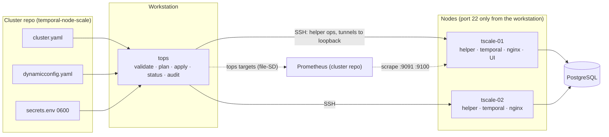

# tops design brief

Project: tops (Temporal Ops), `github.com/2SSK/tops`. Status: draft. Date: 2026-10-10.
Sibling docs: [PRD](prd.md) · [TRD](trd.md) · [App flow](app-flow.md) · [Backend schema](backend-schema.md) ·
[Implementation plan](implementation-plan.md) · [Concepts](concepts.md)

How tops looks and reads in a terminal. tops has no dashboards (PRD D8); its "UI" is its command grammar,
its output and its errors. The model is tadm's output (one line per fact, a symbol, plain words, the next
command to run), made cluster-wide and scriptable.

## Operating model



Intent lives in git; reality lives on the nodes and in Temporal. tops reads both every time, shows the
difference, and changes reality one node at a time.

## Command grammar

`tops <verb> [object] [args] [flags]`. Verbs are short, lowercase, imperative or noun-as-view, and match
tadm where tadm had them (`status`, `apply`, `restart`, `rollback`, `top`, `audit`, `logs`, `investigate`,
`ns`), so muscle memory carries over.

| Group     | Commands                                                                                      |
| --------- | --------------------------------------------------------------------------------------------- |
| Spec      | `init`, `validate`                                                                            |
| Change    | `plan`, `apply`, `bootstrap`, `restart`, `upgrade`, `rollback`, `node add`, `node remove`, `ns ensure` |
| Look      | `status`, `top`, `audit`, `logs`, `investigate`, `profile`, `ns list`                         |
| Integrate | `targets`, `version`, `completion`                                                            |
| Hidden    | `node <op>`: the helper. Hidden from help and completion; refuses unless run as root with a JSON request on stdin |

Naming rules:

| Thing          | Form                                    | Example                         |
| -------------- | --------------------------------------- | ------------------------------- |
| Node argument  | Spec name, exact; no index or IP         | `tops restart tscale-02`        |
| All nodes      | `--all`, never `*` or `all`             | `tops top --all`                |
| Apply id       | `YYYYMMDDTHHMMSSZ-xxxx`, prefix accepted when unique | `tops rollback 20261010T1530` |
| Versions       | Bare semver, no `v`                     | `tops upgrade 1.31.3`           |
| Durations      | Go durations plus `d`                   | `--window 30s`, `-t 2h`         |
| Flags          | Long kebab-case; short only for frequent ones | `--json`, `-y`, `-f`      |
| Sub-verbs      | Second word, not a flag                 | `tops ns ensure`, `tops rollback list` |

Nouns with a default view: `tops ns` = `tops ns list`; `tops rollback` with no argument prints `list` and
does nothing (rollback must name what it restores, unlike tadm's "newest by default"; assumes PRD Q7).

## Global flags

| Flag              | Default            | Meaning                                                                    |
| ----------------- | ------------------ | -------------------------------------------------------------------------- |
| `-f, --file`      | `./cluster.yaml`   | Spec file; also `TOPS_FILE`                                                |
| `--json`          | off                | Machine output on stdout (contract below); implies `--no-color`            |
| `--no-color`      | off                | Also on when `NO_COLOR` is set, `TERM=dumb`, or stdout is not a TTY        |
| `--debug`         | off                | slog text on stderr in addition to the run log                             |
| `-h, --help`      |                    | Help for any command                                                       |

Per-command flags that recur keep one meaning everywhere:

| Flag           | On                                              | Meaning                                                                 |
| -------------- | ----------------------------------------------- | ----------------------------------------------------------------------- |
| `-y, --yes`    | mutating commands                               | Do not ask. Required when stdin is not a TTY                            |
| `--node N`     | `plan`, `apply`                                 | Limit to one node (the ring gate still checks all)                      |
| `--all`        | `restart`, `top`, `logs`                        | Every node; for `restart`, rolling                                      |
| `--timeout D`  | rollouts                                        | Per-node gate timeout (default 3m)                                      |
| `--force`      | `restart`, `apply`                              | Skip the before-gate only; asks you to type the node name; refused with `-y` |
| `-w, --watch N` | `top`                                          | Refresh every N seconds                                                 |
| `-v`           | `audit`                                         | Detail per layer                                                        |
| `-n, --lines N` | `logs`                                         | Last N lines per node before merging (default 50)                       |

`logs` flags: `-f` follow, `-e` errors only, `--warn` warnings and errors, `-q` hide task-queue chatter,
`-g <text>` grep, `-t <duration>` since, `-s` count per message, `-n N` lines, `--raw` the journal's JSON.
No flag letter has two meanings across commands.

## Help text

Style: one-line summary, a usage line, a short "what it does", examples that work on the lab, flags.
No marketing, no "This command allows you to". Generated by cobra from `Use`, `Short`, `Long`, `Example`.

```
$ tops restart --help
Restart Temporal on a node, safely.

Usage:
  tops restart <node> | --all [-y]

Refuses unless every other node is in the ring and all 512 shards are owned.
Waits until the node is SERVING, back in every ring, and owns shards again.
--all restarts one node at a time and stops at the first that does not come back.

Examples:
  tops restart tscale-02
  tops restart --all -y

Flags:
      --all                restart every node, one at a time
      --force              skip the ring check before the restart (asks for the node name)
      --timeout duration   wait this long for the node to come back (default 3m0s)
  -y, --yes                do not ask for confirmation

Global flags:
  -f, --file string   cluster spec (default "cluster.yaml")
      --json          machine-readable output
      --no-color      plain output
      --debug         log details to stderr
```

`tops` with no arguments prints the grouped command list (the groups above), the spec in use and its
cluster name, like tadm's front page.

## Output design

### Streams

| Stream | Carries                                                                                   |
| ------ | ----------------------------------------------------------------------------------------- |
| stdout | The result: tables, plans, reports; or exactly one JSON document with `--json`            |
| stderr | Progress lines, prompts, warnings, errors in human mode; `--debug` logs                   |

A pipe gets clean data: `tops plan | less` shows the plan without progress noise.

### Symbols and colours

| Symbol | Colour  | Means                                       | Used in                     |
| ------ | ------- | ------------------------------------------- | --------------------------- |
| `✓`    | green   | fine                                        | status, audit, apply steps  |
| `!`    | yellow  | warning: works, needs attention             | status, audit, plan notes   |
| `✗`    | red     | failed or act now                           | status, audit, apply steps  |
| `·`    | grey    | idle, skipped, not applicable               | audit, apply steps          |
| `+`    | green   | added (file, line, firewall source)         | plan                        |
| `-`    | red     | removed                                     | plan                        |
| `~`    | yellow  | changed                                     | plan                        |
| `=`    | grey    | unchanged (only with `-v`)                  | plan                        |

Headings bold; command names and node names cyan; secondary text grey. Colour never carries meaning on
its own: the symbol is always printed. Without colour the output is identical minus escape codes.
Symbols are UTF-8; with `LANG`/`LC_ALL` not UTF-8, they degrade to `ok`, `WARN`, `FAIL`, `-` in a fixed
4-character column.

### Tables

- Left-aligned text, right-aligned numbers, two spaces between columns, no borders, no box drawing.
- A table never wraps: long values are cut with `…` to the terminal width; `--json` has them whole.
- Units always shown: `263 shards`, `1.2G of 2.6G`, `412ms`.

### Progress for rolling operations

One line per step, printed when the step ends, prefixed with elapsed time. On a TTY, the step in progress
is a single live line (`\r`-rewritten) showing what tops waits for; it is replaced by the final line.
Without a TTY, only final lines and a "waiting for …" line every 15 s.

```
 0:04  ✓ tscale-01  gate      ring 2/2 · 512/512 shards owned
 0:05  ✓ tscale-01  write     3 files (temporal.yaml, temporal.env, profile.conf)
 0:41  ⠿ tscale-01  restart   waiting for SERVING · ring 1/2 · shards 0  (36s)
```

### Confirmations

- Every mutating command prints its plan first, then asks one question naming the cluster and the nodes:
  `apply to tscale-lab (tscale-01, tscale-02)? [y/N]`. Default is no; only `y`/`yes` proceed.
- `-y` skips the question. With stdin not a TTY and no `-y`: refuse with exit 3.
- Two cases ask for typed input instead of y/N, and `-y` does not skip them:
  - `--force`: `type the node name to restart tscale-01 without the ring check:`.
  - `upgrade`: the backup question; with `-y`, `--backup-confirmed` must also be given.
- `--json` never prompts: mutating commands with `--json` require `-y`.

### `--json` contract

- Exactly one JSON document on stdout, also on failure (`kind: "Error"`). Nothing else on stdout.
- Shapes in [backend-schema.md](backend-schema.md#--json-outputs); every document has `kind` and `topsVersion`.
- Fields are added, never renamed or removed, within a major version (PRD D12). Breaking changes wait for
  the next major.
- Exit codes are the same as in human mode ([TRD](trd.md#exit-codes)); scripts check both.
- `logs` has `--raw` (the journal's JSON lines) instead of `--json`; `investigate` writes a document.

## Errors

Every user-facing error has three parts and a stable code. Format:

```
✗ <what happened>
  why: <the cause, in the operator's terms>
  fix: <the command or edit that resolves it>
  (code: <code>, run log: ~/.local/state/tops/runs/r-20261010T153012Z-9c1e.jsonl)
```

Rules: name the node, file, field or line; never print a stack trace or a raw gRPC status alone; quote
what tops saw (`ring 1 of 2`), not what it expected only; the fix is a command when one exists.

| Code                           | What                                                     | Why (example)                                                            | Fix (example)                                                     |
| ------------------------------ | -------------------------------------------------------- | ------------------------------------------------------------------------ | ----------------------------------------------------------------- |
| `spec.invalid`                 | cluster.yaml has 2 errors                                | `nodes[1].address: 10.78.0.11 is also nodes[0]` (line 31)                | edit cluster.yaml, then `tops validate`                           |
| `secrets.mode`                 | secrets.env is readable by others                        | mode 0644, must be 0600                                                  | `chmod 600 secrets.env`                                           |
| `ssh.host_key_unknown`         | tscale-02 (10.78.0.12) is not in lab/keys/known_hosts    | tops never trusts a host key on first use                                | verify `SHA256:…` then `ssh-keyscan -t ed25519 10.78.0.12 >> lab/keys/known_hosts` |
| `ssh.host_key_changed`         | tscale-02 presented a different host key                 | known: `SHA256:aa…`, presented: `SHA256:bb…`; a rebuilt host or an attack | if the host was rebuilt (`make reset`), remove its line and re-add it |
| `ssh.sudo_password`            | sudo on tscale-01 asks for a password                    | tops needs passwordless sudo for the SSH user                            | add `deploy ALL=(ALL:ALL) NOPASSWD: ALL` in /etc/sudoers.d        |
| `ssh.forwarding_disabled`      | tscale-01 refused a tunnel                               | sshd has `AllowTcpForwarding no`; tops reads Temporal through tunnels    | set `AllowTcpForwarding local` and reload sshd                    |
| `lock.held`                    | tscale-lab is locked                                     | `apply` by ssk@thinkpad, started 2 min ago, renewed 12 s ago            | wait for it, or check that run's terminal                          |
| `lock.lost`                    | stopped: this run no longer holds the lock on tscale-02  | the lease expired (workstation asleep?) and run r-…-4b1c took over      | `tops plan` to see what this run finished; never re-run blindly    |
| `refused.ring_incomplete`      | not restarting tscale-01                                 | history ring has 1 of 2 nodes: tscale-02 is missing; restarting now leaves shards without an owner | `tops status`; bring tscale-02 back first |
| `refused.unknown_member`       | not applying                                             | 10.78.0.13:7234 is in the history ring but not in cluster.yaml           | add it to `nodes`, or stop Temporal on that host                  |
| `refused.immutable`            | not applying                                             | `shards: 1024` but the live cluster was created with 512, fixed forever   | set `shards: 512`; a different count needs a new cluster          |
| `refused.store_identity`       | not applying                                             | `postgres.host: 10.78.0.21` holds no cluster `tscale-lab` (6b0e…); Temporal would create a second, empty cluster | point at the store that holds this cluster, or build a new cluster |
| `refused.version_change`       | not applying                                             | `temporal.version` is 1.31.3, nodes run 1.30.7                           | `tops upgrade 1.31.3`                                             |
| `refused.profile_too_large`    | not applying on tscale-02                                | profile 4c16g needs 4 cores / 16 GB; host has 2 / 3.8 GB                  | use profile 2c4g, or a bigger host                                |
| `refused.headroom`             | not applying                                             | with one of 3 nodes down, a host would own 2048 of 4096 shards; profile 2c4g allows 1024 | add a node or use a bigger profile                |
| `refused.node_stopped` (Q10)   | not applying to tscale-03                                | Temporal is stopped and disabled by `tops node remove` (20261010T1612…)  | `tops node add tscale-03`, or delete it from cluster.yaml         |
| `refused.datastore_in_use`     | not bootstrapping                                        | database `temporal` on 10.78.0.20 already holds cluster `active`         | use `tops apply` to manage it, or point at an empty datastore     |
| `refused.upgrade_path`         | not upgrading to 1.32.0                                  | nodes run 1.30.7; upgrades go one minor at a time and this tops supports 1.30–1.31 | `tops upgrade 1.31.3` first                              |
| `rollout.node_unhealthy`       | tscale-02 did not come back within 3m                    | SERVING yes, ring 2/2, shards 0 of 512 owned by it                       | `tops logs tscale-02 -e`; undo with `tops rollback 20261010T153012Z-7f3a` |
| `render.rejected`              | temporal.yaml rejected by temporal-server 1.31.3 on tscale-01 | `Unable to load configuration: …` (first 5 lines)                   | nothing was changed; fix the spec value named above               |
| `release.checksum`             | temporal_1.31.3_linux_amd64.tar.gz failed verification on tscale-02 | sha256 differs from checksums.txt                              | retry; if it repeats, do not proceed                              |

The table shows examples; every refusal code is listed in
[app-flow.md](app-flow.md#what-tops-refuses-index).

Warnings use `!` and one line, e.g. `! tscale-01: clock not NTP-synchronized; Temporal timers and
membership depend on it`.

## Shell completion

`tops completion bash|zsh|fish` (cobra). Dynamic completion reads the spec given by `-f` (no SSH):

| Position                         | Completes                         |
| -------------------------------- | --------------------------------- |
| `restart`, `top`, `logs`, `profile`, `node add|remove`, `--node` | node names from `nodes[]` |
| `rollback`                       | `list` and nothing else (apply ids need SSH; completion never connects) |
| `upgrade`                        | versions this tops supports       |
| `ns`                             | `list`, `ensure`                  |
| `targets --job`                  | `temporal`, `node`                |

## Example outputs

All from the 2-node lab, cluster `tscale-lab`. Colours omitted.

### `tops status`

```
$ tops status
tscale-lab  Temporal 1.31.3 · 2 nodes · 512 shards · postgres12           15:30:12 UTC

  node        service   version   frontend  rings    shards  memory               clock
✓ tscale-01   active    1.31.3    SERVING   4/4      263     1.2G of 2.6G  45%    synced
✓ tscale-02   active    1.31.3    SERVING   4/4      249     1.1G of 2.6G  42%    synced

cluster
✓ shards      512 of 512 owned · created with 512
✓ rings       frontend 2/2 · history 2/2 · matching 2/2 · worker 2/2 · no unknown members
✓ database    10.78.0.20:5432 reachable via tscale-01 · temporal 1.19 · temporal_visibility 1.14
✓ firewall    TEMPORAL_INPUT in place on 2/2 nodes, matches cluster.yaml

healthy
```

A failing case:

```
$ tops status
tscale-lab  Temporal 1.31.3 · 2 nodes · 512 shards · postgres12           15:41:03 UTC

  node        service   version   frontend  rings    shards  memory               clock
✓ tscale-01   active    1.31.3    SERVING   4/4      512     1.6G of 2.6G  61%    synced
✗ tscale-02   inactive  -         -         0/4      -       -                    synced

cluster
! shards      512 of 512 owned, all by tscale-01 (one node down)
✗ rings       history 1/2 · missing tscale-02
✓ database    10.78.0.20:5432 reachable via tscale-01 · temporal 1.19 · temporal_visibility 1.14

unhealthy: 1 node down. Next: tops logs tscale-02 -e · tops restart tscale-02
$ echo $?
5
```

### `tops plan`

```
$ tops plan
tscale-lab  plan for 2 nodes · Temporal 1.31.3 · validated with temporal-server 1.31.3 on each node

tscale-01
  ~ /etc/temporal/dynamicconfig.yaml                         hot-reload
      - matching.numTaskqueueReadPartitions:
      -   - value: 4
      + matching.numTaskqueueReadPartitions:
      +   - value: 8
  ~ /etc/temporal/temporal.env                               restart
      - GOMEMLIMIT=1800MiB
      + GOMEMLIMIT=4000MiB
  ~ /etc/systemd/system/temporal.service.d/profile.conf      restart
      - MemoryHigh=2700M
      + MemoryHigh=6000M
      - MemoryMax=3200M
      + MemoryMax=6800M
  firewall  clients 7233
      + 10.78.0.40
  ! drift: /etc/temporal/temporal.yaml was edited by hand since 20261010T140155Z-3b7d; apply overwrites it
  → restarts temporal (profile 2c4g → 2c8g)

tscale-02
  ~ /etc/temporal/dynamicconfig.yaml                         hot-reload
  ~ /etc/temporal/temporal.env                               restart
  ~ /etc/systemd/system/temporal.service.d/profile.conf      restart
  firewall  clients 7233
      + 10.78.0.40
  → restarts temporal (profile 2c4g → 2c8g)

cluster
  namespaces  + perf (retention 24h)
  ring        no unknown members

2 nodes change · 2 restarts, one at a time · 1 drift
apply with: tops apply
$ echo $?
2
```

No changes:

```
$ tops plan
tscale-lab  plan for 2 nodes · Temporal 1.31.3 · validated with temporal-server 1.31.3 on each node

✓ tscale-01  in sync
✓ tscale-02  in sync
✓ cluster    namespaces in sync · no unknown members

no changes
```

### `tops apply`

```
$ tops apply
(plan as above)

apply to tscale-lab (tscale-01, tscale-02)? [y/N] y

apply 20261010T153012Z-7f3a
 0:01  ✓ lock      tscale-01, tscale-02
 0:03  ✓ stage     nothing to download
 0:04  ✓ firewall  tscale-01, tscale-02 · clients +1
 0:05  ✓ reload    dynamicconfig.yaml on tscale-01, tscale-02 (Temporal reloads within 10s)
 0:06  ✓ tscale-01  gate      ring 2/2 · 512/512 shards owned
 0:06  ✓ tscale-01  write     2 files · snapshot 20261010T153012Z-7f3a
 0:52  ✓ tscale-01  restart   SERVING · ring 2/2 · owns 255 · 512/512 owned (46s)
 0:53  ✓ tscale-02  gate      ring 2/2 · 512/512 shards owned
 0:53  ✓ tscale-02  write     2 files · snapshot 20261010T153012Z-7f3a
 1:37  ✓ tscale-02  restart   SERVING · ring 2/2 · owns 249 · 512/512 owned (44s)
 1:39  ✓ namespaces perf created (retention 24h), visible on 2/2 nodes
 1:39  ✓ unlock

done in 1m39s · 2 nodes changed · 2 restarts
undo with: tops rollback 20261010T153012Z-7f3a
```

Stopped at a failing node:

```
 0:53  ✓ tscale-02  gate      ring 2/2 · 512/512 shards owned
 0:53  ✓ tscale-02  write     2 files · snapshot 20261010T153012Z-7f3a
 3:53  ✗ tscale-02  restart   not back within 3m: SERVING no · ring 1/2 · owns 0
 3:54  ✓ unlock

✗ tscale-02 did not come back within 3m
  why: frontend not SERVING; last errors in its journal:
       15:34:02 ERROR history  Unable to load configuration: dial tcp 10.78.0.20:5432: connect: connection refused
  fix: tops logs tscale-02 -e   ·   undo on every changed node: tops rollback 20261010T153012Z-7f3a
  (code: rollout.node_unhealthy)
$ echo $?
1
```

### `tops audit`

```
$ tops audit
tscale-lab audit  2 nodes  15s window  2026-10-10T15:45:00Z

  ! 1 layer needs attention  start with the first marked line below

  ✓ servers                     cpu 38% · memory 52%             the nodes have room to spare
  ✓ api (frontend)              212 req/s · 41ms                 clients get quick answers
  ! workflow engine (history)   180ms · queue 1.4s               history is behind → cpu, database or one hot workflow (-v)
  ✓ task queues (matching)      96 tasks/s · 88% instant         tasks reach workers without delay
  ✓ workers                     backlog 12 · wait 120ms          workers keep up with the work
  ✓ database (postgres)         1480 queries/s · 38ms            postgres answers quickly
  ✓ errors                      0.02% of requests                no server-side failures

  details per layer: tops audit -v    longer window: tops audit --window 60s
```

Layers, order and thresholds are tadm's (TRD audit package); `--json` carries the same verdicts with
the figures as numbers.

### `tops rollback list`

```
$ tops rollback list
  apply id                    when (UTC)        by            command          nodes                 result
  20261010T153012Z-7f3a       10-10 15:30       ssk@thinkpad  apply            tscale-01, tscale-02  ok
  20261010T140155Z-3b7d       10-10 14:01       ssk@thinkpad  apply            tscale-01, tscale-02  ok
  20261009T101500Z-0c2e       10-09 10:15       ssk@thinkpad  upgrade 1.31.3   tscale-01, tscale-02  ok

undo one with: tops rollback <apply id>
```

## Writing style for all output

- Short sentences, present tense, the operator's words: "restarts temporal", not "will initiate a
  restart sequence".
- Say what will happen before it happens (`→ restarts temporal`), and what to run next after (`apply
  with: tops apply`, `undo with: tops rollback …`).
- Never claim healthy when a metric is missing: say "metric missing" (PRD R5).
- Times: UTC, `HH:MM:SS` within today, `MM-DD HH:MM` otherwise.
