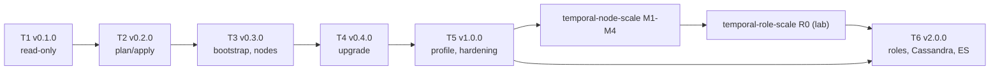

# tops implementation plan

Project: tops (Temporal Ops), `github.com/2SSK/tops`. Status: draft. Date: 2026-10-10.
Sibling docs: [PRD](prd.md) · [TRD](trd.md) · [App flow](app-flow.md) · [Design brief](design-brief.md) ·
[Backend schema](backend-schema.md) · [Concepts](concepts.md)

A build guide in learning order. You build every piece by hand; this file says what to learn before each
piece, what to build, how to prove it works, and where people usually go wrong. It never gives the code.
The shapes to build against are in [backend-schema.md](backend-schema.md), the journeys in
[app-flow.md](app-flow.md), the reasons in the [TRD](trd.md).

**Learn first spine: [concepts.md](concepts.md).** Read it before T1 and come back to it per task. If you
cannot explain a concept a task names, stop and read its link before typing.

## How to use this guide

- Tasks are `T<m>.<n>`, in the order to do them. Each ends with a binary that does a little more and still
  passes everything before it. Milestones T1-T6 and their acceptance tables are the PRD's.
- Every task has five parts: **Goal**, **Learn first** (official docs), **Build**, **Verify** (commands that
  exit non-zero when something is wrong), **Pitfalls**.
- Test first, every time: write the failing table-driven test, make it pass with the least code, refactor.
  Merge only with CI green.
- `make …` runs in the tops repo. Acceptance commands run from the temporal-node-scale repo
  (`LAB=~/Code/Projects/building/temporalScale`) with the build under test on `PATH`.
- `jq -e` turns a JSON assertion into an exit code. A bad spec for a negative test lives next to the real
  one (`cluster.bad.yaml`): spec paths resolve from the spec's directory, so a copy in `/tmp` fails for the
  wrong reason (no secrets, no keys) and the test passes vacuously.

## Order and dependencies



## The lab contract

tops' e2e suite runs against another repo's lab. It may use only this, so either side can change
everything else:

| From temporal-node-scale                                              | Used for                         | Until                                   |
| --------------------------------------------------------------------- | -------------------------------- | --------------------------------------- |
| `make up`, `make check`, `make reset`, `make ssh ARGS='<short> <cmd>'` | Setup, preconditions             | Always                                  |
| `make push`                                                           | Bash-built fixture (T1, T2)      | T3.9 removes the fixture                |
| Container names `tscale-01..03`, `tscale-pg`; `docker kill/stop/start <name>` | Failure injection        | Always. Never `make kill`: it arrives at node-scale M2 |
| IPs 10.78.0.11-13, 10.78.0.20; `lab/keys/`                            | The e2e spec                     | Always                                  |
| `LAB=<path>`                                                          | Harness parameter                | The repo rename (node-scale Q1) changes only this path |

From temporal-role-scale (T6): `make up/check/reset/ssh/kill/revive`, short names (`hist-2`, `cass-2`),
10.80.0.0/24. The harness checks the contract first and fails with "lab contract broken: …".

## Repository layout and make targets

```
cmd/tops/            internal/…  (TRD "Package layout")
test/helper/Dockerfile            Ubuntu 24.04 + systemd + sshd + deploy user (copy of the node-scale lab image)
test/e2e/                         //go:build e2e
.github/workflows/ci.yml, release.yml
.golangci.yml  .goreleaser.yaml  Makefile  README.md  AGENTS.md  LICENSE  CHANGELOG.md
```

| Make target              | Runs                                                                                           |
| ------------------------ | ---------------------------------------------------------------------------------------------- |
| `make build`             | `go build -trimpath -o bin/tops ./cmd/tops`                                                    |
| `make build-linux`       | linux/amd64 and linux/arm64 helpers for development builds on another platform               |
| `make lint`              | `gofmt -l` (must be empty), `golangci-lint run`                                                |
| `make test`              | `go test -race -coverprofile=coverage.out ./...`                                               |
| `make cover`             | Coverage gates: >= 80% overall, >= 90% `internal/safety` and `internal/plan`                   |
| `make helper-test`       | Build `test/helper`, start two privileged systemd containers, `go test -tags helper ./internal/helper/...` over real SSH |
| `make e2e LAB=…`         | `go test -tags e2e -timeout 60m ./test/e2e/... -lab=$(LAB)`; writes `e2e-report.txt` and `e2e-report.json` |
| `make vuln`              | `govulncheck ./...`                                                                            |

## T1: read-only tops (v0.1.0)

### T1.1 Repo, toolchain and CI

**Goal.** An empty `tops` that builds, lints and tests in CI.

**Learn first.**
- Go modules and toolchains: https://go.dev/doc/modules/managing-dependencies, https://go.dev/doc/toolchain
- Cobra (commands, groups, `Use`/`Short`/`Long`/`Example`): https://cobra.dev/
- golangci-lint configuration: https://golangci-lint.run/usage/configuration/
- GitHub Actions workflow syntax: https://docs.github.com/en/actions/reference/workflows-and-actions/workflow-syntax

**Build.** `go.mod` (`go 1.26`), `cmd/tops/main.go` with the root command and grouped help (design brief
"Command grammar"), the Makefile above, `.golangci.yml` with the linters in "CI" below, `ci.yml` with the
jobs in "CI", README stub, CHANGELOG.

**Verify.**
```sh
make lint && make test && make build && ./bin/tops --help | grep -q 'Look'
test $(stat -c %s bin/tops) -lt 36700160          # 35 MB CI gate
```
Push a branch: every CI job green.

**Pitfalls.**
- `go.temporal.io/server` v1.31.3 needs Go >= 1.26.8: pin the `toolchain` line, not just `go 1.26`.
- Do not add dependencies a task does not use yet; each later task adds its own.
- `gocyclo` max 10 bites command handlers first: keep them thin, logic in `internal/`.

### T1.2 Output, errors, exit codes

**Goal.** One package renders tables, symbols, JSON and errors; one function maps errors to exit codes.

**Learn first.**
- Command Line Interface Guidelines (output, errors, stdout vs stderr): https://clig.dev/
- `NO_COLOR`: https://no-color.org/ ; lipgloss tables: https://pkg.go.dev/github.com/charmbracelet/lipgloss/table
- Design brief "Output design", "Errors"; TRD "Exit codes", "Error model".

**Build.** `internal/term`: `UserError{Code, What, Why, Fix}`, the JSON writer (`kind`, `topsVersion`),
symbol fallback for non-UTF-8 locales, progress on stderr. `main` maps errors to exit codes 0-5 and 130.

**Verify.**
```sh
go test -race ./internal/term/...                       # golden: colour, NO_COLOR, non-UTF-8
./bin/tops --json validate -f /nonexistent; test $? -eq 4
./bin/tops --json validate -f /nonexistent | jq -e '.kind == "Error" and .error.code != null'
```

**Pitfalls.** Anything besides the one JSON document on stdout breaks every script. `text/tabwriter`
counts ANSI escapes as width. An error that prints only a gRPC status is not an error message.

### T1.3 Spec, secrets, profiles; `validate` and `init`

**Goal.** tops reads `cluster.yaml` and `secrets.env`, applies defaults, and reports every error with its
path and line.

**Learn first.**
- `go.yaml.in/yaml/v3` `Decoder.KnownFields`, `yaml.Node`: https://pkg.go.dev/go.yaml.in/yaml/v3
- Backend schema "Cluster spec", "Secrets file", "Profiles" (`memoryMiB`); TRD "Loading".
- Temporal history shards (why `shards` is fixed): https://docs.temporal.io/temporal-service/temporal-server

**Build.** `internal/spec` (types, `Defaults`, `Validate` returning every error, the 15-line secrets
parser, mode and owner check), `internal/profile` (embedded profiles, headroom math), `tops validate`,
`tops init`.

**Verify.**
```sh
go test -race -cover ./internal/spec/... ./internal/profile/...
cd $LAB && tops validate; test $? -eq 0
sed 's/shards: 512/shards: 0/' cluster.yaml > cluster.bad.yaml
tops validate -f cluster.bad.yaml --json | jq -e '[.errors[] | select(.path == "shards")] | length == 1'
chmod 644 secrets.env; tops validate; test $? -eq 4; chmod 600 secrets.env; rm cluster.bad.yaml
```

**Pitfalls.**
- dotenv libraries expand `$VAR`: a password with `$` silently changes. Hence the hand parser.
- Return all errors, not the first: the operator fixes a spec in one pass.
- Durations need `d` (`7d`); retention below 1h is invalid (Temporal's local minimum).

### T1.4 Node helper and wire protocol (read-only ops)

**Goal.** `tops node hello|facts|top|journal` runs as root, reads one JSON request on stdin and writes one
typed response.

**Learn first.**
- cgroup v2 (`memory.current/high/max/events`, `cpu.stat`, `cpu.max`, `cpuset.cpus.effective`):
  https://docs.kernel.org/admin-guide/cgroup-v2.html ; PSI: https://docs.kernel.org/accounting/psi.html
- `proc(5)` (`/proc/<pid>/cgroup`, `/proc/<pid>/exe`): https://man7.org/linux/man-pages/man5/proc.5.html
- go-systemd D-Bus: https://pkg.go.dev/github.com/coreos/go-systemd/v22/dbus
- `journalctl -o json`: https://www.freedesktop.org/software/systemd/man/latest/journalctl.html
- Backend schema "Node helper protocol".

**Build.** `internal/wire` (envelope, op types), `internal/helper`: root check, stdin decoding, exit 0/1/2;
`hello` with effective cores and memory (TRD "Host limits"), `facts` (file hashes, content only when the
hash differs, units, `current`, firewall via go-iptables), `top`, `journal` (stream, cancel on stdin EOF).

**Verify.**
```sh
go test -race ./internal/wire/... ./internal/helper/...   # cgroup trees and journal lines as testdata
```
(It runs on real hosts in T1.5.)

**Pitfalls.**
- In a lab container `nproc` and `/proc/meminfo` are the workstation's. The effective limits come from PID
  1's cgroup (`memory.max`, `cpuset.cpus.effective`, `cpu.max`); `max` means unlimited.
- Find a unit's cgroup through `/proc/<MainPID>/cgroup`, not the `ControlGroup` property: under
  `cgroup: host` the paths differ.
- Arguments arrive on stdin, never argv: argv shows in `ps` and the sudo log.

### T1.5 SSH, helper upload, helper test image

**Goal.** tops connects to every node with strict host keys, checks sudo and forwarding, uploads the helper
once per version and runs it.

**Learn first.**
- `golang.org/x/crypto/ssh`, `ssh/knownhosts`, `ssh/agent`: https://pkg.go.dev/golang.org/x/crypto/ssh
- SSH connection protocol, `direct-tcpip` forwarding: https://www.rfc-editor.org/rfc/rfc4254#section-7.2
- `sshd_config` `AllowTcpForwarding`: https://man.openbsd.org/sshd_config ; `known_hosts` format:
  https://man.openbsd.org/sshd#SSH_KNOWN_HOSTS_FILE_FORMAT
- `sudo -n`: https://www.sudo.ws/docs/man/sudo.man/

**Build.** `internal/remote` per TRD "Workstation <-> SSH <-> helper protocol": clients, `HostKeyAlgorithms`
from known_hosts, keepalive, preflight, tunnels with `DialContext`, the fixed upload command, newest-3
cleanup after an upload. `test/helper` image and `make helper-test` (two privileged systemd containers).

**Verify.**
```sh
make helper-test                                    # hello over real SSH; upload once; changed key refused
cd $LAB && tops version --json | jq -e 'all(.nodes[]; .sha256Match)'
tops status --debug 2>&1 | grep -c 'helper upload'  # 0 on the second run
```

**Pitfalls.**
- Never trust on first use. A changed key after `make reset` is expected; the fix is rewriting
  `known_hosts`, not `accept-new`.
- Validate `<v>` against `^[0-9A-Za-z.+-]+$` before it goes into the `sh -c` string.
- A server offering ECDSA first fails against a stored ed25519 key unless you set `HostKeyAlgorithms`.

### T1.6 Temporal and PostgreSQL reads over tunnels

**Goal.** tops reads health, rings, shard ownership, identity and schema versions through SSH tunnels.

**Learn first.**
- Temporal server architecture, roles, membership: https://docs.temporal.io/temporal-service/temporal-server
- gRPC health checking protocol: https://github.com/grpc/grpc/blob/master/doc/health-checking.md
- `grpc.WithContextDialer`: https://pkg.go.dev/google.golang.org/grpc#WithContextDialer
- Admin API (`DescribeCluster`, `DescribeHistoryHost`): `go.temporal.io/server/api/adminservice/v1`
- pgx `DialFunc`: https://pkg.go.dev/github.com/jackc/pgx/v5/pgconn#Config

**Build.** `internal/cluster` (one lazy `grpc.ClientConn` per node, `Serving`, `Describe`, `Shards`);
`internal/datastore/postgres` (reachable, `schema_version`, `cluster_metadata_info` name and `cluster_id`
from the `data` blob, `max_connections`, `pg_stat_activity`).

**Verify.**
```sh
go test -race ./internal/cluster/... ./internal/datastore/...      # fakes for the gRPC services
go test -tags e2e -run 'TestReads' ./test/e2e/... -lab=$LAB         # against the bash-built lab
```

**Pitfalls.**
- SERVING is per service name: `temporal.api.workflowservice.v1.WorkflowService`, not the empty string.
- Each node's `DescribeCluster` is that node's view of the ring. Views can disagree (a partition); keep
  them separate, never merge them.
- `cluster_metadata_info.data` is a protobuf blob: decode it with Temporal's type, do not parse bytes.

### T1.7 `tops status`

**Goal.** One command answers "is the cluster whole?" in under 3 s, in a table and in JSON.

**Learn first.** Design brief "`tops status`"; backend-schema "`Status` example"; TRD "Exit codes".

**Build.** Status assembly (parallel per node), checks with symbols, exit 5 on a failed check.

**Verify.** T1 acceptance rows "Status on the bash-built lab" and "Status exits 5".

**Pitfalls.** An unreachable node is a finding (exit 5), not a crash (exit 1). Never print "healthy" when a
value could not be read.

### T1.8 Metrics and `tops audit`

**Goal.** Two scrapes of every node, one line per layer, the first marked line says where to look.

**Learn first.**
- Exposition format: https://prometheus.io/docs/instrumenting/exposition_formats/
- Histograms and quantiles: https://prometheus.io/docs/practices/histograms/
- `expfmt`: https://pkg.go.dev/github.com/prometheus/common/expfmt
- Temporal cluster metrics: https://docs.temporal.io/references/cluster-metrics
- tadm `audit.sh` (layers and thresholds to port).

**Build.** `internal/metrics` (scrape, deltas, quantiles from bucket deltas), `internal/audit` (layers,
verdicts, advice), fixtures recorded from the lab under omes load for 1.31.3 and 1.30.7, `tops audit`.

**Verify.**
```sh
go test -race -cover ./internal/metrics/... ./internal/audit/...   # healthy, history behind, db slow, idle, missing
```
T1 acceptance row "Audit names the busiest layer".

**Pitfalls.**
- A counter that went down between samples is a restart: treat it as a reset, not a negative rate.
- Long polls (`Poll*`) are waiting, not work: exclude them from latency.
- A missing metric is "metric missing", never green (PRD R5).

### T1.9 `tops top`

**Goal.** Per node: cgroup CPU, memory vs MemoryHigh/Max, Go heap vs GOMEMLIMIT, pressure, OOM kills.

**Learn first.** Go GC guide (GOMEMLIMIT is a soft limit; MemoryMax is not): https://go.dev/doc/gc-guide ;
cgroup v2 `memory.events`.

**Build.** `tops top [<node>|--all] [-w N]` from helper `top` plus `memory_heap`, `num_goroutines` over a tunnel.

**Verify.**
```sh
cd $LAB && tops top --all --json | jq -e 'all(.nodes[]; .top.memHighBytes > 0 and .goHeapBytes > 0)'
```

**Pitfalls.** `memory.high` = `max` means unset. `oom_kill` in `memory.events` counts kills inside the
cgroup; the kernel log has the rest.

### T1.10 `tops logs`

**Goal.** Readable logs from every node, merged by time, with the flags of design brief "Global flags".

**Learn first.** journalctl JSON fields (`MESSAGE`, `__REALTIME_TIMESTAMP`); Temporal's zap JSON lines
(look at `journalctl -u temporal -o json` on a node).

**Build.** `internal/journal` (format, filters, merge, summary), `tops logs`.

**Verify.** T1 acceptance row "Logs merged from both nodes".

**Pitfalls.** Lines that are not JSON still print. Merge by the log's own `ts`, and remember each node has
its own clock. Follow mode ends cleanly on Ctrl-C (stdin EOF to the helper).

### T1.11 `tops investigate`

**Goal.** A workflow report from a UI URL, written to a file.

**Learn first.** Workflow execution and event history: https://docs.temporal.io/workflow-execution ;
task queues: https://docs.temporal.io/task-queue ; the UI URL shape `/namespaces/<ns>/workflows/<id>[/<run>]`.

**Build.** `internal/investigate` (URL parsing, report sections per app-flow journey 8), `tops investigate`.

**Verify.** T1 acceptance row "Investigate from a UI URL".

**Pitfalls.** Workflow ids are URL-encoded and may contain `/`. Visibility lags the execution by a refresh.

### T1.12 `ns list`, `targets`, `version`, `completion`

**Goal.** The remaining read-only commands.

**Learn first.** Prometheus `file_sd_config`:
https://prometheus.io/docs/prometheus/latest/configuration/configuration/#file_sd_config ; cobra shell
completion and `ValidArgsFunction` (cobra docs).

**Build.** As named; completion reads the spec, never SSH.

**Verify.** T1 acceptance row "Targets"; `tops completion zsh | head -1 | grep -q compdef`.

**Pitfalls.** `targets` output is the file-SD array itself (no envelope): Prometheus reads it as is.

### T1.13 e2e harness and v0.1.0

**Goal.** The lab suite runs from one command; v0.1.0 is released with its report attached.

**Learn first.** Go build constraints: https://pkg.go.dev/cmd/go#hdr-Build_constraints ; GoReleaser:
https://goreleaser.com/customization/ ; GitHub artifact attestations (docs.github.com, "Using artifact
attestations"); SLSA levels: https://slsa.dev/spec/v1.0/levels

**Build.** `test/e2e` with the `-lab` parameter, a lab-contract check, the bash-built fixture (node-scale
scripts through `make -C $LAB push/ssh`), an omes load helper; `release.yml`; "Release steps" below.

**Verify.** Every row of the T1 acceptance table.

**Pitfalls.** The harness must undo what it breaks (`docker start` after a stop) even when a test fails.

### T1 acceptance

| Check                                                               | Command                                                                                                    |
| ------------------------------------------------------------------- | ---------------------------------------------------------------------------------------------------------- |
| Installs with `go install`                                          | `go install github.com/2SSK/tops/cmd/tops@v0.1.0 && tops version`                                          |
| Binary size                                                         | `test $(stat -c %s "$(go env GOPATH)/bin/tops") -lt 41943040`                                              |
| Spec validates offline                                              | `tops validate; test $? -eq 0`                                                                             |
| Bad spec rejected with a path                                       | `sed 's/shards: 512/shards: 0/' cluster.yaml > cluster.bad.yaml && tops validate -f cluster.bad.yaml --json \| jq -e '.errors[0].path == "shards"'` |
| Status on the bash-built lab: 512 shards, ring 2 of 2              | `tops status --json \| jq -e '.temporal.shards.owned == 512 and (.temporal.rings.history.members \| length) == 2'` |
| Status exits 5 with a node down                                     | `docker stop tscale-02; tops status; test $? -eq 5; docker start tscale-02`                               |
| Audit names the busiest layer under load                            | omes started by hand, then `tops audit --json \| jq -e '.closest != null and ([.layers[] \| select(.level != "idle")] \| length) > 0'` |
| Logs merged from both nodes                                         | `test $(tops logs --all -n 50 \| grep -o 'tscale-0[12]' \| sort -u \| wc -l) -eq 2`                     |
| Investigate from a UI URL                                           | `tops investigate "http://10.78.0.11/namespaces/default/workflows/<id>/<run>/history"; ls investigate-*.md` |
| Targets                                                             | `tops targets --job temporal \| jq -e 'length == 2 and .[0].labels.job == "temporal"'`                     |
| Helper uploaded once                                                | Second `tops status --debug 2>&1 \| grep -c 'helper upload'` = 0                                           |
| Release artefacts                                                   | `gh release view v0.1.0 --json assets -q '.assets[].name'` lists checksums, SBOM, 3 archives, `e2e-report.txt` |

T1 lets temporal-node-scale delete `scripts/status.sh`.

## T2: plan, apply, snapshots, rollback, restart, lock (v0.2.0)

Managed at T2: `temporal.yaml`, `temporal.env`, `dynamicconfig.yaml`, `temporal.service`, `profile.conf`.
`ui:` is validated and ignored until T3.

### T2.1 Rendering

**Goal.** Every node's five files rendered in memory from the spec, byte-stable.

**Learn first.**
- `text/template` (custom delimiters), `embed`: https://pkg.go.dev/text/template, https://pkg.go.dev/embed
- Temporal server configuration reference: https://docs.temporal.io/references/configuration
- Dynamic config: https://docs.temporal.io/references/dynamic-configuration
- TRD "Templates"; backend-schema "Generated files".

**Build.** `internal/render`: `[[ ]]` templates, `NodeInput`, `FileSet` with effect classes, dynamic-config
merge with the duplicate-key error. Golden files: every profile × 2 nodes, plus a 3-node spec.

**Verify.** `go test -race ./internal/render/...`; review every `-update` diff by eye.

**Pitfalls.**
- Temporal's own `{{ env "…" }}` must pass through untouched; `# enable-template` must stay in the first 1 KB.
- Secrets live only in `temporal.env`; `temporal.yaml` must be safe to print whole.
- Template constants fixed at cluster creation (`failoverVersionIncrement`, …) are pinned by a golden test.

### T2.2 Validation with the target binary

**Goal.** Nothing is switched unless the target `temporal-server` accepts it.

**Learn first.** `temporal-server render-config` and `validate-dynamic-config` (`--help` of the 1.31.3
binary); `iptables-restore --test`: https://man7.org/linux/man-pages/man8/iptables-restore.8.html ;
`systemd-analyze verify`: https://www.freedesktop.org/software/systemd/man/latest/systemd-analyze.html

**Build.** Helper op `validate` in `/run/tops/<run-id>/` (TRD "Validation with the target binary").

**Verify.** `make helper-test` with the real 1.31.3 binary: one accepted and one rejected render.

**Pitfalls.** `render-config` prints the rendered config, password included: discard stdout. Give it
exactly the rendered environment, nothing inherited.

### T2.3 Plan

**Goal.** Per node: what changes, what drifted, what it costs (restart, hot reload, nothing).

**Learn first.** Terraform's plan as a mental model: https://developer.hashicorp.com/terraform/cli/commands/plan ;
go-udiff: https://pkg.go.dev/github.com/aymanbagabas/go-udiff ; TRD "Plan and apply".

**Build.** `internal/plan`: desired vs live, unified diffs, secret masking, drift via `applied.json`, `adopt`
marking, ordering; `tops plan` (exit 0/2/3).

**Verify.**
```sh
go test -race -cover ./internal/plan/...      # incl. a property test: no secret in any diff, random passwords
cd $LAB && tops plan; test $? -eq 2           # the bash-built lab: adopt on both nodes
```

**Pitfalls.** Drift (someone edited the node) and change (you edited the spec) are different lines in the
plan. `facts` sends content only for files whose hash differs: keep `plan` under 10 s.

### T2.4 Safety rules and persistence identity

**Goal.** Every refusal of the PRD Safety table is a pure function with pass and refuse rows.

**Learn first.** PRD "Safety"; app-flow "What tops refuses"; TRD "Persistence identity" (why a new store
address can create a second cluster); concepts "Cluster immutables".

**Build.** `internal/safety`: immutables, store identity (v1: `postgres.host/port`), version via apply,
unknown member, profile vs effective host limits, headroom, stopped node (assumes Q10), no TTY, `--force`
with `-y`, the `max_connections` warning.

**Verify.**
```sh
go test -race -cover ./internal/safety/...    # >= 90%
cd $LAB && sed 's/cluster: active/cluster: tscale-lab/' cluster.yaml > cluster.bad.yaml
tops plan -f cluster.bad.yaml --json | jq -e '.refusals[0].code == "refused.immutable"'; rm cluster.bad.yaml
```

**Pitfalls.** Rules take values and return values; no I/O, or 90% coverage is out of reach. Test the
boundary rows (exactly at the headroom limit).

### T2.5 Cluster lock with leases and fencing

**Goal.** Two runs never change the cluster at once, and a run that lost its lease cannot write.

**Learn first.**
- `open(2)` with `O_CREAT|O_EXCL`: https://man7.org/linux/man-pages/man2/open.2.html
- Leases and fencing tokens: https://martin.kleppmann.com/2016/02/08/how-to-do-distributed-locking.html
- TRD "Cluster lock".

**Build.** Helper `lock` (acquire, renew, release by run id, stale takeover); the workstation renewal
loop; every mutating op checks the lock's run id (`lock.lost`).

**Verify.** `make helper-test` (two helpers race for the lock; a write with a stale run id is refused);
T2 acceptance rows "Lock refuses a second run", "A fenced run cannot write".

**Pitfalls.** Lease times are each node's clock. Without fencing, a laptop that slept through its lease
wakes up and keeps writing after another run took over.

### T2.6 Write, snapshot, restore, history

**Goal.** Every change is atomic per file, preceded by a snapshot, and recorded.

**Learn first.** `rename(2)` atomicity and `fsync` of the directory: https://man7.org/linux/man-pages/man2/rename.2.html ;
content-addressed storage (snapshot `files/<sha256>`); backend-schema "Node state".

**Build.** Helper `write`, `restore`, `history`; `applied.json`; newest 10 snapshots, 100 history records.

**Verify.** `make helper-test`: kill the helper mid-write (old or new content, never partial); restore is
byte-equal including mode and owner; restore makes its own snapshot.

**Pitfalls.** Snapshot before the first byte changes. Copies of `temporal.env` stay 0600 inside 0700 dirs.

### T2.7 Ring gate

**Goal.** A node is touched only when the rest of the ring is whole, and the rollout moves on only when
it is back.

**Learn first.** Concepts "Membership", "History shards"; TRD "Ring gate"; why "stable twice": a ring that
flaps passes a single sample.

**Build.** `internal/gate`: before and after conditions, 2 s polling, stability, timeout report with the
journal tail.

**Verify.** `go test -race ./internal/gate/...` with a fake `Cluster`: flapping ring, shard sum dip,
unknown member, timeout.

**Pitfalls.** Check every node's view, not one. "X owns > 0 shards" catches a node that is in the ring but
has not acquired anything.

### T2.8 `apply` and `restart`

**Goal.** The whole cluster converges one node at a time and stops at the first failure.

**Learn first.** App-flow journeys 3 and 4; SRE book, release engineering:
https://sre.google/sre-book/release-engineering/

**Build.** `internal/rollout` (stage in parallel, non-restart classes in parallel, restart class serially
with the gate); `tops apply`, `tops restart [--all] [--force]`; confirmation and progress.

**Verify.** T2 acceptance rows "First apply adopts", "Dynamic-config change", "Static change", "Killing 02".

**Pitfalls.** Re-plan inside `apply`, never apply a plan computed earlier. `--force` skips the before-gate
only, and never with `-y`.

### T2.9 `rollback`

**Goal.** Any apply can be undone, and the undo can be undone.

**Learn first.** App-flow journey 7; TRD "Snapshots, history and rollback" (why the schema never goes back).

**Build.** `tops rollback list` and `tops rollback <id>` (merge history from all nodes, prefix ids). No
argument prints the list (assumes PRD Q7).

**Verify.** T2 acceptance row "Rollback and its undo".

**Pitfalls.** After a rollback the spec still says the new thing; say so, and `plan` shows it as pending.

### T2.10 `ns ensure`

**Goal.** Namespaces match the spec; unmanaged ones are never touched.

**Learn first.** Namespaces and retention: https://docs.temporal.io/namespaces ; app-flow journey 9.

**Build.** `tops ns ensure` (under the lock, assumes Q8) and the namespace step at the end of `apply`.

**Verify.** T2 acceptance row "`ns ensure` creates and is idempotent".

**Pitfalls.** A new namespace appears on other frontends only after their cache refresh (~10 s): wait for
`DescribeNamespace` on every frontend.

### T2.11 e2e and v0.2.0

**Verify.** Every row below; "Release steps".

### T2 acceptance

| Check                                                                                 | Command                                                                                     |
| ------------------------------------------------------------------------------------- | ------------------------------------------------------------------------------------------- |
| First apply adopts the bash-built cluster (spec `cluster: active`)                    | `tops plan; test $? -eq 2 && tops apply -y`                                                 |
| A workflow started before the takeover completes                                      | `temporal workflow start …` before; after apply `temporal workflow show -w <id> --address 10.78.0.11:7233 \| grep -q Completed` |
| Second plan is clean                                                                  | `tops plan; test $? -eq 0`                                                                  |
| Dynamic-config change, no restart                                                     | edit `config/dynamicconfig.yaml`; `tops apply -y --json \| jq -e '[.steps[] \| select(.action=="restart")] \| length == 0'` |
| Static change restarts one node at a time, shards owned throughout                   | change `temporal.logLevel`; `tops apply -y --json \| jq -e '[.steps[] \| select(.action=="restart")] \| length == 2 and all(.gate.shardsTotal == 512)'` |
| Killing 02 mid-apply stops the rollout                                               | e2e `TestApplyStopsWhenNodeDies`: `docker kill tscale-02` while 01 restarts; exit 1; 02 untouched |
| Rollback and its undo both pass status                                               | `id=$(tops rollback list --json \| jq -r '.applies[0].applyId'); tops rollback $id -y && tops status && tops rollback "$(tops rollback list --json \| jq -r '.applies[0].applyId')" -y && tops status` |
| Lock refuses a second run                                                             | e2e: two concurrent `tops apply -y`; one exits 3 with `lock.held`                          |
| A fenced run cannot write                                                             | e2e: stop run A's renewals past the TTL, run B takes over; A's next op fails with `lock.lost` |
| `ns ensure` creates and is idempotent                                                 | `tops ns ensure -y && tops ns ensure -y --json \| jq -e 'all(.namespaces[]; .changed == false)'` |

T2 lets temporal-node-scale delete nothing: `deploy.sh` still calls `reload-temporal.sh` and
`ensure-namespaces.sh`, and tops cannot build a node until T3. Window rule until T3: rebuild with
`deploy.sh`, then `tops apply` takes the node over again; never run `reload-temporal.sh` on a managed node.

## T3: bootstrap, node add/remove, firewall, nginx, node_exporter, UI (v0.3.0)

### T3.1 Releases and checksums

**Goal.** tops knows where every release lives and verifies it before a node extracts it.

**Learn first.** GitHub release assets: https://docs.github.com/en/repositories/releasing-projects-on-github/about-releases ;
the Temporal, CLI and `temporalio/ui-server` release pages and their `checksums.txt`.

**Build.** `internal/release`: URLs per arch, `checksums.txt` fetch and parse on the workstation, the
supported-versions table (1.31 only until T4).

**Verify.** `go test -race ./internal/release/...` (URL per arch, checksum parsing, unknown version).

**Pitfalls.** The workstation fetches the checksum over TLS; the node only compares. Never trust a
checksum the node downloaded next to the tarball.

### T3.2 Stage on the node

**Goal.** A fresh Ubuntu host gets the `temporal` user, packages and verified releases.

**Learn first.** `apt-get` non-interactive use: https://manpages.ubuntu.com/manpages/noble/man8/apt-get.8.html ;
`useradd --system`: https://man7.org/linux/man-pages/man8/useradd.8.html

**Build.** Helper `stage` per backend-schema "Stage"; `.tops.json` per release; symlinks.

**Verify.** `make helper-test`: stage against a local HTTP server with a fake release (pass, checksum
fail, re-run skips).

**Pitfalls.** `DEBIAN_FRONTEND=noninteractive`, or apt waits for a prompt forever. A release dir staged by
the bash scripts is verified by content, not trusted.

### T3.3 Host files: firewall, nginx, journald, UI

**Goal.** tops renders and applies every host file it owns, each with its own validation.

**Learn first.**
- iptables, `iptables-restore`, conntrack: https://man7.org/linux/man-pages/man8/iptables.8.html,
  https://man7.org/linux/man-pages/man8/iptables-extensions.8.html
- nginx access module and `nginx -t`: https://nginx.org/en/docs/http/ngx_http_access_module.html
- `journald.conf`: https://www.freedesktop.org/software/systemd/man/latest/journald.conf.html
- ui-server configuration: https://github.com/temporalio/ui-server

**Build.** Render firewall rules and unit, nginx site and allow lists, journald and rsyslog drop-ins,
ui-server config and unit; helper effects (`iptables-restore`, restart `temporal-firewall`, `nginx -t` with
restore on failure, reload).

**Verify.** `make helper-test`: chain present after `systemctl restart temporal-firewall`; a bad nginx file
is rejected and the previous one restored.

**Pitfalls.** Accept `ESTABLISHED,RELATED` before the `DROP`, or the node cuts the replies to its own
outbound connections. Never touch Docker's chains or `INPUT` rules other than the jump.

### T3.4 Plan for host files

**Goal.** `plan` shows firewall changes per port group and files tops does not own.

**Build.** Firewall delta (`+`/`-` per group), unknown files in owned dirs as removals (assumes Q9), bash
leftovers listed as "not managed".

**Verify.** T3 acceptance row "Firewall from the spec".

**Pitfalls.** A firewall change that removes a peer applies after the node is gone; one that adds a peer,
before it starts (app-flow journey 5).

### T3.5 Schema on PostgreSQL

**Goal.** tops creates and versions both databases with the target release's tool.

**Learn first.** Temporal SQL schema tool: https://github.com/temporalio/temporal/tree/main/tools/sql ;
PostgreSQL connection limits: https://www.postgresql.org/docs/17/runtime-config-connection.html ;
concepts "Schema versions".

**Build.** Helper `schema` (create-database, `setup-schema -v 0.0`, `update-schema --schema-name`),
password via `SQL_PASSWORD` only; the `max_connections` budget warning.

**Verify.** `make helper-test` against a PostgreSQL container with the real 1.31.3 tool: create, setup,
update, re-run no-op.

**Pitfalls.** Each of the four roles in a process opens its own pools: budget 4 × (20 + 5) per 2c4g node.

### T3.6 `tops bootstrap`

**Goal.** One command from fresh hosts to a healthy cluster, resumable after a failure.

**Learn first.** App-flow journey 1 (incl. the resume rule); concepts "Cluster immutables".

**Build.** Preflight, plan, stage, schema, validate, firewall-first writes, serial first start with the
gate, UI, namespaces, the printed manual steps; resume.

**Verify.** T3 acceptance rows "Fresh lab", "Bootstrap refuses a used datastore", "Bootstrap resumes".

**Pitfalls.** Resume is decided by the datastore (this cluster's name in `cluster_metadata_info`), not by
what the nodes look like.

### T3.7 `tops node add`

**Goal.** A node in the spec joins a running cluster; shard movement is reported.

**Learn first.** App-flow journey 5; consistent hashing (why the split is uneven): concepts "History shards".

**Build.** Firewall on existing nodes first, then stage, write, start, gate; shards before and after.

**Verify.** T3 acceptance row "Remove and add round trip".

**Pitfalls.** Do not assert an even split. Do not assert "never below 512" either: per-host counts are
sampled one host after another, and a shard is briefly unowned (or counted twice) while it moves. Bound
the dip instead.

### T3.8 `tops node remove`

**Goal.** A node leaves after its shards are safely owned elsewhere.

**Build.** Headroom refusal, LB reminder, `disable-now`, wait for full ownership; `refused.node_stopped` in
`apply` (assumes Q10).

**Verify.** T3 acceptance rows "Remove and add", "Handover gaps stay short", "Remove refused".

**Pitfalls.** tops never edits the node list; the operator does, then `apply` cleans the firewall.

### T3.9 Drop the bash fixture; e2e; v0.3.0

**Build.** Delete the bash-built fixture from `test/e2e`; adoption is now tested by deleting `/var/lib/tops`
after a bootstrap.

**Verify.** Every row below.

### T3 acceptance

| Check                                                                                            | Command                                                                                          |
| ------------------------------------------------------------------------------------------------ | ------------------------------------------------------------------------------------------------ |
| Fresh lab to a healthy cluster with UI, under 5 min                                              | `make reset && make up && time tops bootstrap -y && tops status --json \| jq -e '.healthy and .temporal.shards.owned == 512'` |
| UI reachable from an admin address                                                               | `curl -fsS -o /dev/null http://10.78.0.11/`                                                      |
| `/health` for the load balancer                                                                  | `curl -fsS http://10.78.0.12/health` (from an admin or healthcheck address)                     |
| Second plan clean                                                                                | `tops plan; test $? -eq 0`                                                                       |
| Firewall from the spec                                                                           | add `10.78.0.40` to `access.clients`; `tops plan --json \| jq -e '[.nodes[].firewall[] \| select(.group=="clients") \| .add[]] \| unique == ["10.78.0.40/32"]'` |
| Bootstrap refuses a used datastore                                                               | `make down && make up` (nodes lose their units, PostgreSQL keeps its data); spec `cluster: other`; `tops bootstrap -y --json \| jq -e '.error.code == "refused.datastore_in_use"'` |
| Bootstrap resumes                                                                                | e2e: kill tops after node 1 is healthy; `tops bootstrap -y` again exits 0 and starts only node 2 |
| Remove and add round trip, shards owned throughout                                               | `tops node remove tscale-02 -y && tops status --json \| jq -e '.temporal.shards.owned == 512'`; delete it from the spec, `tops apply -y`; put it back, `tops node add tscale-02 -y && tops status --json \| jq -e '(.temporal.rings.history.members \| length) == 2'` |
| Handover gaps stay short during the round trip                                                   | e2e samples `DescribeHistoryHost` every 2 s during both commands; every dip below 512 recovers within 10 s; the longest dip is in the report |
| Remove refused when survivors cannot hold the shards                                             | e2e with `shards: 4096`, `profile: 2c4g` on 2 nodes: `tops node remove tscale-02 -y; test $? -eq 3` |

T3 lets temporal-node-scale delete `scripts/` entirely, the root `compose.yaml`, `.env.example`, `config/`
except `dynamicconfig.yaml`, `lab/temporal.env`, `make push`, `make ui-up`, `make ui-down`. Window until T4:
no upgrade path; the lab stays on 1.31.3.

## T4: upgrade with schema migration (v0.4.0)

### T4.1 Two supported minors

**Goal.** Templates, schema targets and audit fixtures for 1.30.x and 1.31.x (assumes Q11).

**Learn first.** Temporal upgrade guide: https://docs.temporal.io/self-hosted-guide/upgrade-server ;
the 1.31.0 release notes for config and metric changes.

**Build.** Release table, per-minor schema targets (1.18/1.13, 1.19/1.14), 1.30.7 fixtures; helper
`validate` with both real binaries.

**Verify.** `make helper-test` validates the same render with 1.30.7 and 1.31.3.

**Pitfalls.** A config key new in 1.31 that 1.30 rejects is exactly what this catches; add a per-version
template branch only for a key that needs it.

### T4.2 Upgrade path rules

**Build.** Safety rules: downgrade, minor skip, unsupported, mixed versions, backup confirmation.

**Verify.** Table tests over from/to/mixed states.

**Pitfalls.** Two versions during a resumed upgrade are legal; three are not.

### T4.3 Upgrade rollout

**Goal.** Stage and validate everywhere, migrate the schema once, roll binaries with the gate, resume.

**Learn first.** Concepts "Schema versions" (why schema first, why the old binary runs on the new schema).

**Build.** `rollout` upgrade per TRD "Upgrade and schema migration".

**Verify.** T4 acceptance rows.

**Pitfalls.** Nothing restarts before the schema step succeeds. Resume skips what is done.

### T4.4 Spec write-back and v0.4.0

**Learn first.** `yaml.Node` round-tripping: https://pkg.go.dev/go.yaml.in/yaml/v3#Node

**Build.** Rewrite only `temporal.version`, comments and order kept. e2e; release.

**Verify.** T4 acceptance row "Spec rewritten, comments kept".

### T4 acceptance

| Check                                                                                  | Command                                                                                          |
| -------------------------------------------------------------------------------------- | ------------------------------------------------------------------------------------------------ |
| Bootstrap at the previous minor                                                        | spec `temporal.version: 1.30.7`; `make reset && make up && tops bootstrap -y && tops status --json \| jq -e '.datastore.schemas.temporal == "1.18"'` |
| Upgrade migrates once, rolls, no unowned shards                                        | `tops upgrade 1.31.3 -y --backup-confirmed --json \| jq -e '.result == "ok"' && tops status --json \| jq -e '.datastore.schemas.temporal == "1.19" and .datastore.schemas.temporal_visibility == "1.14" and all(.nodes[]; .version == "1.31.3")'` |
| Schema migrated once                                                                   | `test "$(docker exec tscale-pg psql -U temporal -d temporal -Atc "SELECT count(*) FROM schema_update_history WHERE new_version = '1.19'")" = 1` |
| Shards owned throughout                                                                | e2e samples ownership every 2 s during the upgrade; every dip below 512 recovers within 10 s     |
| Spec rewritten, comments kept                                                          | `grep -q 'version: 1.31.3' cluster.yaml && git diff --numstat cluster.yaml \| awk '{exit !($1 == 1 && $2 == 1)}'` |
| Two-minor jump refused                                                                 | from 1.30.7: `tops upgrade 1.32.1 -y --backup-confirmed; test $? -eq 3`                          |
| Downgrade refused                                                                      | `tops upgrade 1.30.7 -y --backup-confirmed; test $? -eq 3`                                       |
| Upgrade rollback puts the binary back, schema stays                                    | `tops rollback <upgrade id> -y && tops status --json \| jq -e 'all(.nodes[]; .version == "1.30.7") and .datastore.schemas.temporal == "1.19"'` |
| Resume after an interrupted upgrade                                                    | e2e: kill tops after the first node switched; re-run `tops upgrade 1.31.3`; schema step is a no-op, only node 2 restarts |

T4 lets temporal-node-scale delete nothing more.

## T5: profile, every refusal tested, v1.0.0

### T5.1 `tops profile`

**Goal.** CPU share per role inside the all-in-one process.

**Learn first.** Go diagnostics and pprof: https://go.dev/doc/diagnostics#profiling ; the profile format:
https://pkg.go.dev/github.com/google/pprof/profile

**Build.** `internal/roleprof` (attribute each sample by the first `go.temporal.io/server/service/<role>`
frame from the leaf; runtime, persistence, other); `tops profile <node> [--seconds N]` over a tunnel to the
loopback pprof port, raw profile saved.

**Verify.** T5 acceptance row "Profile attribution".

**Pitfalls.** Shared code (persistence, gRPC) runs on behalf of a role but outside its package: report it
as its own bucket rather than guessing.

### T5.2 Every refusal has an e2e test

**Build.** One `TestRefuse…` per row of the PRD Safety table and the app-flow refusal index.

**Verify.** `grep -c 'func TestRefuse' test/e2e/*.go` equals the rows of the refusal index.

### T5.3 Coverage, docs, v1.0.0

**Build.** Coverage to the gates; README (5-minute read: what, install, lab quickstart, command table,
safety model); command reference generated from cobra (`docs/commands/`); completions in the archives.

### T5 acceptance

| Check                                                   | Command                                                                                   |
| ------------------------------------------------------- | ----------------------------------------------------------------------------------------- |
| Profile attribution under load                          | omes running; `tops profile tscale-01 --seconds 30 --json \| jq -e '([.shares[] \| select(.role != "other") \| .percent] \| add) >= 90'` |
| Every refusal has an e2e test                           | `make e2e LAB=$LAB` green; `grep -c 'func TestRefuse' test/e2e/*.go` = rows in the refusal index |
| Coverage                                                | `make cover` (fails below the gates)                                                     |
| Full suite on the release binary                        | `make e2e LAB=$LAB TOPS=$(go env GOPATH)/bin/tops`                                         |

temporal-node-scale M1 closes on v1.0.0.

## T6: roles, Cassandra, Elasticsearch, v2.0.0

Starts when temporal-role-scale R0 is done (its lab on 10.80.0.0/24) and v1.0.0 is released. Read
role-scale's TRD (`temporal-role-scale/docs/trd.md`, "How the roles talk") and its concepts first. Each
task names the role-scale gap (N1-N7, PRD "Milestones") it closes.

### T6.1 Spec v2 and lab profiles (N3, N4)

**Goal.** `roles`, per-node profiles, Cassandra and ES persistence in the spec; node-scale's spec migrated.

**Learn first.** Backend-schema "v2 (T6): roles", "Profiles"; AGENTS.md (no compatibility layer).

**Build.** Spec v2 and validation (roles, `profile` required iff roles, `ui.temporalAddress`, Fixed
fields); size-named lab profiles; node-scale `cluster.yaml` migrated in the same release.

**Verify.** `go test -race -cover ./internal/spec/...`; `tops validate` on both labs' specs.

**Pitfalls.** No v1 reader left behind: v2 refuses a v1 spec with a message that says what to change.

### T6.2 Topology, units, firewall, nginx, targets per role (N6, N7)

**Goal.** Each host gets exactly what its roles need.

**Learn first.** `temporal-server start --help` (`--service`); role-scale TRD "Ports per host".

**Build.** `topology.Services` from roles; units with `--service`; peers = nodes with roles; clients rule
on frontend hosts plus the UI host; nginx and `/health` per TRD "T6 extension points"; `targets` with
`role`, nothing for `roles: []`.

**Verify.** Golden files for each host kind; T6 acceptance rows "Targets carry roles", "No peers rule for
the UI host", "`/health` only on frontends".

**Pitfalls.** `/health` proxies to the frontend's HTTP port; on a history host it would always fail, and a
load balancer would mark a healthy cluster down.

### T6.3 Rings through frontends; per-role gate; bootstrap stages (N2)

**Goal.** The gate works when most hosts have no frontend.

**Learn first.** TRD "Ring gate" (v2 part); concepts "Membership".

**Build.** Ring views from frontend hosts only; gate per role; shard checks only for history; bootstrap
role stages; `--force` for the last running frontend.

**Verify.** Gate tests with a fake cluster of role hosts; T6 acceptance row "Per-role restart gate".

**Pitfalls.** Before the first frontend runs, nothing can be read: that is why frontends start first.

### T6.4 Cassandra reads, health and schema (N5)

**Learn first.** Concepts (Cassandra items); gocql `ClusterConfig.Dialer`:
https://pkg.go.dev/github.com/apache/cassandra-gocql-driver/v2 ; `temporal-cassandra-tool --help`.

**Build.** `datastore/cassandra`: per-host up, quorum, replication, schema version, identity; helper
`schema` with the cassandra tool (create-keyspace with RF and DC from the spec, setup, update).

**Verify.** `make helper-test` against a single-node Cassandra container (re-run no-op); T6 acceptance
row "Cassandra health in status".

**Pitfalls.** The driver discovers peers and dials their addresses: the dialer must tunnel every host, not
only the first contact point.

### T6.5 Elasticsearch health and schema (N5)

**Learn first.** Cluster health API: https://www.elastic.co/guide/en/elasticsearch/reference/8.19/cluster-health.html ;
`temporal-elasticsearch-tool` README (EXPERIMENTAL).

**Build.** `datastore/elasticsearch`: `_cluster/health`, index exists; schema steps setup, create-index,
update, in that order.

**Verify.** `make helper-test` against a single-node ES container (re-run no-op).

**Pitfalls.** An index created before the template gets dynamic mapping: order is the contract.

### T6.6 Render Cassandra and ES; persistence identity (N1)

**Learn first.** TRD "Persistence identity"; concepts "Cluster immutables".

**Build.** `temporal.yaml` for Cassandra + ES v8 (sprig `urlParse`, as measured); the Fixed checks and the
store identity check through new addresses.

**Verify.** T6 acceptance rows "Persistence change refused", "Keyspace change refused".

**Pitfalls.** `DescribeCluster` says "cassandra" for any keyspace: the kind check alone misses N1.

### T6.7 Status, audit, top across roles; node add/remove per role

**Build.** `status` per role with the v2 `datastore` shape; `audit` and `top` over role hosts; `node add`
and `node remove` move only that role's ring (no headroom check for non-history roles).

**Verify.** T6 acceptance rows "Frontend-only change", "Add a matching host".

### T6.8 e2e on both labs; v2.0.0

**Verify.** Every row below on the role-scale lab, and the full node-scale suite on the migrated spec.

### T6 acceptance (role-scale lab unless noted)

| Check                                                                          | Command                                                                                    |
| ------------------------------------------------------------------------------ | ------------------------------------------------------------------------------------------ |
| Split cluster bootstraps                                                       | `make reset && make up && tops bootstrap -y` (role-scale repo)                             |
| Cassandra + ES + 512 shards, history only                                      | `tops status --json \| jq -e '.temporal.persistenceStore == "cassandra" and .temporal.visibilityStore == "elasticsearch" and .temporal.shards.owned == 512 and (.temporal.rings.history.members \| length) == 2'` |
| Cassandra health in status                                                     | `tops status --json \| jq -e '.datastore.cassandra.quorum and ([.datastore.cassandra.hosts[] \| select(.up)] \| length) == 3 and .datastore.elasticsearch.status == "green"'` |
| Per-role restart gate                                                          | `make kill ARGS=hist-2`; wait until `tops status --json \| jq -e '.temporal.shards.owned == 512'`; `tops restart trscale-hist-1; test $? -eq 3`; `tops restart trscale-fe-1 -y` exits 0; `make revive ARGS=hist-2` |
| Frontend-only change moves no shards                                           | fe-1 and fe-2 `profile: lab-384m` → `lab-256m`; `tops apply -y --json \| jq -e '[.steps[] \| select(.action=="restart") \| .node] \| all(startswith("trscale-fe"))'` |
| Profile larger than the container refused                                      | fe-1 `profile: lab-768m` (MemoryMax 680M above its 384 MiB `mem_limit`) in `cluster.bad.yaml`; `tops plan -f cluster.bad.yaml; test $? -eq 3` |
| Persistence change refused                                                     | `persistence` replaced by a `postgres` block in `cluster.bad.yaml`; `tops plan -f cluster.bad.yaml; test $? -eq 3` |
| Keyspace change refused                                                        | `keyspace: temporal_b` in `cluster.bad.yaml`; `tops plan -f cluster.bad.yaml --json \| jq -e '.refusals[0].code == "refused.immutable"'` |
| Targets carry roles; none for the UI host                                      | `tops targets --job temporal \| jq -e 'length == 7 and all(.[]; .labels.role != null and .labels.node != "trscale-mon")'` |
| No peers rule for the UI host                                                  | `! make ssh ARGS='hist-1 sudo iptables -S TEMPORAL_INPUT' \| grep -q 10.80.0.70`             |
| `/health` only on frontends                                                    | `curl -fsS http://10.80.0.11/health && make ssh ARGS='hist-1 test ! -e /etc/nginx/conf.d/temporal.conf'` |
| Add a matching host                                                            | role-scale R-D9: `tops node add trscale-match-3 -y`; history shards per host unchanged       |
| node-scale still green on v2                                                   | `make e2e LAB=$LAB` (node-scale lab, migrated spec)                                       |

## CI

`.github/workflows/ci.yml`, on every push and pull request. All jobs required for merge.

| Job       | Steps                                                                                                    | Fails when                                    |
| --------- | -------------------------------------------------------------------------------------------------------- | --------------------------------------------- |
| lint      | `gofmt -l .` empty; `golangci-lint run` (errcheck, govet, staticcheck, revive, gosec, errorlint, gocyclo max 10, misspell, bodyclose, noctx, sloglint, contextcheck) | Any finding |
| test      | `go test -race -coverprofile=coverage.out ./...`; `make cover`                                           | A test, a race, or a coverage gate            |
| vuln      | `govulncheck ./...`                                                                                      | A reachable vulnerability                     |
| build     | `GOOS/GOARCH` = linux/amd64, linux/arm64, darwin/arm64; `CGO_ENABLED=0 -trimpath`                        | Build error; any binary > 35 MB               |
| helper    | `make helper-test` (privileged Docker on `ubuntu-24.04` runners)                                          | A helper test                                 |
| release dry run | `goreleaser release --snapshot --clean` (on pull requests touching `.goreleaser.yaml`)            | Config error                                  |

Coverage gates exclude `cmd/tops` and `internal/helper/host` (thin wrappers over systemd, apt, iptables and
exec, covered by helper tests). The lab e2e does not run in CI (PRD Q4); it gates releases.

## Release steps

1. `main` green; CHANGELOG has the version's section; docs updated.
2. `git tag -s vX.Y.Z && git push origin vX.Y.Z`.
3. `release.yml` runs GoReleaser (archives, `checksums.txt`, SBOMs, completions), attests the archives,
   and creates a **draft** release.
4. On the workstation: `make e2e LAB=$LAB TOPS=<binary from the draft>`;
   `gh release upload vX.Y.Z e2e-report.txt e2e-report.json`.
5. Publish. `go install github.com/2SSK/tops/cmd/tops@vX.Y.Z` and `tops version` on a clean machine.
6. In the cluster repo: delete what the milestone lets it delete, in the change that proves it on the lab
   (temporal-node-scale D3).

No release is published without an attached green e2e report (PRD R9).

## Definition of done

Per task: test written first and table-driven; golden diffs reviewed; `make lint` and `make test` clean
(no `//nolint` without a reason on the line); errors wrapped with context, user-facing errors with code,
what, why, fix; no secret in logs (a test for each new secret field); shape changes reflected in
[backend-schema.md](backend-schema.md), output changes in [design-brief.md](design-brief.md); user-visible
behaviour has an e2e test; you can explain every concept the task named.

Per milestone (release): acceptance table passes on the lab; CI green, coverage gates met, binary < 40 MB;
e2e report, checksums, SBOM and attestations on the release; README and CHANGELOG updated; the scripts the
milestone covers deleted in temporal-node-scale (map below).

## Script deletion map (temporal-node-scale)

Agrees with temporal-node-scale PRD M1.

| tops milestone | Deleted in temporal-node-scale                                                                                              |
| -------------- | --------------------------------------------------------------------------------------------------------------------------- |
| T1 (v0.1.0)    | `scripts/status.sh`                                                                                                         |
| T2 (v0.2.0)    | Nothing (`deploy.sh` still calls `reload-temporal.sh` and `ensure-namespaces.sh`)                                           |
| T3 (v0.3.0)    | `deploy.sh`, `reload-temporal.sh`, `ensure-namespaces.sh`, `reload-firewall.sh`, `setup-nginx.sh`, `setup-ui.sh`, `install-temporal.sh`, `setup-databases.sh`, `lib.sh`, root `compose.yaml`, `.env.example`, `config/` except `dynamicconfig.yaml`, `lab/temporal.env`, `make push`, `make ui-up/ui-down` |
| T4 (v0.4.0)    | Nothing left                                                                                                                |
| T5 (v1.0.0)    | Nothing left; M1 closes                                                                                                     |
| T6 (v2.0.0)    | Nothing (temporal-role-scale never has scripts besides `lab/lab.sh`)                                                       |
