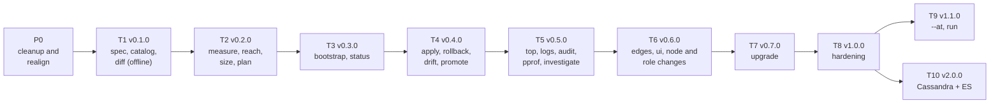

# tops implementation plan

Project: tops (Temporal Ops), `github.com/2SSK/tops`. Status: draft. Date: 2026-10-23.
Sibling docs: [PRD](prd.md) · [TRD](trd.md) · [App flow](app-flow.md) · [Design brief](design-brief.md) ·
[Backend schema](backend-schema.md) · [Concepts](concepts.md) · [Roadmap](roadmap.md)

A build guide in learning order. You build every piece by hand; this file says what to learn before each
piece, what to build, how to prove it works, where people usually go wrong, and when to stop. It never gives
the code. Shapes are in [backend-schema.md](backend-schema.md), flows in [app-flow.md](app-flow.md), rules
and algorithms in the [TRD](trd.md), output in the [design brief](design-brief.md). **Learn-first spine:
[concepts.md](concepts.md).**

## How to use this guide

- Steps are `P0.<n>` (cleanup) and `T<m>.<n>` (milestones), in build order. Each ends with a binary that does
  a little more and still passes everything before it; each milestone ends with a release you can demo.
- Every step has: **Goal** (one sentence), **Learn first** (official docs; read before typing), **Build**
  (what, not how), **Verify** (commands that exit non-zero when wrong), **Pitfalls**, **Done when** (the
  checklist that ends the step).
- Test first: the failing table-driven test, the least code to pass, refactor while green. Merge only with CI
  green.
- Go standards for every step: `context.Context` first on every function that does I/O; errors wrapped with
  `fmt.Errorf("…: %w", err)` and compared with `errors.Is/As`; user-facing failures as `*term.UserError`;
  logging only through `log/slog`; table-driven tests with `t.Run`; `gocyclo` 10 keeps handlers thin.
- `make …` runs in the tops repo. Lab commands use `LAB=./lab` (VPSLAB). Commands written `tops -e lab …` run
  inside a fleet root: the fixture (`TOPS_ROOT=$PWD/internal/fleet/testdata/fleet` until T2.6,
  `test/e2e/fleet` after) or temporalScale.
- Every user-visible change adds a CHANGELOG line in the same commit.

## Status (2026-10-23)

27 commits, 2026-10-11 to 2026-10-20; ~1,600 lines of Go including tests; `go vet` and `go test ./...` pass.

| Step  | State   | Commits                                                                                     |
| ----- | ------- | ------------------------------------------------------------------------------------------- |
| T1.1  | done    | `a5901f2` design docs, `0d89937` scaffold, `8168dcb` README, `eb03785` Makefile + golangci, `3f12113` root command, `1372039`/`b161210` CI, `69a0413` CHANGELOG |
| T1.2  | done    | `148d0a6` UserError + exit codes, `ad66e88` signals, `5f330c3` what/why/fix, `d6ea9b7` usage errors, `119fdd8`/`3ed2d84`/`25c7337` marks and colour, `d2817cb` x/sys bump (GO-2026-5024), `59ee519` JSON errors, `e1708ac` `--json`/`--no-color` |
| T1.3  | done (Oct 10 shape) | `86c0ab3` strict parse, `fceb130` defaults, `309a58c`/`6c6da37`/`b1eff38`/`1f1ac1f` validation, `4a10935` load, `75bcdeb` `validate -f`, `fefb956` `--json` |
| P0    | **next** | Realign the code with these docs (below)                                                   |

What the review found in the code (each is a Phase 0 step):

| Finding                                                                                      | Step |
| -------------------------------------------------------------------------------------------- | ---- |
| `make build` does not set `CGO_ENABLED=0`: a binary built on Arch links glibc and will not run as the helper on Ubuntu 24.04 (CI sets it; the Makefile does not) | P0.1 |
| `.PHONY` lists `link` instead of `lint`; comment typos in `internal/term` and `internal/spec` (`retruns`, `prined`, `pritned`, `ot only`, `with  a`, `tops keep`) | P0.1 |
| `bin/` and `coverage.out` sit in the root but are git-ignored (`bin`, `coverage.*`): nothing to fix, `make clean` removes them | P0.1 |
| `cli.Version` is a `const "dev"`: `-ldflags -X` cannot set a constant, so every release would report `dev` | P0.2 |
| `validateAccess` checks clients, monitors and admins but not `healthchecks`                   | P0.3 |
| CHANGELOG uses `## Added` under `## [Unreleased]` (Keep a Changelog wants `###`)              | P0.3 |
| `spec.Cluster` has `profile` (never validated), `secrets`, `dynamicConfig`, `ui.node`; `testdata/lab.yaml` uses the deleted bash lab (`tscale`, 10.78.0.0/24) | P0.4 |
| Nodes have no `roles`                                                                        | P0.5 |
| A persistent `-f/--file` (default `cluster.yaml`) instead of `-e <env>` and a fleet root     | P0.6 |

## Order and dependencies



## The lab contract (VPSLAB)

The e2e suite may use only this from `./lab` (the user's VPSLAB repo, git-ignored in tops):

| From VPSLAB                                                         | Used for                               |
| ------------------------------------------------------------------- | -------------------------------------- |
| `make up`, `make down`, `make reset`, `make test`                   | Node lifecycle                         |
| An untracked `compose.override.yaml` (Compose merges it automatically) | CPU and memory caps of every node and of `vps-pg`; tops ships it as `test/e2e/vpslab.override.yaml` |
| Compose profile `pg` (`vps-pg`, postgres:17.11, 10.80.0.20, `max_connections` 300) | PostgreSQL. Today an uncommitted change in VPSLAB's `compose.yaml`: commit it there first (PRD Q19) |
| Containers `vps-01..03`, `vps-pg`; `docker stop/start/kill`         | Failure injection                      |
| 10.80.0.11-13, gateway 10.80.0.1 (the workstation)                  | The e2e spec                           |
| `keys/id_ed25519`; `keys/known_hosts` with a line per node address (`10.80.0.1x`), rewritten by `make up` | SSH |

tops make targets wrap it: `make lab-up` (copy the override, `make -C lab up`, then
`docker compose --project-directory lab --profile pg up -d --wait vps-pg`), `make lab-renew`
(`make -C lab reset`, then `lab-up`: new nodes and new host keys, PostgreSQL data kept), `make lab-reset`
(`vps-pg` down with its volume, then `lab-renew`), `make lab-down`. The harness checks the contract first and
fails with `lab contract broken: …`.

**One cluster at a time.** tops' e2e fixture (cluster `tops-e2e`) and temporalScale's `lab` environment
(cluster `tscale-lab`) use the same containers and the same `vps-pg` (PRD D22). Every e2e run starts with
`make lab-reset`; afterwards temporalScale's lab is rebuilt with its own `tops -e lab bootstrap`. See the
temporalScale TRD constraints for the other rule about who may use these containers.

**Memory budget.** tops sizes every role up to its node's cap; it cannot see the workstation, so if the sum of
all caps exceeds the workstation's free memory, the host overcommits and every number tops reads (and every
measurement) is wrong. The reference workstation has 15 GiB with a desktop running and 4.5–6 GiB free. Caps
(decided by T2.1's measurements; these are the starting proposal):

| Container                         | CPUs | Memory cap | Runs                                    |
| --------------------------------- | ---- | ---------- | --------------------------------------- |
| vps-01                            | 1.5  | 1.25 GiB   | frontend, history, matching, worker (ui from T6) |
| vps-02                            | 1.5  | 1.25 GiB   | frontend, history, matching, worker     |
| vps-03                            | 1    | 768 MiB    | frontend, matching                      |
| vps-pg                            | 1    | 512 MiB    | PostgreSQL, capped like a small database host; size set in T2.1b from measurements, not to force a bottleneck |
| monitoring (temporalScale's)      | -    | 512 MiB    | Prometheus, Grafana, cAdvisor, host node_exporter (4 containers) |
| **v1 lab total**                  |      | **4.25 GiB** | fits the 4.5 GiB lower bound          |

The v2 lab (`lab-cass`) stops vps-03 and vps-pg and adds `vps-cass-1..3` (768 MiB each, 256 MB heap; measured
~550 MiB idle) and `vps-es` (768 MiB, 256 MB heap; ~670 MiB idle): 2.5 + 2.25 + 0.75 + 0.5 = **6 GiB**, the
upper bound. Run it with the desktop light, or with monitoring stopped (5.5 GiB).

## Repository layout and make targets

```
cmd/tops/  internal/…           (TRD "Package layout")
tools/cataloggen/               own go.mod; the catalog generator (T1.6)
test/helper/Dockerfile          Ubuntu 24.04 + systemd + sshd + deploy user (T2.3)
test/e2e/                       //go:build e2e; fleet/ fixture; vpslab.override.yaml; vpslab.v2.override.yaml
.github/workflows/ci.yml, release.yml   .golangci.yml  .goreleaser.yaml  Makefile  CHANGELOG.md
.cache/                         git-ignored: Temporal source checkouts for the generator
```

| Target             | Runs                                                                        | Exists |
| ------------------ | --------------------------------------------------------------------------- | ------ |
| `make build`       | `CGO_ENABLED=0 go build -trimpath -ldflags "-s -w -X …Version=$(VERSION)" -o bin/tops ./cmd/tops` | yes; flags P0.1-P0.2 |
| `make test`        | `go test -race -coverprofile=coverage.out ./...`                            | yes    |
| `make lint`        | `golangci-lint run` (gofmt as a formatter)                                  | yes    |
| `make vuln`        | `govulncheck ./...`                                                         | yes    |
| `make check`       | lint, test, vuln                                                            | yes    |
| `make clean`       | removes `bin/`, `coverage.out`                                              | yes    |
| `make generate`    | source checkouts, `tools/cataloggen` per minor, then `git diff --exit-code internal/catalog` | T1.6 |
| `make cover`       | Gates: >= 80% overall; >= 90% `safety`, `plan`, `sizing`                    | T1.10  |
| `make build-linux` | linux/amd64 and linux/arm64 helpers into `bin/`                             | T2.3   |
| `make helper-test` | systemd containers from `test/helper`, `go test -tags helper` over real SSH | T2.3   |
| `make lab-up`, `lab-renew`, `lab-reset`, `lab-down` | VPSLAB lifecycle (above)                   | T2.1   |
| `make e2e`         | `go test -tags e2e -timeout 60m ./test/e2e/... -lab=$(LAB)`; writes `e2e-report.{txt,json}` | T2.6 |

# Phase 0: cleanup and realign

The code was written against the Oct 10 design. Phase 0 makes it match these docs before anything new is
built on it (PRD D25). Six small steps, 3-5 days. After P0, `tops -e lab validate` runs against a fleet root
and a spec with roles; everything else waits for T1.

### P0.1 Build and repo hygiene

**Goal.** `make build` produces the same static binary CI does, and the tree has no stale typos.

**Learn first.**
- cgo and `CGO_ENABLED`: https://pkg.go.dev/cmd/cgo ; why a cgo binary needs the build machine's glibc:
  https://go.dev/doc/install/source#environment
- `go build` flags (`-trimpath`, `-ldflags`): https://pkg.go.dev/cmd/go#hdr-Compile_packages_and_dependencies
- `.PHONY`: https://www.gnu.org/software/make/manual/html_node/Phony-Targets.html
- `git check-ignore`: https://git-scm.com/docs/git-check-ignore

**Build.**
- `Makefile`: `.PHONY` lists `lint` (not `link`); `build` exports `CGO_ENABLED=0`.
- Fix the comment typos listed in "Status".
- Confirm `bin/` and `coverage.out` are ignored; delete them from the working tree with `make clean`.

**Verify.**
```sh
make clean build && ! ldd bin/tops 2>/dev/null | grep -q libc        # "not a dynamic executable"
git check-ignore -q bin/tops coverage.out
grep -n '^\.PHONY' Makefile | grep -qw lint
make check
```

**Pitfalls.**
- `tops` imports `net` (through cobra today, `x/crypto/ssh` later); with cgo on, the resolver links libc and
  the binary fails on Ubuntu 24.04 with `GLIBC_2.xx not found` when built on a newer distro. CI hides this
  because it sets the variable itself.
- `misspell` only knows common misspellings; it did not catch `retruns`.

**Done when.** `make check` is clean; `bin/tops` is static; `git status` shows only intended changes.

### P0.2 Version from the build

**Goal.** `tops version` prints the version the binary was built as, with commit and Go version.

**Learn first.**
- Linker `-X`: https://pkg.go.dev/cmd/link (it sets string variables, never constants)
- `runtime/debug.ReadBuildInfo` and its `vcs.*` settings: https://pkg.go.dev/runtime/debug#BuildInfo
- `git describe`: https://git-scm.com/docs/git-describe ; semver: https://semver.org/

**Build.**
- `internal/cli`: the version becomes a package `var` (default `dev`); every `--json` document already reads
  it.
- `Makefile`: `VERSION ?= $(shell git describe --tags --always --dirty)` passed with `-X`; `-s -w`.
- `tops version`: `tops <version> (<commit[:7]>, <go version>)`; `--json` `Version` document
  (`tops: {version, commit, goVersion}`). Commit and Go version from `ReadBuildInfo`.

**Verify.**
```sh
make build && bin/tops version | grep -v ' dev '
bin/tops version --json | jq -e '.kind == "Version" and .tops.version != "dev" and (.tops.commit | length) > 0'
go run ./cmd/tops version | grep -q ' dev '                         # unstamped builds say dev
```

**Pitfalls.**
- `-X` with a wrong import path or on a constant is silently ignored. Test the built binary, not a unit test.
- `go test` binaries carry no VCS stamp; keep the build-info reading behind a small function you can feed in
  tests.

**Done when.** Built binaries report `git describe`; `--json` has a `Version` document; CHANGELOG has a line.

### P0.3 `healthchecks` validation and CHANGELOG hygiene

**Goal.** All four `access` lists are validated; the CHANGELOG follows Keep a Changelog.

**Learn first.**
- Table-driven tests: https://go.dev/wiki/TableDrivenTests
- Keep a Changelog 1.1.0: https://keepachangelog.com/en/1.1.0/

**Build.**
- A failing row in `validate_test.go` (`access.healthchecks[0]` not an address; a duplicate), then the one
  missing call in `validateAccess`.
- CHANGELOG: `## Added` → `### Added`; capitalise each entry; add the `[Unreleased]` link at the bottom.
  Nothing is released yet, so later P0 steps rewrite unreleased entries in place (`validate -f` becomes
  `validate` with `-e`); there is no "Removed" entry for a flag no release ever had.

**Verify.**
```sh
go test -race -run TestValidate ./internal/spec/... -v | grep -q healthchecks
grep -q '^### Added' CHANGELOG.md && ! grep -q '^## Added' CHANGELOG.md
```

**Pitfalls.** Write the test first and watch it fail; a validator that is never called passes every test
that does not exercise it, which is how this one slipped.

**Done when.** The new rows pass; `make check` clean.

### P0.4 Remove obsolete spec fields; VPSLAB test data

**Goal.** `spec.Cluster` holds only fields these docs define for this stage.

**Learn first.**
- Backend schema "Fields" (the `Since` column) and the "Removed in P0.4" note.
- AGENTS.md: no compatibility layers.

**Build.**
- Delete `Profile`, `Secrets`, `DynamicConfig`, the `UI` type and field, `validateUI`, and the `Secrets` and
  `DynamicConfig` defaults (and `nodeExists` if nothing else uses it).
- Replace `internal/spec/testdata/lab.yaml` with VPSLAB values: cluster `tops-e2e`, `10.80.0.x`, user
  `deploy`, the lab keys by `~` path; no deleted fields.
- A test row proving `profile:` and `ui:` are now unknown keys (exit 4 with a line).

**Verify.**
```sh
go test -race ./...
! grep -rnE 'Profile|DynamicConfig|10\.78\.|tscale' internal/
```

**Pitfalls.** Keeping `ui` "because it comes back in T6" is the compatibility layer AGENTS.md forbids: it
returns as a role, with a different shape (D24).

**Done when.** No obsolete field or test value remains; tests green.

### P0.5 Roles per node

**Goal.** Every node lists the Temporal roles it runs, and the spec says when a role runs nowhere.

**Learn first.**
- The four roles: https://docs.temporal.io/temporal-service/temporal-server ; concepts "The four roles",
  "One unit per role".

**Build.**
- `Node.Roles []string` (`yaml:"roles"`).
- One ordered role list in `internal/spec` (frontend, history, matching, worker): it will drive stage
  order, ports, sizing and completion, so it exists once.
- Rules: non-empty; each from the list; no duplicates (`nodes[1].roles[2]: history is also nodes[1].roles[0]`);
  cluster-wide, each role on at least one node (`nodes: no node runs history`).
- Fixture: vps-01 and vps-02 all four, vps-03 frontend and matching.

**Verify.**
```sh
go test -race -cover ./internal/spec/...   # rows: missing roles, empty, unknown ("matchng"), duplicate, no history anywhere, ui (not yet a role)
```

**Pitfalls.**
- Role names are lowercase and exact; do not accept `History`.
- Do not add `ui` yet (T6.2) or `pin` (T2.4): `validate` must never accept what tops cannot do (D24).

**Done when.** All rows pass; the fixture validates; the error messages list the allowed roles.

### P0.6 `-e` replaces `-f`: fleet root and environments

**Goal.** `tops -e <env> validate` loads `environments/<env>/cluster.yaml` from the fleet root; `-f` is gone.

**Learn first.**
- How git finds its root by walking up: https://git-scm.com/docs/git-rev-parse#Documentation/git-rev-parse.txt---show-toplevel
- `path/filepath` (`Dir`, `Join`, `Abs`), `os.Stat`, `io/fs`: https://pkg.go.dev/path/filepath , https://pkg.go.dev/io/fs
- Cobra persistent flags and `PersistentPreRunE`: https://pkg.go.dev/github.com/spf13/cobra#Command
- Testing without process globals (`t.Setenv` vs injection): https://pkg.go.dev/testing#T.Setenv
- TRD "Fleet root and environments".

**Build.**
- `internal/fleet`: `FindRoot(cwd, getenv)` (`TOPS_ROOT`, else walk up to a directory containing
  `environments/`); `Environments(root)` (sorted names matching `^[a-z][a-z0-9-]{0,30}$`);
  `Load(root, env)` returning the cluster and its file path, with `ssh.key`/`ssh.knownHosts` expanded (`~`)
  and resolved relative to the environment directory. Errors `spec.no_root`, `spec.no_env` (listing the
  environments found).
- `internal/spec`: `Load(path)` and its "pass -f" fix text go; `fleet` reads the file and calls `Parse`, and
  error texts name the real file instead of the literal `cluster.yaml`.
- `internal/cli`: `Options.File` and the persistent `--file/-f` flag are deleted; `Options.Env` with a
  persistent `-e/--env`; `Options.Getenv` and `Options.Getwd` injected (`main` passes `os.Getenv`,
  `os.Getwd`). `validate` requires `-e` (`usage.invalid` listing the environments); `completion` refuses it.
- `validate` output: `✓ environments/lab is valid: cluster tops-e2e, 3 nodes, 10 roles`; the `Validation`
  document gains `env` and `cluster`.
- Fixture fleet `internal/fleet/testdata/fleet/` with `base/` (empty files) and `environments/lab/` (the P0.5
  spec) and `environments/staging/` (same shape, cluster `tops-e2e-staging`, other addresses). The CLI tests
  move from `-f testdata/…` to this root.

**Verify.**
```sh
go test -race -cover ./internal/fleet/... ./internal/cli/...
make build && export TOPS_ROOT=$PWD/internal/fleet/testdata/fleet
bin/tops -e lab validate; test $? -eq 0
bin/tops validate; test $? -eq 4                                   # no -e: names lab, staging
bin/tops -e nope validate --json | jq -e '.error.code == "spec.no_env"'
bin/tops validate -f x 2>&1 | grep -q 'unknown shorthand flag'     # -f is gone
(unset TOPS_ROOT; cd /tmp && ~/Code/Projects/building/tops/bin/tops -e lab validate --json | jq -e '.error.code == "spec.no_root"')
```

**Pitfalls.**
- A default environment, or a `TOPS_ENV` variable, is the classic way to apply to production by accident.
  Do not add one.
- Resolve spec paths from the environment directory, not the working directory: tops runs from anywhere
  inside the fleet repo.
- Stop the upward walk at the filesystem root; a symlinked working directory walks the link's parents.

**Done when.** No `File`/`-f` anywhere in `internal/cli`; all CLI tests use the fixture root; CHANGELOG
entries rewritten; temporalScale can validate its `environments/lab` once it has written one with roles.

# T1: spec, environments, settings catalog (v0.1.0)

Offline only: nothing in T1 connects to a node. Demo in temporalScale: `tops -e lab validate`,
`tops knobs cacheTTL`, `tops diff lab staging -v`.

### T1.1 Repo, toolchain and CI — done

**Goal.** A Go module with lint, test, vuln and cross-build in CI. **Done** in the commits above: `go 1.26.0`
with `toolchain go1.26.8`; jobs lint, test, vuln, build (linux/amd64, linux/arm64, darwin/arm64) with the
35 MB size gate. **Done when** (met): CI green on `main`.

### T1.2 Output, errors, exit codes — done

**Goal.** Every failure prints what/why/fix or one JSON document and exits with a documented code. **Done**:
`internal/term` (`UserError`, `ExitCode`, `PrintError`, `WriteErrorJSON`, marks, colour detection,
`Reported`), `cmd/tops` signal handling. T1.9 adds the `pending.` and `unhealthy.` prefixes to `ExitCode`.
**Done when** (met): exit codes 0/1/3/4/130 tested.

### T1.3 Spec v0 and `validate` — done (realigned in P0)

**Goal.** `cluster.yaml` parsed strictly and validated with every problem reported. **Done**: `Parse` with
`KnownFields`, `Defaults`, `Validate` returning every `Problem`, `ParseDuration` with `d`,
`validate [--json]`. P0.3-P0.6 changed its shape. **Done when** (met).

### T1.4 Problems carry lines

**Goal.** Every validation problem names its file and line (H5).

**Learn first.**
- `yaml.Node` (kinds, `Line`, `Content` pairs in mappings): https://pkg.go.dev/go.yaml.in/yaml/v3#Node
- `yaml.TypeError` (strict-decode errors are strings starting `line N:`): https://pkg.go.dev/go.yaml.in/yaml/v3#TypeError
- Golden files: https://pkg.go.dev/testing (the `-update` flag pattern)

**Build.**
- `Problem` gains `Line` (and `File`, used for settings files from T1.8).
- After the strict decode, decode once more into a `yaml.Node`; a path walker maps `nodes[2].roles[1]` to the
  node's line; a missing key reports its parent's line.
- Strict-decode failures (unknown keys, wrong types) become problems too: parse the `line N: …` prefix of
  each `TypeError` entry, with a test that pins that format.
- Human output: `✗ <file>:<line>  <path>  <message>`, then the `spec.invalid` summary (design brief).
- `testdata/bad/*.yaml` fixtures, one per rule, with golden output (human and JSON).

**Verify.**
```sh
go test -race ./internal/spec/... ./internal/cli/...
for f in internal/spec/testdata/bad/*.yaml; do … ; done   # via the golden test, not by hand
bin/tops -e bad validate --json | jq -e 'all(.errors[]; .path != "" and .line > 0)'   # bad env in the fixture fleet
```

**Pitfalls.**
- `yaml.Node.Decode` ignores `KnownFields`; keep the strict decoder for the struct and use the node only for
  lines.
- Mapping nodes store keys and values alternately in `Content`; flow style (`{ name: x }`) has lines too.

**Done when.** Every bad fixture has a golden file; every problem has `line > 0` except "missing required
key" rows, which carry the parent's line.

### T1.5 Secrets file

**Goal.** `environments/<env>/secrets.env` is read safely, checked by `validate`, and never printed.

**Learn first.**
- `stat(2)`, mode and owner: https://man7.org/linux/man-pages/man2/stat.2.html ; `io/fs.FileMode`:
  https://pkg.go.dev/io/fs#FileMode ; `syscall.Stat_t` for the uid: https://pkg.go.dev/syscall#Stat_t
- `slog.LogValuer`: https://pkg.go.dev/log/slog#LogValuer ; `fmt.Stringer`
- Why dotenv expansion breaks passwords: the `$` handling in any dotenv library's README.

**Build.** In `internal/fleet`: the file check (regular, 0600, owner = current uid → `secrets.mode`), the
hand parser (backend schema grammar → `secrets.invalid` with line), required keys per persistence kind; an
`internal/secret` `Value` type whose `String()`, `GoString()`, `Format()` and `LogValue()` print `***`, with
an explicit `Reveal()` used only where the value is rendered. `validate` checks the file; other commands read
it only when they connect.

**Verify.**
```sh
go test -race ./internal/fleet/... ./internal/secret/...   # rows: 0644, other owner, symlink, $ in value, quotes, unknown key, missing key
chmod 644 $TOPS_ROOT/environments/lab/secrets.env; bin/tops -e lab validate; test $? -eq 4; chmod 600 $TOPS_ROOT/environments/lab/secrets.env
```

**Pitfalls.**
- git does not keep 0600: tests create the fixture's secrets file in `t.TempDir()` with the mode they need.
- A test that formats a `Value` with `%v`, `%+v`, `%#v` and `slog` must see `***` every time.

**Done when.** Every row passes; no code path prints a secret; CHANGELOG line.

### T1.6 Settings catalog generator and `tops knobs`

**Goal.** Every dynamic-config key of Temporal 1.31 is searchable offline: key, roles, default, meaning.

**Learn first.**
- `go generate`: https://go.dev/blog/generate ; multi-module repositories:
  https://go.dev/doc/modules/managing-source#multiple-module-source
- `go/packages`: https://pkg.go.dev/golang.org/x/tools/go/packages ; `go/types` tutorial:
  https://github.com/golang/example/tree/master/gotypes ; `go/constant`: https://pkg.go.dev/go/constant
- Temporal dynamic config: https://docs.temporal.io/references/dynamic-configuration ; read
  `common/dynamicconfig/constants.go`, `setting.go` and `setting_gen.go` at `v1.31.3`.
- `embed`: https://pkg.go.dev/embed ; TRD "Settings catalog".

**Build.**
- `tools/cataloggen/` with its own `go.mod` (D23). `versions.txt`. `make generate` clones the tag into
  `.cache/temporal/v<version>` (add `.cache/` to `.gitignore`) and runs the generator per minor.
- The generator: load the checkout with `go/packages`; for each `New…Setting(…)` call in `constants.go`
  record key, type and precedence (constructor name), default (`go/constant` value via `types.Info.Types`,
  else source text), description; roles from `types.Info.Uses` of each variable across `service/<role>/…`
  (else `shared`); the `candidate` hint. Sorted, timestamp-free output.
- `internal/catalog`: embeds `catalog-*.json`; `Lookup(minor, key)` (case-insensitive), `Search(minor,
  text)`, `Closest(minor, key)` (prefix match, then edit distance; a 15-line function, no dependency).
- `tops knobs [text] [-v]` (design brief); `--json` `Knobs`.
- CI `generate` job with the module cache and `.cache/` cached; lint the generator module separately
  (`cd tools/cataloggen && golangci-lint run`): the root `./...` does not include a nested module.

**Verify.**
```sh
make generate                                              # re-run is byte-stable (git diff --exit-code)
go test -race ./internal/catalog/...                       # fixture: history.cacheTTL -> [history], default 1h, candidate restart
bin/tops knobs --json | jq -e '.settings | length > 500'
bin/tops knobs cacheTTL --json | jq -e 'any(.settings[]; .key == "history.cacheTTL" and .roles == ["history"])'
! grep -q 'go.temporal.io/server' go.mod                   # the server never enters tops' module for the generator
```

**Pitfalls.**
- The first `go/packages` load downloads Temporal's whole dependency graph; do it once, then work offline.
- Defaults like `256000*4*1024` or `time.Minute` need `go/constant`, not string parsing.
- A setting referenced only from `common/…` may still be read by just one role at run time; `shared` is the
  honest label. Do not guess.
- Keys are case-insensitive in Temporal; search and duplicate checks must be too.
- Absolute paths or map iteration order in the output break byte-stability.

**Done when.** `make generate` is clean twice in a row; `knobs` works offline; CI `generate` job green.

### T1.7 Classify the keys you set

**Goal.** Every key the fleet repo sets has a hot or restart class with evidence; everything else is
`unknown`.

**Learn first.** TRD "Classification"; read a property function's life in Temporal: where `Get(dc)` is
stored (`service/history/configs/config.go`) and where it is called (`service/history/workflow/cache/cache.go`).

**Build.** `internal/catalog/class-1.31.yaml` and its loader; `unknown` as the default; `knobs` shows
`apply` and, with `-v`, the evidence. Classify the keys in temporalScale's `base/` and `overrides.yaml` (and
the fixture's): cite the call site; a `hot` entry also carries `lab: pending` until T4.3.

**Verify.**
```sh
go test -race ./internal/catalog/...          # unknown default; a class for a key not in the catalog fails
bin/tops knobs history.cacheTTL --json | jq -e '.settings[0].apply == "restart"'
```

**Pitfalls.** A property-function field looks hot and is often read once in a constructor. "Requires
service restart" in a description covers 14 keys; silence proves nothing.

**Done when.** Every key set anywhere in the fixture and temporalScale has an entry with a call-site citation.

### T1.8 Dynamic-config merge

**Goal.** Per role, the merged settings of `base/` and the environment's overrides, checked against the
catalog, and `validate` runs them.

**Learn first.** TRD "Dynamic-config merge order"; Temporal's file format (constraints, value lists):
https://docs.temporal.io/references/dynamic-configuration

**Build.** `internal/settings`: read `base/common.yaml`, `base/<role>.yaml`, `overrides.yaml` as `yaml.Node`
(lines for errors); merge by the table; type checks; constraint names against precedence; the warnings; the
`TimeoutStopSec` check against the drain settings; `Layers(key)` for `knobs -e`. `validate` reports these
problems with `file` and `line`.

**Verify.**
```sh
go test -race -cover ./internal/settings/...  # order, whole-key replace, role routing, shared keys, unknown key, wrong type, case folding
bin/tops knobs frontend.namespaceRPS -e lab --json | jq -e '.settings[0].layers.effective != null'
```

**Pitfalls.** `History.CacheTTL` and `history.cacheTTL` in two layers are the same key. Merge whole values;
merging constraint lists produces settings nobody wrote.

**Done when.** `validate` covers settings; `knobs -e` shows layers; coverage of `internal/settings` >= 80%.

### T1.9 `tops diff`

**Goal.** Two environments compared offline; promotable differences decide the exit code.

**Learn first.** GitOps principles: https://opengitops.dev/ ; TRD "Diff and promote".

**Build.** In `internal/fleet`: resolve both environments; compare promotable and by-design groups; human
output and `EnvDiff`. `term`: the `+ - ~` marks and the `pending.`/`unhealthy.` exit-code prefixes (TRD
"Exit codes"), with rows in `ExitCode`'s table test.

**Verify.**
```sh
go test -race ./internal/fleet/... ./internal/term/...
bin/tops diff lab staging; test $? -eq 2
bin/tops diff lab lab; test $? -eq 0
bin/tops -e lab diff lab staging; test $? -eq 4                  # -e refused here
```

**Pitfalls.** Compare resolved values (defaults applied, merged settings), not raw files: a key set to its
default in one environment and absent in the other is still a difference worth showing, marked as such.

**Done when.** Exit codes 0/2/4 tested; `EnvDiff` golden.

### T1.10 `tops init`, coverage gate, release pipeline, v0.1.0

**Goal.** A new environment in one command; v0.1.0 released with checksums, SBOM and provenance.

**Learn first.** GoReleaser: https://goreleaser.com/customization/ ; GitHub artifact attestations:
https://docs.github.com/en/actions/security-for-github-actions/using-artifact-attestations ; SLSA levels:
https://slsa.dev/spec/v1.0/levels ; `go tool cover`: https://go.dev/blog/cover

**Build.** `tops init <env>` (embedded commented template; never overwrites; `spec.env_exists`); `make cover`
(per-package thresholds from `go tool cover -func`); `.goreleaser.yaml` with the same `CGO_ENABLED=0`
and `-X` flags as the Makefile; `release.yml` on tags; README quickstart.

**Verify.** T1 acceptance.

**Pitfalls.** `init` must refuse an existing environment. GoReleaser's default `ldflags` set `main.version`;
point them at `internal/cli.Version`.

**Done when.** T1 acceptance green; v0.1.0 tagged and published.

### T1 acceptance

| Check                                   | Command                                                                                       |
| --------------------------------------- | --------------------------------------------------------------------------------------------- |
| Installs, reports its version           | `go install github.com/2SSK/tops/cmd/tops@v0.1.0 && tops version \| grep -q 0.1.0`            |
| Lab spec valid                          | `tops -e lab validate; test $? -eq 0` (temporalScale)                                         |
| Errors point at the field               | `tops -e bad validate --json \| jq -e 'all(.errors[]; .path != "" and .line > 0)'` (fixture)   |
| Catalog complete and stable             | `make generate`; `tops knobs --json \| jq -e '.settings \| length > 500'`                      |
| Environments compared                   | `tops diff lab staging -v` (temporalScale): only intended differences                          |
| Init                                    | `tops init qa && test "$(stat -c %a environments/qa/secrets.env)" = 600 && ! tops init qa`    |
| Release artefacts                       | `gh release view v0.1.0 --json assets -q '.assets[].name'` lists checksums, SBOM, archives   |

# T2: measure, reach, size, plan (v0.2.0)

Demo: on a bare VPSLAB, `tops -e lab capacity` shows each node's detected size and per-role limits;
`tops -e lab plan` lists every file each role would get, exit 2.

### T2.1a Lab budget, caps, and a per-role cluster by hand

**Goal.** VPSLAB runs with caps that fit the workstation, and you have run a per-role Temporal cluster on it
by hand once.

**Learn first.**
- Compose override merging and profiles: https://docs.docker.com/compose/how-tos/multiple-compose-files/merge/ ,
  https://docs.docker.com/compose/how-tos/profiles/
- systemd resource control and `systemd-run`:
  https://www.freedesktop.org/software/systemd/man/latest/systemd.resource-control.html ,
  https://www.freedesktop.org/software/systemd/man/latest/systemd-run.html
- cgroup v2 files: https://docs.kernel.org/admin-guide/cgroup-v2.html
- Temporal server configuration: https://docs.temporal.io/references/configuration ; the SQL tool:
  https://docs.temporal.io/self-hosted-guide/visibility (schema setup sections)
- Go 1.25 container-aware GOMAXPROCS: https://go.dev/doc/go1.25

**Build.** No tops code.
1. In VPSLAB (your other repo): commit the `vps-pg` service (Q19); add `compose.override.yaml` to its
   `.gitignore`.
2. Workstation budget: `free -m` with your normal desktop, three times over a working day; the lowest
   `available` is the budget. Write `test/e2e/vpslab.override.yaml` from the lab contract's table so the sum
   of every cap fits it, and the make targets `lab-up`, `lab-renew`, `lab-reset`, `lab-down`.
3. On VPSLAB by hand: download the 1.31.3 release on each node; write one config per role and one
   dynamic-config file; create the databases with `temporal-sql-tool`; start each role with
   `systemd-run --unit=m-<role> -p MemoryAccounting=yes … start --service <role>`; register a namespace.

**Verify.**
```sh
make lab-up && docker inspect -f '{{.Name}} {{.HostConfig.NanoCpus}} {{.HostConfig.Memory}}' vps-01 vps-02 vps-03 vps-pg
for n in 11 12 13; do ssh-keygen -F 10.80.0.$n -f lab/keys/known_hosts >/dev/null || echo "missing 10.80.0.$n"; done
ssh -F lab/keys/ssh_config vps-01 cat /sys/fs/cgroup/memory.max                      # the container limit
ssh -F lab/keys/ssh_config vps-01 systemctl show m-history -p MemoryCurrent           # accounting works
curl -s 10.80.0.11:9234/metrics | grep -E '^gomaxprocs '                              # equals the node's cpus (open point 4)
```

**Pitfalls.**
- `free` and `nproc` inside a VPSLAB node report the workstation; read the cgroup files.
- `docker compose down` without `--profile pg` leaves `vps-pg` attached, and the `vpslab` network cannot be
  removed while it has endpoints: `lab-down` and `lab-reset` stop `vps-pg` first.
- `ssh-keygen -R` on `known_hosts` removes the address lines tops needs; `make -C lab up` writes them back.
- An uncapped `vps-pg` can take memory the nodes were promised; always cap it, and record the cap with every run.

**Done when.** `make lab-up` gives capped nodes and `vps-pg`; you have queried a namespace through the
hand-run frontend; you can explain every line of the configs you wrote (they become T2.5's templates).

### T2.1b Measure the sizing constants

**Goal.** Every constant of the TRD formula exists, with its raw samples.

**Learn first.**
- omes (Temporal's load generator): https://github.com/temporalio/omes
- Go GC guide: https://go.dev/doc/gc-guide
- TRD "Constants and how they are measured"; concepts "Measurement discipline".

**Build.** No tops code.
1. Write the reference load down before the first run: omes scenario `workflow_with_single_noop_activity`, one
   fixed rate, 15 minutes, omes commit pinned.
2. A sampler (shell over SSH is enough): unit cgroups every second, every role's metrics port every 10 s.
3. Runs on the two node sizes (vps-01's and vps-03's caps), three each: idle (each role alone, then all
   together), reference load, double load. `perShard`: three short-lived clusters at 128, 256 and 512 shards
   (each needs a fresh database: the count is fixed at creation).
4. Derive every constant; write `internal/sizing/testdata/measure-<date>.json` (backend schema) and a
   README there stating scenario, rate, sizes, dates.
5. Fit check for temporalScale's shape S3 (all four roles on vps-03): compute `free` for four roles at
   vps-03's proposed cap from the measured floors. If it is negative, record it and decide with PRD Q20
   before choosing caps.
6. Decide the final caps (PRD Q14): each node holds its roles' floors plus headroom under the reference load;
   `vps-pg` sized from its measured use at the reference rate with the same headroom rule as the nodes (no
   bottleneck is designed in); the total fits the budget. Update the lab contract table.

**Verify.**
```sh
jq -e '.runs | length >= 6' internal/sizing/testdata/measure-*.json
jq -e '.perShard | length == 3' internal/sizing/testdata/measure-*.json
jq -e '.workstation.memAvailableMinBytes > 0' internal/sizing/testdata/measure-*.json
jq -e '.s3FitVps03 != null' internal/sizing/testdata/measure-*.json      # the four-roles-on-vps-03 result, fit or not
```

**Pitfalls.**
- Caps above the workstation's free memory are not an error anywhere: the kernel swaps or OOM-kills and the
  measurements are silently wrong. Check `free -m` on the workstation during every run.
- Measure each role alone for its floor, and together for its share; the two answer different questions.
- Write down the load before you look at the numbers, or you will tune the load to the answer.
- These constants are re-validated in T8 under 30 minutes of load; a first set does not need to be perfect,
  it needs to be recorded.

**Done when.** The measure file and its README are committed; the lab contract caps are final.

### T2.2 Node helper and wire: `hello`, `facts`

**Goal.** `tops node hello|facts` runs as root, reads one JSON request, writes one typed response.

**Learn first.** `proc(5)` (`/proc/<pid>/cgroup`, `/proc/<pid>/exe`): https://man7.org/linux/man-pages/man5/proc.5.html ;
`sched_getaffinity(2)`: https://man7.org/linux/man-pages/man2/sched_getaffinity.2.html ; go-systemd D-Bus:
https://pkg.go.dev/github.com/coreos/go-systemd/v22/dbus ; `encoding/json` `Decoder.DisallowUnknownFields`;
backend schema "Node helper protocol".

**Build.** `internal/wire` (envelope, op names, every type); `internal/helper`: root check, stdin decode,
exit 0/1/2, slog JSON on stderr; `hello` with cgroup-aware memory and cores and their sources (the cgroup
root is a parameter, so tests point it at testdata); `facts` (hashes, content only when different, every
`temporal@*` instance, `current`, `applied.json`). The hidden `node` command in `internal/cli`.

**Verify.** `go test -race ./internal/wire/... ./internal/helper/...` with cgroup trees as testdata (root
cgroup; container with `memory.max`; `cpu.max` `150000 100000` -> 1.5 cores; `max`).

**Pitfalls.** `max` means unlimited. Walk PID 1's cgroup and its visible ancestors; take the minimum.
Nothing in the helper may read the spec: it only executes what the request says.

**Done when.** Both ops tested on fixtures; `sudo bin/tops node hello < req.json` works on your workstation.

### T2.3 SSH, host keys, helper upload, helper test image

**Goal.** tops connects to every node with strict host keys, checks sudo and forwarding, uploads the helper
once per build.

**Learn first.** `x/crypto/ssh`, `knownhosts`, `agent`: https://pkg.go.dev/golang.org/x/crypto/ssh ;
RFC 4254 `direct-tcpip`: https://www.rfc-editor.org/rfc/rfc4254#section-7.2 ; `known_hosts` format:
https://man.openbsd.org/sshd#SSH_KNOWN_HOSTS_FILE_FORMAT ; errgroup: https://pkg.go.dev/golang.org/x/sync/errgroup

**Build.** `internal/remote` per TRD (dial, auth, host keys with `HostKeyAlgorithms` from the stored
entries, keepalive, preflight, `Call` for helper ops, `Dial` for tunnels); the upload command as one constant;
`make build-linux`; `test/helper` image and `make helper-test`; `tops version -e`; `--debug`. A test that the
set of shell strings tops sends is exactly `uname -m` and the upload command (H2); a test that fails on
`InsecureIgnoreHostKey` anywhere in the tree (H3).

**Verify.**
```sh
make helper-test                                   # hello over SSH; upload once; changed key refused; unknown key refused
bin/tops -e lab version --json | jq -e 'all(.nodes[]; .helperSha256 | length == 16)'
```

**Pitfalls.** `make -C lab reset` changes host keys; the fix is `make -C lab up` rewriting `known_hosts`,
never `accept-new`. Upload over stdin, never as an argument. Close every session; a leaked session holds
the connection open after Ctrl-C.

**Done when.** `make helper-test` green in CI; a second `version -e` uploads nothing.

### T2.4 Sizing, pins and `tops capacity`

**Goal.** Per node and role: limits, weights and pools from detected size, roles and pins; headroom; DB
budget.

**Learn first.** TRD "Sizing"; PostgreSQL connection settings:
https://www.postgresql.org/docs/17/runtime-config-connection.html ; `pg_stat_activity`:
https://www.postgresql.org/docs/17/monitoring-stats.html#MONITORING-PG-STAT-ACTIVITY-VIEW ; pgx `DialFunc`:
https://pkg.go.dev/github.com/jackc/pgx/v5/pgconn#Config

**Build.** `nodes[].pin` in the spec (validation rows from the backend schema); `internal/sizing` (pure:
inputs -> `RoleSize` per role with the formula string; the three refusals; constants per minor plus the test
that recomputes them from T2.1b's samples); `internal/datastore/postgres` read of the connection limits
through a tunnel; `tops capacity`.

**Verify.**
```sh
go test -race -cover ./internal/sizing/...     # golden per node shape: all roles, frontend+matching, pinned, too small, one history node
bin/tops -e lab capacity --json | jq -e 'all(.nodes[]; (.roles | length) > 0) and .db.ok and .headroom.ok'
```

**Pitfalls.** Round once, at the end, in one direction (down for limits, up for pools), or the sum of roles
exceeds the node. A pin changes what is left for the others; test it. With one history node, headroom is
skipped with a warning, not divided by zero.

**Done when.** `internal/sizing` coverage >= 90%; `capacity` on the lab matches a hand calculation for one
node.

### T2.5 Rendering per role

**Goal.** Every node's file set, per role, byte-stable.

**Learn first.** `text/template`, `embed`: https://pkg.go.dev/text/template , https://pkg.go.dev/embed ;
Temporal server configuration: https://docs.temporal.io/references/configuration ; backend schema
"Generated files".

**Build.** `internal/render`: `[[ ]]` templates from the configs you wrote by hand in T2.1a; `NodeInput`; per
role `<role>.yaml`, `<role>.env`, `dynamicconfig-<role>.yaml`, `limits.conf`; the shared `temporal.env` and
`temporal@.service`; `FileSet` with role and effect; the port table once. Check in the 1.31.3 source whether
the worker role needs `publicClient.hostPort` (TRD open point 6) and render it if so. Golden files per node of
the fixture.

**Verify.** `go test -race ./internal/render/...`; read every `-update` diff.

**Pitfalls.** Temporal's `{{ env "…" }}` must pass through; `# enable-template` must stay in the first
1 KB. Secrets only in `temporal.env`. Ports come from one table, never typed into a template twice.

**Done when.** Golden files for every node of the fixture; a property test proves no secret value appears
outside `temporal.env`.

### T2.6 `plan` on bare nodes, e2e harness, v0.2.0

**Goal.** `plan` shows everything a bootstrap would create, before anything is copied.

**Learn first.** Terraform plan as the model: https://developer.hashicorp.com/terraform/cli/commands/plan ;
go-udiff: https://pkg.go.dev/github.com/aymanbagabas/go-udiff

**Build.** `internal/plan` (desired vs `facts`; on a node with no tops state everything is `create`;
`not validated: 1.31.3 not staged`); `tops plan` exit 0/2/3; `test/e2e` harness (temporary fleet root from
`test/e2e/fleet/` with absolute lab key paths, `TOPS_ROOT`, the contract check, `make lab-reset`, the
workstation memory check, the report files).

**Verify.** T2 acceptance.

**Pitfalls.** `plan` must leave nodes untouched: assert it (H1). The e2e fixture is not temporalScale's lab;
never point the harness at temporalScale.

**Done when.** T2 acceptance green on the release binary; v0.2.0 published with the e2e report.

### T2 acceptance

| Check                                | Command                                                                                            |
| ------------------------------------ | -------------------------------------------------------------------------------------------------- |
| Detected sizes are the containers'   | `tops -e lab capacity --json \| jq -e '.nodes[] \| select(.name=="vps-03") \| .memory.source \| startswith("cgroup")'` |
| Per-role limits for every listed role | `tops -e lab capacity --json \| jq -e '[.nodes[].roles[]] \| length == 10'` (4 + 4 + 2)          |
| Plan lists every file, exit 2        | `tops -e lab plan; test $? -eq 2`                                                                  |
| Plan changes nothing (H1)            | e2e `TestPlanTouchesNothing`: sha256 of `/etc/temporal`, `/opt/temporal`, `/var/lib/tops` before = after; `/run/tops` empty |
| Helper uploaded once                 | second `tops -e lab plan --debug 2>&1 \| grep -c 'helper upload'` = 0                              |
| Too-small node refused               | e2e: a temp env whose vps-03 pins `history.memoryMax` above what the cap leaves: `tops -e small plan --json \| jq -e '.refusals[0].code == "refused.node_too_small"'`; exit 3 (independent of the final caps) |
| Unknown host key refused             | e2e: a node's line removed from a copy of `known_hosts`: exit 1 `ssh.host_key_unknown`            |

# T3: bootstrap and status (v0.3.0)

Demo: `make lab-reset && tops -e lab bootstrap -y && tops -e lab status`: three nodes, rings per role,
512 shards owned. temporalScale keeps its bash version until v0.4.0: v0.3.0 builds and reads a cluster but
cannot change it or roll it back.

### T3.1 Releases, checksums, `stage`

**Goal.** A fresh node gets the `temporal` user and verified releases.

**Learn first.** The Temporal server and CLI release pages and their `checksums.txt`; `useradd --system`:
https://man7.org/linux/man-pages/man8/useradd.8.html ; `archive/tar`, `compress/gzip`:
https://pkg.go.dev/archive/tar ; `net/http` with context: https://pkg.go.dev/net/http#NewRequestWithContext

**Build.** `internal/release` (URL patterns per kind and arch, checksum parsing, supported minors table);
helper `stage` (user, directories, download, verify, extract, `current` only on first install, release
retention).

**Verify.** `go test -race ./internal/release/...`; `make helper-test` against a local HTTP server (pass,
checksum fail, re-run skips).

**Pitfalls.** The workstation fetches checksums over TLS; the node only compares. Extract into a temp dir and
rename; a half-extracted release must never look installed. Reject archive paths with `..`.

**Done when.** A fresh helper container ends with the release staged and the user created; a second run
changes nothing.

### T3.2 Validation with the target binary

**Goal.** Nothing switches unless the target `temporal-server` accepts every role's files.

**Learn first.** `temporal-server render-config` and `validate-dynamic-config` (`--help` of 1.31.3;
`render-config` takes `--config/--env` only); `systemd-analyze verify`:
https://www.freedesktop.org/software/systemd/man/latest/systemd-analyze.html

**Build.** Helper `validate` per role in `/run/tops/<run-id>/<role>/`, removed on exit; `plan` uses it when the
release is staged; `refused.render_rejected`.

**Verify.** `make helper-test` with the real binary: one accepted and one rejected render per role.

**Pitfalls.** `render-config` prints the password: discard stdout. Give it exactly the rendered environment.

**Done when.** Every role's golden render validates with 1.31.3; `/run/tops` is empty after every run.

### T3.3 Schema on PostgreSQL

**Goal.** Both databases created and versioned by the target release's tool.

**Learn first.** Temporal SQL tool: https://github.com/temporalio/temporal/tree/main/tools/sql ; concepts
"Schema versions".

**Build.** Helper `schema` (create-database, `setup-schema -v 0.0`, `update-schema --schema-name`), password
through `SQL_PASSWORD` only; progress events.

**Verify.** `make helper-test` against a PostgreSQL container: create, setup, update, re-run no-op.

**Pitfalls.** An existing database owned by another role makes the migration fail later; preflight reports
it. Never put the password in argv: `ps` shows argv to every user.

**Done when.** Re-running `schema` is a no-op; the tool's stderr reaches the operator without secrets.

### T3.4 Cluster lock with leases and fencing

**Goal.** Two runs never change an environment at once; a run that lost its lease cannot write.

**Learn first.** `open(2)` `O_CREAT|O_EXCL`: https://man7.org/linux/man-pages/man2/open.2.html ; `flock(2)`:
https://man7.org/linux/man-pages/man2/flock.2.html and `unix.Flock`: https://pkg.go.dev/golang.org/x/sys/unix#Flock ;
leases and fencing: https://martin.kleppmann.com/2016/02/08/how-to-do-distributed-locking.html ; TRD
"Cluster lock".

**Build.** Helper `lock` (acquire, renew, release, stale takeover under the flock); the fencing check inside
every fenced op (under the flock); workstation side: acquire in spec order, release on every exit path, a
renewal goroutine with its own session, cancelled with the run's context.

**Verify.** `make helper-test`: two helpers race (one wins); a stale run id is refused; takeover waits for an
in-progress write.

**Pitfalls.** Lease times are node clocks. Without fencing, a laptop that slept through its lease keeps
writing. Release in a `defer` that uses a fresh context: the run's context is already cancelled on Ctrl-C.

**Done when.** All race rows pass under `-race`; `lock.held` names holder, command and age.

### T3.5 Write, snapshots, template units, `service`, `history`

**Goal.** Atomic writes preceded by snapshots; role units enabled and started by name; an audit record per
node.

**Learn first.** `rename(2)` and directory `fsync`: https://man7.org/linux/man-pages/man2/rename.2.html ;
systemd template instances and instance drop-ins:
https://www.freedesktop.org/software/systemd/man/latest/systemd.unit.html

**Build.** Helper `write`, `restore`, `history`, `applied.json` (with enabled roles), `service` on
`temporal@<role>.service` through D-Bus (job result checked); snapshot retention (10) and history retention
(100).

**Verify.** `make helper-test`: kill mid-write (old or new, never partial); restore byte-equal; an instance
drop-in changes only that instance (`systemctl show temporal@history -p MemoryMax`).

**Pitfalls.** `daemon-reload` after any unit or drop-in change, before the restart. Snapshot before the first
byte. A D-Bus job that ends `failed` is an error even though the call returned.

**Done when.** Every fenced op checks the lease; history records never contain contents or secrets.

### T3.6 Temporal reads over tunnels

**Goal.** Health, rings per role, shard ownership and identity read through frontends.

**Learn first.** gRPC health checking: https://github.com/grpc/grpc/blob/master/doc/health-checking.md ;
`grpc.WithContextDialer`: https://pkg.go.dev/google.golang.org/grpc#WithContextDialer ; the admin service
request/response messages at tag v1.31.3 (search the source for `DescribeClusterResponse` and
`DescribeHistoryHostRequest`).

**Build.** `internal/cluster`: one lazy connection per frontend node; `Serving`, `Describe`, `Shards`; views
kept per frontend. Check that the admin messages decode against both supported binaries (TRD open point 8).

**Verify.** `go test -race ./internal/cluster/...` with fake services (`grpc/test/bufconn`).

**Pitfalls.** SERVING is per service name: `temporal.api.workflowservice.v1.WorkflowService`. Never merge
views from different frontends.

**Done when.** Fakes cover a missing member, disagreeing views and a shard dip.

### T3.7 Per-role gate

**Goal.** A role is touched only when its ring is otherwise whole, and the next step waits until it is back.

**Learn first.** TRD "Gate per role"; concepts "Membership", "History shards".

**Build.** `internal/gate`: before/after per role, 2 s polling, stable twice, timeout report with the journal
tail; the single-instance and single-frontend warnings.

**Verify.** `go test -race ./internal/gate/...` with a fake cluster: flapping ring, shard dip, unknown member,
single-instance role, last frontend.

**Pitfalls.** "In the ring" for matching and worker is all the cluster can tell you; do not invent a partition
check. History "owns > 0" catches a member that has not acquired anything. Use an injected clock in tests,
never `time.Sleep`.

**Done when.** Every row passes in milliseconds; refusal codes match the app-flow index.

### T3.8 `tops bootstrap`

**Goal.** Fresh VPSLAB to a healthy cluster in one command, resumable.

**Learn first.** App-flow `bootstrap` and journey 2; concepts "Cluster immutables".

**Build.** `internal/rollout` bootstrap: lock, preflight (sizing, ports, OS, units, clock), datastore preflight,
plan, confirm, stage, schema, validate, role stages with gates, namespaces, printed manual steps, resume;
`internal/runlog`; the live progress line and prompts (design brief TTY rules). First check on the lab
whether a frontend reports SERVING before any history exists (TRD open point 5); adjust stage 1's gate to
what you observe.

**Verify.** T3 acceptance rows "Fresh lab", "Used datastore", "Resume", "Resume onto recreated nodes".

**Pitfalls.** Recreated nodes have new host keys: `make lab-renew` rewrites `lab/keys/known_hosts`; tops never
accepts a key itself. Resume is decided by the datastore (`cluster_metadata_info` names this cluster), not by
what the nodes look like.

**Done when.** Bootstrap from a fresh lab < 5 min; kill-and-rerun resumes.

### T3.9 `status`, `ns`, e2e, v0.3.0

**Goal.** A cluster you can see whole, with namespaces as the spec says.

**Learn first.** Namespaces: https://docs.temporal.io/namespaces ; `OperatorService`/`WorkflowService`
namespace calls in `go.temporal.io/api`.

**Build.** `tops status` (per node and role; exit 5); `ns list`, `ns ensure` (lock; wait until visible on
every frontend); e2e for the rows below.

**Verify.** T3 acceptance.

**Pitfalls.** Retention is a duration in the API and days in the UI; compare durations.

**Done when.** T3 acceptance green; v0.3.0 published with the e2e report.

### T3 acceptance

| Check                                     | Command                                                                                       |
| ----------------------------------------- | --------------------------------------------------------------------------------------------- |
| Fresh lab to healthy, < 5 min             | `make lab-reset && time tops -e lab bootstrap -y && tops -e lab status --json \| jq -e '.healthy and .temporal.shards.owned == 512'` |
| Rings per role match the spec             | `tops -e lab status --json \| jq -e '(.temporal.rings.history.members \| length) == 2 and (.temporal.rings.matching.members \| length) == 3'` |
| One unit per role                         | `ssh -F lab/keys/ssh_config vps-03 systemctl list-units 'temporal@*' --no-legend \| wc -l` = 2 |
| Second plan clean                         | `tops -e lab plan; test $? -eq 0`                                                             |
| Status exits 5 with a node down           | `docker stop vps-02; tops -e lab status; test $? -eq 5; docker start vps-02`                  |
| Bootstrap refuses a used datastore        | `make lab-renew` (PostgreSQL kept); spec `cluster: other`; `tops -e lab bootstrap -y --json \| jq -e '.result == "refused"'`; exit 3 `refused.datastore_in_use` |
| Bootstrap resumes                         | e2e: kill tops after the history stage; re-run exits 0 and starts only what is missing        |
| Resume onto recreated nodes               | start a workflow; `make lab-renew`; `tops -e lab bootstrap -y && tops -e lab status --json \| jq -e '.healthy and .temporal.shards.owned == 512'`; the workflow completes; `tops -e lab ns --json` lists the namespaces unchanged |
| `ns ensure` idempotent                    | `tops -e lab ns ensure -y && tops -e lab ns ensure -y --json \| jq -e '.result == "nothing"'` |
| Lock refuses a second run                 | e2e: two `bootstrap` at once; one exits 3 `lock.held`                                          |

# T4: change safely (v0.4.0)

Demo: a hot key changes with no restart; a restart key restarts each reader once, role-major; killing a node
mid-apply stops the rollout; rollback and its undo; a hand edit makes `drift` exit 2; `promote` then `diff` is
clean.

### T4.1 Safety rules

**Goal.** Every refusal of the PRD safety table is a pure function with pass and refuse rows.

**Learn first.** PRD "Safety"; TRD "Persistence identity"; app-flow refusal index.

**Build.** `internal/safety`: immutables, store identity (`postgres.host/port`), version via apply, unknown
member, node too small, headroom, DB budget, node stopped, last role instance, no TTY, `--force` with `-y`.
Each returns `nil` or a `*term.UserError` with what/why/fix.

**Verify.** `go test -race -cover ./internal/safety/...` (>= 90%; boundary rows exactly at each limit).

**Pitfalls.** No I/O in rules, or the coverage target is out of reach.

**Done when.** One function per refusal row in scope; coverage >= 90%.

### T4.2 Plan: change classes per role and drift

**Goal.** Per role: hot, restart, start or stop, and why; drift separate from intended change.

**Learn first.** TRD "Plan and apply"; concepts "Static vs dynamic config".

**Build.** Classify each changed dynamic-config key through the catalog class (unknown = restart, noted);
file classes per role; role start/stop from `roles` vs `applied.json`; drift lines from `applied.json`.

**Verify.** `go test -race -cover ./internal/plan/...` (>= 90%; a property test: no secret in any diff).

**Pitfalls.** A changed `limits.conf` also changes `GOMEMLIMIT`: one restart, not two.

**Done when.** Every row of the TRD classification table has a test.

### T4.3 `apply` and `restart`

**Goal.** The cluster converges one role on one node at a time and stops at the first failure.

**Learn first.** App-flow `apply`, `restart`, journeys 3 and 4; SRE book, release engineering:
https://sre.google/sre-book/release-engineering/

**Build.** `internal/rollout` apply (lock first, plan under the lock, stage parallel, hot parallel,
restart/start/stop role-major with gates); `tops apply [--node] [--force]`, `tops restart <role>|--all`. Run
the lab check of every `hot` class entry (`lab: pending`), record the result as its evidence, and turn on the
test that fails on any `pending` left.

**Verify.** T4 acceptance rows "Hot key", "Restart key", "Killing a node", "Lock".

**Pitfalls.** Re-plan inside `apply`; never execute a plan computed before the lock. `--force` skips the
before-gate only, never with `-y`.

**Done when.** The rows pass; no `lab: pending` remains.

### T4.4 `rollback`

**Goal.** Any apply can be undone, and the undo can be undone.

**Learn first.** App-flow `rollback` and journey 12; TRD "Snapshots, history, rollback".

**Build.** `rollback list`, `rollback <id>` (history merged across nodes; prefix ids; role order as apply).

**Verify.** T4 acceptance row "Rollback and undo".

**Pitfalls.** After a rollback the spec still says the new thing: say so.

**Done when.** Rollback of a rollback restores the original bytes on every node.

### T4.5 `drift`

**Goal.** Changes made behind tops' back are found in one read-only run.

**Learn first.** Terraform drift detection: https://developer.hashicorp.com/terraform/tutorials/state/resource-drift ;
TRD "Drift".

**Build.** `tops drift` from `facts` and `applied.json`; units vs enabled roles; binary vs `current`; unknown
ring members; exit 0/2/5.

**Verify.** T4 acceptance row "Drift".

**Pitfalls.** A role stopped by `node remove` is not drift: read its history record.

**Done when.** Each finding type has an e2e row.

### T4.6 `promote`, e2e, v0.4.0

**Goal.** Lab's proven values written into staging's files, never its identity.

**Learn first.** `yaml.Node` editing with comments kept: https://pkg.go.dev/go.yaml.in/yaml/v3#Node ; TRD
"Diff and promote".

**Build.** `tops promote <from> <to> [--only] [--partial] [-y]`; refuses `temporal.version` with the upgrade
command; validates the target after writing and restores the files if it fails.

**Verify.** T4 acceptance row "Promote".

**Pitfalls.** Re-encoding a whole `yaml.Node` tree can reorder or reflow; change only the target nodes and
check `git diff --numstat`.

**Done when.** T4 acceptance green; v0.4.0 published; temporalScale deletes its bash lab (PRD milestones).

### T4 acceptance

| Check                                          | Command                                                                                    |
| ---------------------------------------------- | ------------------------------------------------------------------------------------------ |
| Hot key, no restart                            | set a `hot` frontend key; `tops -e lab apply -y --json \| jq -e '[.steps[] \| select(.action=="restart")] \| length == 0'` |
| Restart key restarts each reader once, in order | set `history.cacheTTL`; `tops -e lab apply -y --json \| jq -e '[.steps[] \| select(.action=="restart") \| .role] == ["history","history"]'` |
| Shards owned throughout                        | e2e samples ownership every 2 s; every dip below 512 recovers within 10 s                  |
| Killing a node stops the rollout               | e2e `TestApplyStopsWhenNodeDies`: `docker kill vps-02` while vps-01 history restarts; exit 1; vps-02 untouched |
| Rollback and undo                              | `tops -e lab rollback <id> -y && tops -e lab status && tops -e lab rollback <new id> -y && tops -e lab status` |
| Lock refuses a second run; fencing             | e2e: two applies, one `lock.held`; a run past its lease gets `lock.lost`                   |
| Drift                                          | edit a rendered file on vps-02; `tops -e lab drift; test $? -eq 2`; `tops -e lab apply -y`; `tops -e lab drift; test $? -eq 0` |
| Promote                                        | `tops promote lab staging -y && tops diff lab staging; test $? -eq 0` (fixture fleet)       |
| Store identity                                 | `postgres.host: 10.80.0.21` in a temp env: `tops -e bad plan --json \| jq -e '.refusals[0].code == "refused.store_identity"'` |

# T5: look (v0.5.0)

Demo: under omes load `tops -e lab audit` names the busy layer; `tops -e lab pprof history --node vps-01 heap`
saves a profile; `tops -e lab investigate '<url>'` writes a report.

### T5.1 `top`

**Goal.** Per role: memory against its limits, Go heap against GOMEMLIMIT, CPU against its weight.

**Learn first.** cgroup v2 `memory.events`, PSI: https://docs.kernel.org/accounting/psi.html ; Go GC guide:
https://go.dev/doc/gc-guide

**Build.** Helper `top` per unit; `tops top [--node] [--role] [-w N]` with `memory_heap`, `gomaxprocs` per role.

**Verify.** `tops -e lab top --json | jq -e 'all(.nodes[].roles[]; .top.memHighBytes > 0 and .goMaxProcs > 0)'`

**Pitfalls.** Find the unit's cgroup through `/proc/<MainPID>/cgroup`. `memory.high` = `max` means unset.

**Done when.** Every role has every column; `-w` redraws without scrolling on a TTY.

### T5.2 `logs`

**Goal.** One role's journal across nodes, merged by time, filterable.

**Learn first.** `journalctl -o json` fields: https://www.freedesktop.org/software/systemd/man/latest/journalctl.html ;
Temporal's zap JSON lines.

**Build.** Helper `journal` over several units (streaming); `internal/journal` (format, filters, merge by
`ts`, summary); `tops logs [--node] [--role] [-f -E -q -g -t -s -n --raw]`.

**Verify.** `test $(tops -e lab logs --role history -n 50 | grep -o 'vps-0[12]' | sort -u | wc -l) -eq 2`

**Pitfalls.** Non-JSON lines still print. Each node has its own clock. Follow ends cleanly on Ctrl-C (stdin
EOF to the helper).

**Done when.** `-f` across three nodes stops cleanly; `--raw` is valid NDJSON.

### T5.3 Metrics and `audit`

**Goal.** Two scrapes of every role, one line per layer, the first marked line says where to look.

**Learn first.** Exposition format: https://prometheus.io/docs/instrumenting/exposition_formats/ ; histograms:
https://prometheus.io/docs/practices/histograms/ ; Temporal cluster metrics:
https://docs.temporal.io/references/cluster-metrics ; the USE method: https://www.brendangregg.com/usemethod.html

**Build.** `internal/metrics` (scrape per role port, deltas, quantiles from bucket deltas); `internal/audit`
(layers, verdicts, advice). Thresholds: record healthy baselines under T2.1b's reference load and a saturated
run (double the rate); set each layer's warn and red between them; keep both runs as fixtures.

**Verify.** `go test -race -cover ./internal/metrics/... ./internal/audit/...` (healthy, history behind,
pools saturated, idle, missing); T5 acceptance.

**Pitfalls.** Counter resets are restarts, not negative rates. Long polls are waiting, not work. Missing is
never green.

**Done when.** Both fixtures produce the expected verdicts; thresholds cite their runs.

### T5.4 `pprof`

**Goal.** A CPU or heap profile of one role on one node, saved locally.

**Learn first.** `net/http/pprof`: https://pkg.go.dev/net/http/pprof ; Go diagnostics: https://go.dev/doc/diagnostics

**Build.** `tops pprof <role> --node N [cpu|heap] [--seconds]` through a tunnel to `127.0.0.1:79xx`.

**Verify.** `go tool pprof -top "$(tops -e lab pprof history --node vps-01 heap --json | jq -r .path)" | head`

**Pitfalls.** A CPU profile blocks for `--seconds`; say so before it starts. Write to a temp file and rename.

**Done when.** Both kinds open in `go tool pprof`.

### T5.5 `investigate`

**Goal.** One URL in, one report out.

**Learn first.** Workflow execution and history: https://docs.temporal.io/workflow-execution ; task queues:
https://docs.temporal.io/task-queue ; `pg_stat_activity` (link in T2.4).

**Build.** `internal/investigate` (UI URL parsing; report sections of the app flow); journal grep across every
role's units in the workflow's window; `pg_stat_activity` rows of the Temporal role.

**Verify.** `tops -e lab investigate "http://10.80.0.11/namespaces/default/workflows/<id>/<run>/history" && ls investigate-*.md`

**Pitfalls.** Workflow ids are URL-encoded and may contain `/`. `pg_stat_statements` is not installed on
`vps-pg`; do not depend on it.

**Done when.** URL parsing has a table test with encoded ids; the report has every section even when a source
is unreachable.

### T5.6 `targets`, e2e, v0.5.0

**Goal.** Prometheus scrape targets as a function of the spec.

**Learn first.** `file_sd_config`: https://prometheus.io/docs/prometheus/latest/configuration/configuration/#file_sd_config

**Build.** `tops targets [--job]`: one group per role instance with `role`; the `node` job arrives with T6.

**Verify.** `tops -e lab targets --job temporal | jq -e 'length == 10 and all(.[]; .labels.role != null)'`

**Pitfalls.** Output must be stable (sorted) so temporalScale's generated file does not churn.

**Done when.** T5 acceptance green; v0.5.0 published.

### T5 acceptance

| Check                              | Command                                                                                 |
| ---------------------------------- | --------------------------------------------------------------------------------------- |
| Audit names the busy layer         | omes at the saturated rate; `tops -e lab audit --json \| jq -e '.closest != null'`       |
| Audit healthy at the baseline      | omes at the reference rate; `tops -e lab audit --json \| jq -e '.verdict == "ok"'`       |
| Per-role top                       | T5.1 verify                                                                             |
| Logs merged                        | T5.2 verify                                                                             |
| Profile saved and readable         | T5.4 verify                                                                             |
| Investigate report                 | T5.5 verify                                                                             |
| Targets                            | T5.6 verify                                                                             |

# T6: edges, UI, node and role changes (v0.6.0)

Demo: remove and re-add vps-03; move matching off vps-01 and back, shards owned throughout; the Web UI on
vps-01.

### T6.1 Firewall, nginx, journald

**Goal.** Nodes accept only the traffic the spec allows; frontends answer `/health`.

**Learn first.** `iptables-restore`: https://man7.org/linux/man-pages/man8/iptables-restore.8.html ; nginx
access module: https://nginx.org/en/docs/http/ngx_http_access_module.html ; `journald.conf`:
https://www.freedesktop.org/software/systemd/man/latest/journald.conf.html

**Build.** Render the chain (peers = nodes with Temporal roles; clients rule on frontend nodes), boot unit,
nginx site and allow lists (frontend and ui nodes), journald drop-in; helper effects with test and restore.

**Verify.** `make helper-test`: chain present after `systemctl restart temporal-firewall`; a bad nginx file is
rejected and the old one restored.

**Pitfalls.** `ESTABLISHED,RELATED` before `DROP`. Never touch Docker's chains. Port 22 stays open first.

**Done when.** A source outside `access` cannot reach 7233 in the e2e suite.

### T6.2 node_exporter and the `ui` role

**Goal.** The Web UI runs on nodes that list `ui`; every node exports host metrics.

**Learn first.** Temporal Web UI self-hosting: https://docs.temporal.io/web-ui ; the ui-server release assets
for the pinned version (TRD open point 7: confirm which repository publishes them).

**Build.** Spec: `ui` joins the role list; `ui.version`, `ui.temporalAddress` and their rules (D24). Packages
in `stage`; `temporal-ui.service` and its config (`127.0.0.1:7233` or `ui.temporalAddress`); the ui gate; ui
sized inside the node's reserve; the `node` targets job.

**Verify.** `curl -fsS -o /dev/null http://10.80.0.11/` from an admin address; `tops -e lab targets --job node | jq -e 'length == 3'`.

**Pitfalls.** The UI dials Temporal from the node; on a node without a frontend it needs the client firewall
rule on a frontend node.

**Done when.** `validate` accepts `ui` only now; the UI answers through nginx.

### T6.3 Plan for host files

**Goal.** `plan` shows firewall and host-file changes like any other change.

**Build.** Firewall delta per port group; unknown files in owned dirs shown as removals.

**Learn first.** TRD "Plan and apply" (firewall, nginx, host classes).

**Verify.** add `10.80.0.40` to `access.clients`; `tops -e lab plan --json | jq -e '[.nodes[].firewall[] | select(.group=="clients") | .add[]] | unique == ["10.80.0.40/32"]'`

**Pitfalls.** Peer additions apply before a node starts; removals after it is gone.

**Done when.** Every port group has a plan row test.

### T6.4 Roles added to or removed from a node

**Goal.** Editing `roles` and running `apply` starts or drains a role and resizes the others.

**Learn first.** App-flow journey 5; concepts "Per-role scaling signals".

**Build.** Start and stop steps in `rollout` (stop: refuse last instance, `disable --now`, wait out of the
ring, remove files, drop from `applied.json`).

**Verify.** T6 acceptance row "Move matching".

**Pitfalls.** The node's other roles grow or shrink: they restart too, and the order must keep every ring
whole.

**Done when.** The row passes with shards owned throughout.

### T6.5 `node add`

**Goal.** A node in the spec joins with its roles, firewall first.

**Learn first.** App-flow `node add`.

**Build.** Firewall on existing nodes first; stage, validate, write; start roles in stage order with gates;
shards moved reported.

**Verify.** T6 acceptance row "Remove and add".

**Pitfalls.** Do not assert an even shard split, or "never below 512"; bound the dip.

**Done when.** The row passes; `refused.not_in_spec` and `refused.node_in_use` have e2e rows.

### T6.6 `node remove`, e2e, v0.6.0

**Goal.** A node leaves without making any role instance-less.

**Learn first.** App-flow `node remove`.

**Build.** Last-instance and headroom refusals; LB reminder; stop roles in reverse stage order; history record;
`refused.node_stopped` in `plan`.

**Verify.** T6 acceptance.

**Pitfalls.** The node remains in the spec until the operator deletes it; `drift` must not report its stopped
roles.

**Done when.** T6 acceptance green; v0.6.0 published.

### T6 acceptance

| Check                                  | Command                                                                                    |
| -------------------------------------- | ------------------------------------------------------------------------------------------ |
| `/health` on frontend nodes            | `curl -fsS http://10.80.0.13/health`                                                       |
| UI reachable                           | `curl -fsS -o /dev/null http://10.80.0.11/`                                                |
| Remove and add                         | `tops -e lab node remove vps-03 -y`; delete it; `apply`; restore it; `tops -e lab node add vps-03 -y && tops -e lab status --json \| jq -e '(.temporal.rings.matching.members \| length) == 3'` |
| Move matching                          | drop `matching` from vps-01; `apply`; `tops -e lab status --json \| jq -e '(.temporal.rings.matching.members \| length) == 2'`; add it back; `apply`; 3 again; shards owned throughout |
| Last instance refused                  | worker only on vps-01; drop it: `tops -e lab plan; test $? -eq 3`                          |

# T7: upgrade (v0.7.0)

### T7.1 Second supported minor

**Goal.** Everything version-specific exists for 1.30 too.

**Learn first.** Temporal upgrade guide: https://docs.temporal.io/self-hosted-guide/upgrade-server ; the 1.31
release notes.

**Build.** Catalog and class file for 1.30 (start from 1.31's; re-check every cited call site); sizing
constants re-measured for 1.30 (T2.1b procedure, one size); templates and audit fixtures; release table.

**Verify.** `make generate`; `make helper-test` validates the same render with both binaries.

**Pitfalls.** A key that exists in only one minor must fail `validate` on the other, with the version named.

**Done when.** `knobs` and `capacity` work for a 1.30 spec.

### T7.2 Upgrade path rules

**Goal.** Only safe upgrade paths are allowed.

**Learn first.** TRD "Upgrade".

**Build.** Downgrade, minor skip, unsupported, more than two versions live, backup confirmation.

**Verify.** Table tests over from/to/mixed states.

**Pitfalls.** Patch upgrades within a minor are allowed and still migrate the schema if the tool says so.

**Done when.** Every rule has rows at its boundary.

### T7.3 Upgrade rollout, write-back, v0.7.0

**Goal.** One command upgrades a cluster one minor, schema first.

**Learn first.** App-flow journey 7.

**Build.** TRD "Upgrade": lock, stage, validate, schema once, role-major rolling, `temporal.version` written
back via `yaml.Node`.

**Verify.** T7 acceptance.

**Pitfalls.** Nothing restarts before the schema step succeeds; resume skips what is done.

**Done when.** T7 acceptance green; v0.7.0 published.

### T7 acceptance

| Check                                   | Command                                                                                   |
| --------------------------------------- | ----------------------------------------------------------------------------------------- |
| Bootstrap at the previous minor         | spec 1.30.x; `make lab-reset && tops -e lab bootstrap -y && tops -e lab status --json \| jq -e '.datastore.schemas.temporal == "1.18"'` |
| Upgrade migrates once, rolls per role   | `tops -e lab upgrade 1.31.3 -y --backup-confirmed --json \| jq -e '.result == "ok"'`; schemas 1.19/1.14; every role on 1.31.3 |
| Shards owned throughout                 | e2e sampling; every dip recovers within 10 s                                              |
| Spec rewritten, comments kept           | `git diff --numstat environments/lab/cluster.yaml` = `1 1`                                 |
| Skip and downgrade refused              | `tops -e lab upgrade 1.32.x …; test $? -eq 3`; `tops -e lab upgrade 1.30.x …; test $? -eq 3` |
| Rollback keeps the schema               | `tops -e lab rollback <id> -y`; binaries 1.30.x, schema 1.19                               |

# T8: hardening (v1.0.0)

### T8.1 Sizing under load

**Goal.** The formula holds on the running cluster.

**Learn first.** Your T2.1b README; concepts "Measurement discipline".

**Build.** e2e `TestSizingUnderLoad`: reference load for 30 min on the e2e sizes; assert no `oom_kill`, no
`memory.events max`, each role's peak below its MemoryHigh, GC CPU share below the bound set in T2.1b.
Re-derive any constant that fails, with new samples.

**Verify.** The test in the release e2e report.

**Pitfalls.** A pass on an idle workstation proves little; run it with your normal desktop load.

**Done when.** The test passes twice in a row.

### T8.2 Every refusal has an e2e test

**Goal.** Every v1 row of the refusal index is proven.

**Learn first.** App-flow refusal index.

**Build.** One `TestRefuse<Name>` per v1 row.

**Verify.** `grep -c 'func TestRefuse' test/e2e/*.go` = the v1 rows of the index.

**Pitfalls.** Each test asserts both the code and that nothing changed (hashes before and after).

**Done when.** The counts match.

### T8.3 Coverage, docs, v1.0.0

**Goal.** A release a reviewer can install, read and trust.

**Learn first.** Cobra doc generation: https://pkg.go.dev/github.com/spf13/cobra/doc

**Build.** Coverage gates; README (what, install, lab quickstart, command table, safety model, headline goals
with their measures); command reference generated from cobra (`docs/commands/`); completions in archives.

**Verify.** `make cover`; `make e2e LAB=./lab TOPS=$(go env GOPATH)/bin/tops`.

**Pitfalls.** Generated docs drift unless CI regenerates and diffs them.

**Done when.** v1.0.0 published with a green e2e report; the README path takes a reviewer to a running lab
cluster in under 15 minutes.

# T9: scheduled apply and `run` (v1.1.0)

### T9.1 `apply --at`

**Goal.** A confirmed plan runs later, or refuses if the cluster moved.

**Learn first.** Terraform saved plans and stale-plan refusal:
https://developer.hashicorp.com/terraform/cli/commands/apply#plan-file ; TRD "v1.1".

**Build.** Input hashes at confirmation; wait; lock and re-plan at the time; `refused.plan_stale` or apply
without asking; Ctrl-C before the time cancels cleanly.

**Verify.** e2e: `--at` in 2 min runs; a hand edit during the wait makes it refuse.

**Pitfalls.** Local time for the operator, UTC in the run log; a time already passed today is refused, not
moved to tomorrow.

**Done when.** Both e2e rows pass.

### T9.2 `run`

**Goal.** A role that will not start can be watched in the foreground.

**Learn first.** `systemd-run --scope`: https://www.freedesktop.org/software/systemd/man/latest/systemd-run.html

**Build.** Streaming helper op; refused while the unit is active; stdin EOF kills the process.

**Verify.** e2e: stop matching on vps-03; `tops -e lab run matching --node vps-03` prints its startup log;
Ctrl-C leaves the unit stopped.

**Pitfalls.** Run it with the role's environment and limits, as the `temporal` user, or it behaves
differently from the unit.

**Done when.** v1.1.0 published.

# T10: Cassandra and Elasticsearch (v2.0.0)

Lab: environment `lab-cass` (the same name as temporalScale's): VPSLAB vps-01/02 plus `vps-cass-1..3`
(10.80.0.51-53, one at a time) and `vps-es` (10.80.0.61) from `test/e2e/vpslab.v2.override.yaml`; vps-03 and
vps-pg stopped. Measured idle 2026-10-05: about 550 MiB per Cassandra node (256 MB heap), 670 MiB for ES
(256 MB heap). Memory budget: lab contract (6 GiB).

### T10.1 Learning track and the v2 lab

**Goal.** You have run Temporal on Cassandra + ES by hand once.

**Learn first.** Concepts "v2: Cassandra and Elasticsearch" (quorum, LWT, snitch and DC, repair, templates
before indices, health colours).

**Build.** The v2 override; `make lab-up V2=1`; by hand: create the keyspace with `temporal-cassandra-tool`,
the ES template and index, run Temporal against them once.

**Verify.** `docker exec vps-cass-1 nodetool status` shows three `UN`; `curl -s 10.80.0.61:9200/_cluster/health`.

**Pitfalls.** Cassandra refuses to bootstrap a node while another joins: start them one at a time. The keyspace
names `dc1`; the snitch must report `dc1` too.

**Done when.** A workflow completes on the hand-built v2 cluster.

### T10.2 Spec

**Goal.** The v2 persistence fields validate.

**Learn first.** Backend schema "v2".

**Build.** `persistence.cassandra` and `persistence.elasticsearch`; exclusive with `postgres`; secrets keys.

**Verify.** `go test -race ./internal/spec/... ./internal/fleet/...`.

**Pitfalls.** `hosts` must be at least `replicationFactor`.

**Done when.** temporalScale's `lab-cass` validates.

### T10.3 Cassandra reads, health and schema

**Goal.** tops reads Cassandra's health and owns its schema.

**Learn first.** gocql dialer: https://pkg.go.dev/github.com/apache/cassandra-gocql-driver/v2

**Build.** `internal/datastore/cassandra` (per host up, quorum, replication, schema version, identity); helper
`schema` with the Cassandra tool.

**Verify.** `make helper-test` against a single-node Cassandra (re-run no-op).

**Pitfalls.** The driver discovers peers: tunnel every host, not only the contact points.

**Done when.** Health and schema rows pass.

### T10.4 Elasticsearch health and schema

**Goal.** tops reads ES health and owns its template and index.

**Learn first.** Cluster health API: https://www.elastic.co/guide/en/elasticsearch/reference/8.19/cluster-health.html

**Build.** `internal/datastore/elasticsearch`; schema steps setup, create-index, update, in that order.

**Verify.** `make helper-test` against a single-node ES (re-run no-op).

**Pitfalls.** An index created before its template gets dynamic mapping.

**Done when.** Rows pass.

### T10.5 Render, sizing and the identity guard

**Goal.** Temporal on Cassandra + ES rendered, sized and protected.

**Learn first.** TRD "Persistence identity" (v2 rows).

**Build.** Cassandra and ES datastores per role; `maxConns` per role from re-measured constants; identity
rows of TRD "Persistence identity" marked v2.

**Verify.** T10 acceptance rows "Keyspace change refused", "RF change refused".

**Pitfalls.** Measure Cassandra connection constants; do not reuse the SQL ones.

**Done when.** Rows pass.

### T10.6 Status, audit, e2e, v2.0.0

**Goal.** The v2 cluster is visible and the v1 suite still passes.

**Learn first.** Visibility: https://docs.temporal.io/visibility

**Build.** `status` datastore section; audit ES row (`visibility_persistence_*`); e2e on the v2 lab and the full
v1 suite on PostgreSQL.

**Verify.** T10 acceptance.

**Pitfalls.** ES `yellow` on a single-node cluster is normal; it is a warning, not a failure.

**Done when.** v2.0.0 published.

### T10 acceptance

| Check                         | Command                                                                                       |
| ----------------------------- | --------------------------------------------------------------------------------------------- |
| Bootstrap on Cassandra + ES   | `make lab-reset V2=1 && tops -e lab-cass bootstrap -y && tops -e lab-cass status --json \| jq -e '.temporal.persistenceStore == "cassandra" and .temporal.visibilityStore == "elasticsearch"'` |
| Datastore health              | `tops -e lab-cass status --json \| jq -e '.datastore.cassandra.quorum and .datastore.elasticsearch.status == "green"'` |
| One Cassandra node lost       | `docker kill vps-cass-2`; status warns, exit 0; `docker start vps-cass-2`                      |
| Keyspace change refused       | `keyspace: temporal_b`: `tops -e lab-cass plan --json \| jq -e '.refusals[0].code == "refused.immutable"'` |
| RF change refused             | `replicationFactor: 1`: same                                                                   |
| PostgreSQL suite still green  | `make e2e LAB=./lab`                                                                           |

## CI

| Job      | Steps                                                                  | Fails when                  |
| -------- | ---------------------------------------------------------------------- | --------------------------- |
| lint     | `make lint`; from T1.6 also the generator module                       | any finding (exists)        |
| test     | `make test`; `make cover` from T1.10                                   | test, race, coverage gate   |
| vuln     | `make vuln`                                                            | reachable vulnerability (exists) |
| build    | linux/amd64, linux/arm64, darwin/arm64; 35 MB gate                     | build error, size (exists)  |
| generate | `make generate` from T1.6                                              | catalog not reproducible    |
| helper   | `make helper-test` from T2.3                                           | a helper test               |
| release  | GoReleaser on tags from T1.10; `goreleaser release --snapshot --clean` on PRs | config error         |

Lab e2e does not run in CI (PRD Q4); it gates releases.

## Release steps

1. `main` green; CHANGELOG `Unreleased` moved under the version; docs updated.
2. `git tag -s vX.Y.Z && git push origin vX.Y.Z`; `release.yml` builds a draft release with archives,
   checksums, SBOMs, completions and attestations.
3. `make e2e LAB=./lab TOPS=<draft binary>`; upload `e2e-report.txt` and `e2e-report.json`.
4. Publish; `go install …@vX.Y.Z` on a clean machine.
5. In temporalScale: adopt the release in the same change that proves it on its `lab` environment
   (rebuild it after the e2e run: `make lab-reset`, `tops -e lab bootstrap`).

## Definition of done

Per step: test first, table-driven; golden diffs reviewed; `make check` clean (no `//nolint` without a
reason); errors wrapped, user errors with code, what, why, fix; context on every I/O call; no secret in logs;
shapes in backend-schema.md, output in design-brief.md, flows in app-flow.md, updated in the same change;
user-visible behaviour has an e2e test; CHANGELOG line; you can explain every concept the step named.

Per milestone: acceptance table green on VPSLAB; CI green; e2e report, checksums, SBOM and attestations on the
release; README and CHANGELOG updated.

## What temporalScale can delete per release

| tops release | temporalScale                                                                                  |
| ------------ | ---------------------------------------------------------------------------------------------- |
| P0 (no release) | Nothing; it can write `environments/lab/cluster.yaml` with roles and validate it with a local build |
| v0.1.0       | Nothing; it gains `base/` and `environments/{lab,staging}/` and `tops -e lab validate` in its lint |
| v0.3.0       | Nothing: tops builds and reads its `lab` environment on VPSLAB, but cannot change or roll it back yet |
| v0.4.0       | Its bash lab (`lab/`, tscale 10.78.0.0/24) and every deploy script: `apply`, `rollback` and `drift` cover the change path |
| v0.5.0       | Nothing: every bash script already went at v0.4.0                                              |
| v1.0.0       | Nothing left; every runbook names tops commands only                                           |
