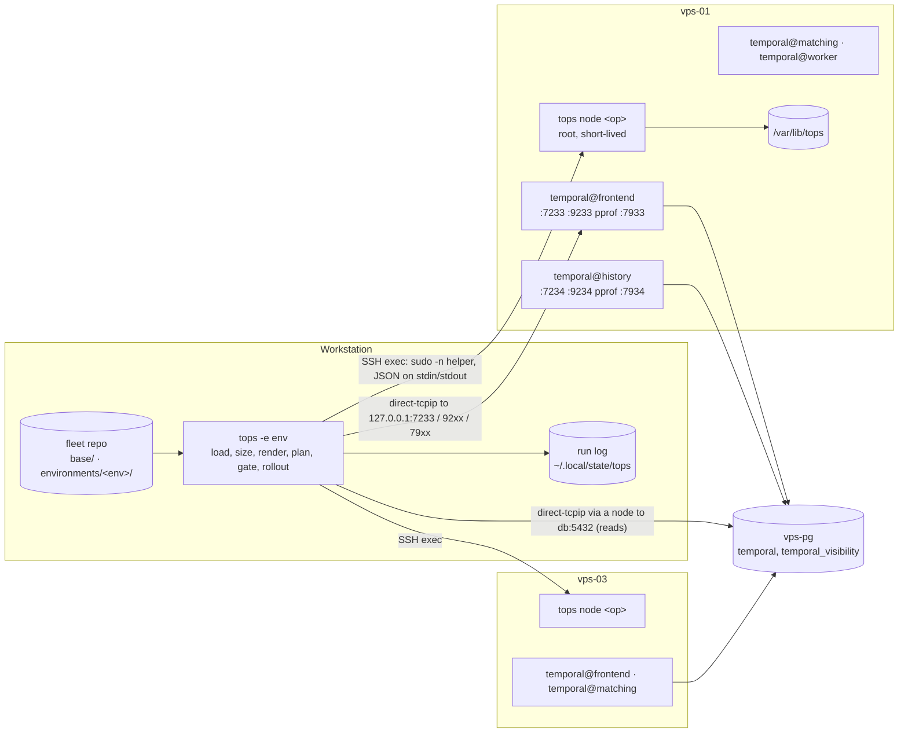

# tops TRD

Project: tops (Temporal Ops), `github.com/2SSK/tops`. Status: draft. Date: 2026-10-23.
Sibling docs: [PRD](prd.md) · [App flow](app-flow.md) · [Design brief](design-brief.md) ·
[Backend schema](backend-schema.md) · [Implementation plan](implementation-plan.md) · [Concepts](concepts.md) ·
[Roadmap](roadmap.md)

How tops is built. The PRD says what and why; when they disagree, the PRD wins. Exact shapes are in the
backend schema; this file gives the rules and algorithms. "Verified" = checked against the Temporal v1.31.3
source (`github.com/temporalio/temporal`, tag `v1.31.3`), its release assets, or the named module version.
"Verify in Tn" = an assumption the named task checks on the lab before relying on it.

## Constraints

| Constraint                                                                | Source        |
| ------------------------------------------------------------------------- | ------------- |
| One Go binary: workstation CLI and node helper                            | PRD D1        |
| Nodes: Ubuntu 24.04, amd64 or arm64, SSH, passwordless sudo, systemd, cgroup v2 | PRD non-goals, D9 |
| Workstation: Linux or macOS                                               | PRD non-goals |
| Port 22 only from the workstation; everything else through SSH forwarding | PRD D4        |
| No state file, no daemon, nothing running between invocations            | PRD D1, D2    |
| Two Temporal minors per release: 1.30 and 1.31                            | PRD D13       |
| Go 1.26 (`go.mod`: `go 1.26.0`, `toolchain go1.26.8`); `CGO_ENABLED=0` for every build | tops `go.mod`; H2 |
| No compatibility layers                                                    | AGENTS.md     |
| The only lab is VPSLAB (`./lab`, 10.80.0.0/24), shared with temporalScale's `lab` one cluster at a time | PRD D22 |

## Architecture



| Component        | Runs where             | Does                                                                                         |
| ---------------- | ---------------------- | -------------------------------------------------------------------------------------------- |
| CLI              | Workstation            | Finds the fleet root, loads one environment, sizes, renders per role, decides, orchestrates  |
| SSH layer        | Workstation            | One `x/crypto/ssh` client per node per run: exec sessions for the helper, tunnels for TCP    |
| Node helper      | Node, root via sudo    | `tops node <op>`: one typed operation per invocation. Exits when done                       |
| Temporal client  | Workstation            | gRPC over tunnels to frontends: health, admin, operator, workflow services                   |
| Metrics reader   | Workstation            | HTTP over tunnels to each role's metrics port and `:9100`; parsed with `expfmt`              |
| Datastore reader | Workstation            | Read-only queries over a tunnel opened from a node                                           |

Rules: decisions are made on the workstation; the helper executes and reports facts. Datastore writes run
the target release's tool on one node; reads run on the workstation through a tunnel. No shell output is
parsed; the only shell string the workstation sends is the fixed helper upload command.

## Package layout

```
cmd/tops/                 wiring: root command, signals, error -> exit code                  (done)
internal/term/            output, symbols, colour, JSON, UserError, exit codes                (done)
internal/cli/             cobra commands, flags, confirmation                                 (validate done)
internal/spec/            cluster.yaml types, Parse, Defaults, Validate                       (P0 realigns)
internal/fleet/           fleet root, environments, secrets; diff, promote, init              (P0.6)
internal/catalog/         embedded settings catalog per minor, search, hot/restart class      (T1.6)
internal/settings/        per-role dynamic config: base + overrides merge, checks              (T1.8)
internal/wire/            helper request/response types                                       (T2.2)
internal/helper/          node-side ops behind `tops node <op>`                               (T2.2)
internal/remote/          SSH, known_hosts, helper upload, tunnels                            (T2.3)
internal/sizing/          detected size + roles + pins -> per-role limits and pools; refusals (T2.4)
internal/datastore/       postgres reads (T2.4); cassandra, elasticsearch (T10)
internal/render/          embedded templates, per-node per-role file set                      (T2.5)
internal/plan/            desired vs live, change classes per role, drift, order              (T2.6)
internal/release/         release URLs, checksums, supported minors                          (T3.1)
internal/cluster/         Temporal APIs over tunnels                                          (T3.6)
internal/gate/            per-role before/after conditions                                    (T3.7)
internal/rollout/         bootstrap, apply, restart, rollback, node add/remove, upgrade       (T3.8)
internal/runlog/          slog JSON run log                                                   (T3.8)
internal/safety/          every refusal rule as a pure function                               (T4.1)
internal/journal/         journal entries -> readable lines, merge                            (T5.2)
internal/metrics/         scrape, parse, deltas, quantiles                                    (T5.3)
internal/audit/           layer verdicts                                                      (T5.3)
internal/investigate/     UI URL parsing, workflow report                                     (T5.5)
tools/cataloggen/         own go.mod: Temporal source -> catalog JSON; never linked into tops (T1.6)
test/helper/              Ubuntu 24.04 + systemd + sshd image for helper tests                (T2.3)
test/e2e/                 e2e suite (build tag e2e), fleet fixture, VPSLAB overrides          (T2.6)
```

Packages are created by the task that first needs them; nothing is stubbed ahead.

Dependency direction: `cli -> rollout -> {plan, safety, gate, render, sizing} -> {settings, catalog, spec}`;
`cli -> fleet -> spec`; `rollout -> remote, cluster, datastore`. `helper` imports only `wire` and stdlib or
listed libraries. `spec`, `fleet` (except file reads and writes), `settings`, `catalog`, `sizing`, `render`,
`plan`, `safety`, `audit`, `journal`, `investigate` do no network I/O: values in, values out.

Interfaces are defined where consumed (`rollout`), small, with fakes in its tests:

```go
type Nodes interface {
	Call(ctx context.Context, node string, op wire.Op, args, result any) error
}

type Cluster interface {
	Describe(ctx context.Context, frontendNode string) (cluster.View, error) // rings, shards, identity
	Shards(ctx context.Context, frontendNode, historyAddr string) (int, error)
	Serving(ctx context.Context, frontendNode string) (bool, error)
}
```

Every function that does I/O takes `context.Context` first; every error crossing a package boundary is
wrapped with `fmt.Errorf("…: %w", err)`; user-facing failures are `*term.UserError`.

## Library choices

| Need                      | Choice                                                         | Why / rejected                                                                         |
| ------------------------- | -------------------------------------------------------------- | -------------------------------------------------------------------------------------- |
| Commands, completion      | `github.com/spf13/cobra` (in use)                              | Subcommands, groups, completion, `ValidArgsFunction`                                   |
| Terminal output           | `charmbracelet/lipgloss`, `muesli/termenv`, `x/term` (in use)  | Width-aware tables with ANSI; `NO_COLOR`                                               |
| YAML                      | `go.yaml.in/yaml/v3` (in use)                                  | `KnownFields(true)`; `yaml.Node` for line numbers and for comment-keeping writes (`promote`, `upgrade`) |
| SSH                       | `golang.org/x/crypto/ssh`, `ssh/knownhosts`, `ssh/agent`       | In-process sessions and `DialContext` tunnels; no `ssh_config` parsing                 |
| Temporal public API       | `go.temporal.io/api` gRPC clients                              | Namespaces, describe, history, task queues                                             |
| Temporal admin API        | `go.temporal.io/server/api/adminservice/v1`, `go.temporal.io/server/api/persistence/v1` | `DescribeCluster`, `DescribeHistoryHost`; `ClusterMetadata` for the identity check. One server version in `go.mod` (the newest supported minor); these messages are stable across 1.30-1.31 (verify in T3.6) |
| gRPC                      | `google.golang.org/grpc` + `WithContextDialer` -> `ssh.Client.DialContext` | Tunnels without local listeners; health via `grpc_health_v1`                 |
| Metrics                   | `prometheus/common/expfmt`                                      | Reference parser                                                                       |
| Catalog generator         | `golang.org/x/tools/go/packages`, `go/types`, `go/constant` (in `tools/cataloggen`'s own module) | Defaults and descriptions exist only in source; role attribution needs type-checked references |
| PostgreSQL reads          | `jackc/pgx/v5` with `DialFunc` over SSH                        | Standard driver                                                                        |
| Diffs                     | `aymanbagabas/go-udiff`                                         | Maintained port of the gopls diff                                                      |
| Parallelism               | `golang.org/x/sync/errgroup` with `SetLimit`                    | Bounded fan-out with cancellation                                                      |
| systemd on nodes          | `github.com/coreos/go-systemd/v22/dbus`                         | Typed unit properties and jobs; template instances by name                              |
| Journal                   | `journalctl -o json` exec'd by the helper                       | No cgo; stable JSON export format                                                      |
| Firewall                  | `iptables-restore` + `coreos/go-iptables` for reads             | Atomic chain replace                                                                   |
| Logging                   | `log/slog` (stdlib)                                             | Structured run log; `LogValuer` masks secrets                                          |
| Tests                     | stdlib `testing`, `stretchr/testify`, golden files with `-update` | Table-driven                                                                         |
| Release                   | GoReleaser, `actions/attest-build-provenance`, syft             | PRD D11                                                                                |
| v2 only                   | `apache/cassandra-gocql-driver/v2`, `net/http` for ES           | Added in T10                                                                           |

## Build and version

| Item         | Rule                                                                                                   |
| ------------ | ------------------------------------------------------------------------------------------------------ |
| Version      | `internal/cli.version` is a `var` (not a `const`) set by `-ldflags "-X github.com/2SSK/tops/internal/cli.version=$(git describe --tags --always --dirty)"`; default `dev` |
| Commit, Go   | From `runtime/debug.ReadBuildInfo()` (`vcs.revision`, `vcs.modified`, `GoVersion`)                      |
| Build        | `CGO_ENABLED=0 go build -trimpath -ldflags "-s -w -X …"`; the Makefile and GoReleaser use the same flags. A cgo build links glibc and fails on Ubuntu 24.04 when built on a newer distro |
| Helper path  | `/usr/local/lib/tops/<sha16>/tops`, `<sha16>` = first 16 hex of the linux binary's sha256. Content-addressed: dev builds never collide, nothing to compare |

## Fleet root and environments

### Finding the root and the environment

| Step | Rule                                                                                                                  |
| ---- | --------------------------------------------------------------------------------------------------------------------- |
| 1    | Root = `$TOPS_ROOT` if set; else the nearest directory, from the working directory upwards, that contains `environments/`. None: `spec.no_root` (exit 4) |
| 2    | `-e <env>` names `environments/<env>/`; `<env>` matches `^[a-z][a-z0-9-]{0,30}$`. Missing: `spec.no_env` (exit 4) listing the environments found |
| 3    | Commands that read a cluster require `-e`; without it, `usage.invalid` listing the environments. There is no default and no environment variable for it (a forgotten export must never select production) |
| 4    | Commands that take no environment (`init`, `diff`, `promote`, `completion`) refuse `-e` with `usage.invalid`; `knobs` and `version` take it optionally |
| 5    | `-f` does not exist. Tests use fleet fixtures under `testdata/`; the e2e harness builds a temporary fleet root and sets `TOPS_ROOT` |

`Options` carries `Getenv` and `Getwd` functions so tests never touch the process environment.

### Loading one environment

1. `environments/<env>/cluster.yaml`: decoded into `spec.Cluster` with `KnownFields(true)`, and once more into a
   `yaml.Node` to map every problem path to its line. Defaults applied in `spec.Defaults`. `spec.Validate`
   returns every problem, not the first.
2. Paths in the spec (`ssh.key`, `ssh.knownHosts`) expand a leading `~` and resolve relative to the
   environment directory.
3. `environments/<env>/secrets.env`: regular file, mode 0600, owned by the current user, else `secrets.mode`.
   Format `KEY=VALUE`, `#` comments, no quoting, no `export`, no `$` expansion. A small hand parser on purpose:
   dotenv libraries expand `$`, which silently changes passwords. Read by `validate` (checks only) and by
   commands that connect; never by `knobs`, `diff`, `promote`.
4. `base/common.yaml`, `base/<role>.yaml` and `environments/<env>/overrides.yaml` (all optional): merged per
   role (below), checked against the catalog of the spec's Temporal minor.

### Spec validation rules

Field reference with defaults is in [backend-schema.md](backend-schema.md#cluster-spec-environmentsenvclusteryaml).
Cross-field rules:

| Rule                                                                                         | Since |
| -------------------------------------------------------------------------------------------- | ----- |
| Node names and addresses unique; addresses IPv4                                              | done  |
| `access.*` entries are IPv4 addresses or CIDRs, unique per list (all four lists)             | P0.3  |
| Every node lists 1+ roles from the role set; no duplicates                                   | P0.5  |
| Each of `frontend`, `history`, `matching`, `worker` runs on at least one node               | P0.5  |
| `pin.<role>` only for a role the node lists, never `ui`; `memoryMax` at least the role's floor (embedded constants) | T2.4 |
| `ui.version` required iff a node lists `ui`; `ui.temporalAddress` required iff a `ui` node runs no `frontend` | T6.2 |
| Every key in `base/` and `overrides.yaml` exists in the catalog of `temporal.version`'s minor and decodes as its type | T1.8 |
| `temporal@.service` `TimeoutStopSec` (90 s) exceeds the merged `*.shutdownDrainDuration` plus `frontend.shutdownFailHealthCheckDuration` | T1.8 |

`Problem` = `{path, line, message}`. `path` uses `nodes[2].roles[1]` syntax; `line` comes from the
`yaml.Node` walk (0 only for a missing required key, which reports the line of its parent).

### Dynamic-config merge order

For role `r` (the same result on every node that runs `r` in this environment), later wins, at whole-key
level (a key's constraint list is replaced, never merged):

| Order | Source                                   | Contributes                                                    |
| ----- | ---------------------------------------- | -------------------------------------------------------------- |
| 0     | Temporal's default                       | Not written                                                    |
| 1     | `base/common.yaml`                       | Keys the catalog says `r` reads                                |
| 2     | `base/<r>.yaml`                          | Keys of this role; a key `r` does not read is an error         |
| 3     | `environments/<env>/overrides.yaml`      | Keys the catalog says `r` reads                                |

Keys compare case-insensitively (Temporal does); the spelling in the rendered file is the catalog's.

| Check                                                      | Result                          |
| ---------------------------------------------------------- | ------------------------------- |
| Key unknown to the catalog of the spec's minor             | `validate` error, with the closest known keys (edit distance) |
| Value does not decode as the catalog type                  | `validate` error                |
| Constraint name not allowed by the key's precedence        | `validate` error                |
| Key read by no role on any node of the environment         | warning                         |
| Key in both `common.yaml` and `<r>.yaml`                   | warning (the role file wins)    |
| Rendered file rejected by `temporal-server validate-dynamic-config` on the node | `refused.render_rejected` (exit 3), nothing written |

The rendered `/etc/temporal/dynamicconfig-<r>.yaml` contains only what `r` reads, so a file diff is the
effect. `tops knobs <key> -e <env>` prints the value at each layer and the effective one.

### Diff and promote

`tops diff <a> <b>` loads both environments offline and compares resolved values (defaults applied, settings
merged per role):

| Group        | Fields                                                                                  | Shown        |
| ------------ | --------------------------------------------------------------------------------------- | ------------ |
| Promotable   | `temporal.version`, `temporal.cli`, `temporal.logLevel`, `ui.version`, `namespaces`, every overrides key | Always; exit 2 if any differs |
| By design    | `cluster`, `shards`, persistence, `ssh`, `access`, `nodes` (shown as a shape: node count, roles per node), pins | With `-v`; never affects the exit code |

`tops promote <from> <to> [--only versions|namespaces|settings] [--partial] [-y]` writes the promotable
values of `<from>` into `<to>`'s `cluster.yaml` and `overrides.yaml` through `yaml.Node` (comments and order
kept), after showing the diff and asking. Rules: identity fields are never written; `temporal.version` is
shown and never written, with the `tops -e <to> upgrade <v>` to run instead (D5); a key present in `<from>`'s
overrides and absent in `<to>`'s is added, absent in `<from>` and present in `<to>` is removed; a key unknown
to `<to>`'s minor refuses the promotion unless `--partial`. After writing, `<to>` is re-validated; on failure
the original files are restored and the command exits 4. No node is contacted. The operator reviews
`git diff`, commits, then runs `tops -e <to> plan`.

### `init`

`tops init <env>` creates `environments/<env>/cluster.yaml` (embedded, commented template with every field),
an empty `overrides.yaml`, a 0600 `secrets.env` with the required keys commented, and any missing
`base/{common,frontend,history,matching,worker}.yaml` (empty maps). It refuses an existing
`environments/<env>/` (`spec.env_exists`, exit 4) and never overwrites a file. Outside a fleet root it
refuses `spec.no_root`; a new fleet repo starts with `mkdir environments`.

## Settings catalog

### What Temporal's source gives (verified, v1.31.3)

| Fact                                                                                        | Consequence                                                   |
| ------------------------------------------------------------------------------------------- | ------------------------------------------------------------- |
| Every setting is an exported package variable in `common/dynamicconfig/constants.go`, built by a generated constructor `New<Precedence><Type>Setting(key, default, description)` or `...WithConstrainedDefault`; 567 in v1.31.3 (346 global, 166 namespace, 41 task queue, 8 shard, 6 destination, 2 namespace-id, 2 task type, 1 CHASM task type) | Key, type, precedence, default expression and description are derivable by parsing the file |
| The registry and the `def`/`description` fields are unexported; settings expose only `Key()`, `Precedence()`, `Validate()`, `Get()`, `Subscribe()` | No runtime enumeration by importing the package: the generator parses source |
| Defaults are Go expressions (`256000*4*1024`, `time.Minute`, `math.MaxInt`, other constants)  | Constant-foldable defaults are evaluated with `go/constant`; others are kept as their source text |
| Which role reads a key is not declared; it follows from where the variable is referenced (`service/frontend`, `service/history`, `service/matching`, `service/worker`, or shared `common/...`) | Derivable from type-checked references, with shared code attributed to every role |
| Hot vs restart is not declared. `Get(c)` returns a property function; whether the consumer calls it per use or once is decided at each call site. Example: `history.hostLevelCacheMaxSizeBytes` is stored as an `IntPropertyFn` but read once in `NewHostLevelCache`, so a change needs a restart although its type looks live | **Not derivable automatically.** Classified by hand |
| 14 descriptions say the setting needs a restart (e.g. `history.cacheTTL`); none states the opposite | A partial hint for `restart`; silence means nothing |
| The file client re-reads the file every `pollInterval` and logs `Updated dynamic config`     | Proves the file was read, not that a consumer applied the value |

### Generator (`tools/cataloggen`)

A `main` package in its own module (own `go.mod` with `golang.org/x/tools`), so neither its dependencies nor
`go.temporal.io/server` enter tops' `go.mod` (D23). `make generate`:

1. For each supported minor, ensure a source checkout at `.cache/temporal/v<version>` (git-ignored):
   `git clone --depth 1 --branch v<version> https://github.com/temporalio/temporal`. The pinned versions live
   in `tools/cataloggen/versions.txt`.
2. Run `go run ./tools/cataloggen -src .cache/temporal/v1.31.3 -out internal/catalog/catalog-1.31.json`;
   `go/packages` loads `./...` of the checkout with `Mode: NeedSyntax|NeedTypes|NeedTypesInfo` (this
   downloads Temporal's dependencies into the module cache once).
3. `git diff --exit-code internal/catalog/` in CI: the output must be byte-stable (sorted keys, no
   timestamps, no absolute paths).

| Field         | Derived from                                                                                     |
| ------------- | ------------------------------------------------------------------------------------------------ |
| `key`         | First constructor argument (string literal)                                                      |
| `type`        | Constructor name (`Bool`, `Int`, `Float`, `String`, `Duration`, `Map`, `Typed`)                  |
| `precedence`  | Constructor name: allowed constraints (`namespace`, `taskQueueName`, `shardId`, …)               |
| `default`     | Second argument: `go/constant` value if constant, else the expression text; constrained defaults as a list |
| `description` | Third argument                                                                                    |
| `roles`       | Packages that reference the variable (`types.Info.Uses`): `service/<role>/...` -> that role; anything else -> `shared`, delivered to every role |
| `candidate`   | Static hint, not a classification: description says restart, or `.Get(x)()` -> `restart`; `Subscribe` -> `hot`; otherwise `unknown` |

### Classification (hand-made, with evidence)

`internal/catalog/class-<minor>.yaml`, one entry per classified key:

```yaml
history.hostLevelCacheMaxSizeBytes:
  apply: restart
  evidence: "read once in service/history/workflow/cache/cache.go NewHostLevelCache"
frontend.namespaceRPS:
  apply: hot
  evidence: "property fn called per request in the frontend rate limiter"
  lab: pending          # replaced by the lab check's date and observation in T4.3
```

| Rule                                                                                       |
| ------------------------------------------------------------------------------------------ |
| A key without an entry is `unknown`, and `plan` treats `unknown` as `restart`                |
| `hot` requires both a call-site citation (the property function is called on use, or `Subscribe`) and a lab check: change the value, observe the effect without a restart |
| `restart` requires a call-site citation (read in a constructor, an fx provider, or `.Get(x)()`) |
| The user classifies every key the fleet repo sets before setting it; the rest stay `unknown` |
| A class for a key not in the catalog is a test failure                                     |
| From T4.3 on, a test fails if any entry still says `lab: pending`                          |
| A new Temporal minor starts from the previous minor's file; T7 re-checks every cited call site |

## Sizing

### Detection (helper `hello`)

| Value           | Rule                                                                                                          |
| --------------- | ------------------------------------------------------------------------------------------------------------- |
| Effective memory | `min(MemTotal, memory.max of PID 1's cgroup and each visible ancestor)`; `max` = no limit                    |
| Effective cores  | `min(CPUs in sched_getaffinity, cpuset.cpus.effective, cpu.max quota / period of PID 1's cgroup and ancestors)`, fractional allowed |
| Source           | Each value reports where it came from (`meminfo`, `cgroup:/sys/fs/cgroup/memory.max`, `affinity`, `cgroup:cpu.max`) |

On a VM, PID 1 is in the root cgroup and the limits are the machine's. In VPSLAB (`cgroup: private`) the
container's limits are visible at the namespace root, so `/proc/meminfo` (the workstation's) is never used
alone.

### Formula

All constants are the author's, measured on VPSLAB. For node `n` running roles `R`:

```
reserve      = osBase + Σ aux_a                      a ∈ {nginx, node_exporter, ui-server} present on n
avail        = M − reserve                            M = effective memory
free         = avail − Σ_{r∈R, unpinned} floor_r − Σ_{r∈R, pinned} pin.memoryMax_r
MemoryMax_r  = floor_r + free × share_r / Σ_{unpinned} share      (or the pin)
MemoryHigh_r = MemoryMax_r × (1 − burst_r)
GOMEMLIMIT_r = MemoryHigh_r × (1 − nonHeap_r)
CPUWeight_r  = round(100 × cpu_r / mean(cpu over the four roles))  (or the pin)
dbPool_r     = clamp(ceil(conn_r × C), 2, maxPool)                  C = effective cores (or the pin)
visPool_r    = clamp(ceil(visConn_r × C), 1, maxPool)
```

Rounding happens once, at the end: limits round down to MiB, pools round up. GOMAXPROCS and GOGC are not set:
Go >= 1.25 derives GOMAXPROCS from the cgroup CPU limit when the main module's `go` directive is >= 1.25
(verify in T2.1 through the `gomaxprocs` gauge of each role), and GOGC stays at its default while GOMEMLIMIT
bounds the heap.

| Refusal                   | When                                                                                                   |
| ------------------------- | ------------------------------------------------------------------------------------------------------ |
| `refused.node_too_small`  | `free < 0`, or a pin leaves a role below its floor                                                      |
| `refused.headroom`        | `h >= 2` history nodes and, with one down, a survivor's predicted history memory `floor_history + perShard × ceil(shards / (h − 1))` exceeds its `GOMEMLIMIT_history`. With `h = 1` there is no survivor: a warning, never a refusal |
| `refused.db_budget`       | `Σ_nodes Σ_roles (dbPool_r + visPool_r) > max_connections − superuser_reserved_connections − reserved_connections − sessions of other users − 2` (tops' own reads), all read from PostgreSQL at plan time |

`tops capacity` prints every input, constant and result per node and role, and the formula line that
produced each number.

### Constants and how they are measured

Reference load: omes scenario `workflow_with_single_noop_activity` at one fixed rate for 15 minutes (rate
chosen in T2.1b and written down before the first run). Every measurement is taken on two VPSLAB node sizes, three runs each, worst value kept.

| Constant          | Measured as                                                                                         |
| ----------------- | --------------------------------------------------------------------------------------------------- |
| `osBase`          | `memory.current` of the node's root cgroup minus Temporal units, idle, no aux services              |
| `aux_a`           | `memory.peak` of nginx, node_exporter, ui-server units under the reference load (T6; zero until then) |
| `floor_r`         | `memory.current` of `temporal@r` alone on a node, idle 10 min after start                           |
| `share_r`         | `memory.peak − floor_r` per role under the reference load on an all-roles node, normalised to sum 1  |
| `burst_r`         | Largest rise of `memory.current` in any 10 s window under load, as a fraction of the role's peak    |
| `nonHeap_r`       | `(memory.current − memory_heapinuse) / memory.current` at load                                      |
| `cpu_r`           | `cpu.stat usage_usec` delta per role under the reference load                                       |
| `conn_r`, `visConn_r` | Peak `persistence_sql_in_use` per role (default and visibility store) under load, divided by cores, times 1.5 |
| `maxPool`         | Largest pool that still showed in-use growth when the load was doubled                              |
| `perShard`        | Slope of idle history `memory.current` over owned shards: three separate clusters (128, 256, 512 shards; the count is fixed at creation, so each needs a fresh database) |

The raw samples live in `internal/sizing/testdata/measure-<date>.json`; `internal/sizing/constants.go` holds
the constants per minor, and a test recomputes them from the samples with the rules above, so a constant
cannot drift from its evidence. Re-measured for every new supported Temporal minor (T7) and under load in T8.

## Rendering per role

- Templates are `text/template` files embedded in `internal/render`, delimiters `[[ ]]` so Temporal's own
  `{{ env "X" }}` passes through. Values are written literally, so diffs show real numbers. Secrets are the
  exception: config references `{{ env "TOPS_PG_PASSWORD" }}`; the value lives only in
  `/etc/temporal/temporal.env` (0600).
- Input: one `render.NodeInput` per node (cluster, node, its roles with sizing results, peers per role,
  merged dynamic config per role, ports). Templates contain no logic beyond `if`/`range`.
- Output: `render.FileSet` = ordered `{Path, Content, Mode, Owner, Group, Role, Effect}`. Byte-stable.

### Per role on a node

| Item                                   | Value                                                                                      |
| -------------------------------------- | ------------------------------------------------------------------------------------------ |
| Unit                                   | `temporal@<role>.service` from the template `temporal@.service`                            |
| ExecStart                              | `/opt/temporal/current/temporal-server --config-file /etc/temporal/%i.yaml start --service %i` (`--config-file` and repeatable `--service` verified in `cmd/server/main.go`) |
| Server config                          | `/etc/temporal/<role>.yaml`: shared persistence, membership, cluster metadata; this role's pool sizes, metrics address, pprof port, dynamic-config path |
| Environment                            | `/etc/temporal/temporal.env` (secrets, shared) and `/etc/temporal/<role>.env` (`GOMEMLIMIT`)  |
| Limits                                 | `/etc/systemd/system/temporal@<role>.service.d/limits.conf`: `MemoryHigh`, `MemoryMax`, `CPUWeight` |
| Dynamic config                         | `/etc/temporal/dynamicconfig-<role>.yaml`                                                   |

The worker role reaches frontends through `publicClient.hostPort`; on a node without a frontend it is the
first frontend node's `<address>:7233`. Whether 1.31 still requires it or resolves frontends through
membership: verify in T2.5 against `common/config` and the worker service.

### Ports

tops' scheme: the role's Temporal gRPC port decides the last digit of every port it owns.

| Role      | gRPC | Membership | HTTP | Metrics (`0.0.0.0`) | pprof (`127.0.0.1`) |
| --------- | ---- | ---------- | ---- | ------------------- | ------------------- |
| frontend  | 7233 | 6933       | 7243 | 9233                | 7933                |
| history   | 7234 | 6934       | -    | 9234                | 7934                |
| matching  | 7235 | 6935       | -    | 9235                | 7935                |
| worker    | 7239 | 6939       | -    | 9239                | 7939                |
| ui        | -    | -          | 8080 on 127.0.0.1 | -        | -                   |

node_exporter: 9100; nginx: 80. The port table exists once, in `internal/render`; templates and the firewall
read it. The `services:` block lists all four roles in every role's config (Temporal reads only the started
service's block).

### Validation with the target binary

Run by the helper op `validate` before anything on the node changes, for `plan`, `apply`, `upgrade`,
`bootstrap`, `node add`:

| Check            | How                                                                                                   |
| ---------------- | ----------------------------------------------------------------------------------------------------- |
| Server config    | Per role: the rendered `<role>.yaml` as `/run/tops/<run-id>/<role>/production.yaml`; `temporal-server --config /run/tops/<run-id>/<role> --env production render-config` with exactly the rendered environment (`render-config` takes only `--config/--env`, verified). Exit != 0 fails; stdout (which contains the password) is discarded |
| Dynamic config   | `temporal-server validate-dynamic-config <file>` per role file; exit != 0 or a `warning:` line fails  |
| Units            | `systemd-analyze verify` on the template and drop-ins in the run dir                                  |
| Firewall (T6)    | `iptables-restore --test --noflush`, same for IPv6                                                    |
| nginx (T6)       | `nginx -t` after write; previous files restored on failure                                            |

`/run/tops/<run-id>` is removed when the op ends, success or not. On a node with no release staged, `plan`
prints `not validated: 1.31.3 not staged` and does not fail.

## Workstation, SSH and helper

### Connection

| Item       | Rule                                                                                                               |
| ---------- | ------------------------------------------------------------------------------------------------------------------ |
| Dial       | `nodes[].address:ssh.port`. The node is identified by its address in `known_hosts` (VPSLAB writes both `[127.0.0.1]:220x` and `10.80.0.1x` lines; tops uses the second) |
| Auth       | `ssh.key` if set (passphrase prompted on a TTY), else `SSH_AUTH_SOCK`. No password auth                            |
| Host keys  | `knownhosts.New(ssh.knownHosts)`; unknown or changed key refuses with the presented fingerprint and the line to verify. `HostKeyAlgorithms` set from the stored entries for that host. No trust on first use |
| Not read   | `~/.ssh/config`, `ProxyJump`; agent forwarding never requested                                                     |
| Sessions   | One client per node per run; each helper call one `session.Run`; tunnels by `client.DialContext`                    |
| Keepalive  | Every 15 s; 3 misses = unreachable                                                                                 |
| Timeouts   | Dial 5 s; helper op 60 s (stage and schema 10 min; journal follow and `run` unbounded)                             |
| Preflight  | `sudo -n true` succeeds; a tunnel to `127.0.0.1:22` opens (`ssh.forwarding_disabled` otherwise)                     |

### Helper upload and invocation

1. Needed: the linux binary for the node's arch (from `uname -m` in the preflight session, the one other
   fixed command): the workstation's own executable if it is linux of that arch, else the release asset of
   the same version verified against `checksums.txt`, cached in `${XDG_CACHE_HOME:-~/.cache}/tops/<v>/`. A
   `dev` build for another arch refuses (`helper.no_binary`): build it with `make build-linux`.
2. Path `/usr/local/lib/tops/<sha16>/tops`. Run `sudo -n <path> node hello`; on "not found", upload with the
   one fixed shell string, binary on stdin (`<sha16>` is `[0-9a-f]{16}`, so nothing is interpolated):

   ```
   sudo -n sh -c 'set -e; d=/usr/local/lib/tops/<sha16>; mkdir -p -m 0755 "$d"; cat > "$d/tops.tmp"; chmod 0755 "$d/tops.tmp"; mv "$d/tops.tmp" "$d/tops"'
   ```

   then `hello` again; it reports its own sha256, which must match. Keep the newest 3 directories.

```
sudo -n /usr/local/lib/tops/<sha16>/tops node <op> [--stream]
stdin:  one JSON request (kept open for streaming ops; EOF = cancel)
stdout: one JSON response | NDJSON events then one response
stderr: helper slog JSON, copied into the run log with node=<name>
exit:   0 ok · 1 not ok (response says why) · 2 undecodable request or not root
```

The op name is on the command line (sudo logs it); arguments are on stdin, never in argv. The helper is the
exact build of the workstation (same sha), so there is no protocol version. Ops are idempotent. Shapes:
[backend-schema.md](backend-schema.md#node-helper-protocol).

| Op         | Mutates                            | Fenced | Used by                                       | Since |
| ---------- | ---------------------------------- | ------ | --------------------------------------------- | ----- |
| `hello`    | no                                 | no     | every run; sizing detection                   | T2.2  |
| `facts`    | no                                 | no     | plan, status, drift, apply, rollback          | T2.2  |
| `validate` | only `/run/tops/<run-id>`          | no     | plan, apply, upgrade, bootstrap               | T3.2  |
| `stage`    | releases, user, packages           | yes    | bootstrap, apply, upgrade, node add           | T3.1  |
| `schema`   | datastore                          | yes    | bootstrap, upgrade                            | T3.3  |
| `lock`     | `/var/lib/tops/lock`               | -      | every mutating command                        | T3.4  |
| `write`    | files, symlinks, effects           | yes    | bootstrap, apply, upgrade, node add           | T3.5  |
| `restore`  | files from a snapshot              | yes    | rollback                                      | T3.5  |
| `service`  | unit state                         | yes    | every rollout                                 | T3.5  |
| `history`  | append / list                      | append | every mutating command; rollback list         | T3.5  |
| `top`      | no                                 | no     | top                                           | T5.1  |
| `journal`  | no                                 | no     | logs, investigate, gate failure report        | T5.2  |
| `run`      | starts a foreground process        | no     | run (v1.1)                                    | T9.2  |

## Reading Temporal

Through tunnels to the node's loopback; one lazy `grpc.ClientConn` per frontend node per run.

| Fact                       | Source                                                                                             |
| -------------------------- | -------------------------------------------------------------------------------------------------- |
| Frontend SERVING           | `grpc_health_v1.Health/Check{service: "temporal.api.workflowservice.v1.WorkflowService"}` on that node's 7233 |
| Rings                      | `AdminService.DescribeCluster` on every reachable frontend: `membership_info.rings[]` (role, members). Each frontend's view is kept separately; the gate requires agreement |
| Identity                   | Same call: `cluster_name`, `cluster_id`, `history_shard_count`, `persistence_store`, `visibility_store`, `server_version` |
| Shards per history host    | `AdminService.DescribeHistoryHost{host_address: "<ip>:7234"}` -> `len(shard_ids)`                  |
| Unit state, binary         | Helper `facts`: `temporal@<role>` units, `/proc/<MainPID>/exe`                                     |
| Resource use               | Helper `top`: the unit's cgroup v2 files (path from `/proc/<MainPID>/cgroup`); `memory_heap`, `gomaxprocs`, `num_goroutines` from the role's metrics port |
| Audit inputs               | Every role's metrics port and `:9100`, scraped twice `--window` apart, all in parallel             |
| CPU or heap profile        | `GET http://127.0.0.1:79xx/debug/pprof/{profile?seconds=N|heap}` through a tunnel                  |

## Gate per role

Views are read from every running frontend (the admin API lives there). Ring membership is per role:
`frontend` 7233, `history` 7234, `matching` 7235, `worker` 7239.

| Role     | Before touching role R on node X (refuse if any fails)                         | After (poll 2 s; stable twice 5 s apart; timeout 3 min)   |
| -------- | ------------------------------------------------------------------------------ | --------------------------------------------------------- |
| all      | At least one frontend other than X's is SERVING (else `refused.last_frontend`); no unknown member in any ring of any view | -             |
| frontend | Every other frontend in the frontend ring in every view                        | X SERVING; X in the frontend ring in every view           |
| history  | Every other history member in the ring; shard sum = `shards`                    | X in the history ring; X owns > 0 shards; sum = `shards`  |
| matching | Every other matching member in the ring                                         | X in the matching ring in every view                      |
| worker   | Every other worker member in the ring                                           | X in the worker ring in every view                        |
| ui       | -                                                                               | `GET 127.0.0.1:8080` answers 200                          |

A role with a single instance in the cluster has no "other member": restarting it is allowed with a warning
(`! history runs on one node: its shards are unowned while it restarts`); stopping or removing it is refused.
With a single frontend in the cluster, its own restart is allowed with the same kind of warning; the after
gate then polls through it once it is back. On timeout the rollout stops, prints the failed condition, the
last 20 error lines of `temporal@R` on X and `tops -e <env> rollback <apply-id>`. `--force` skips the
before-conditions only.

### Orders

| Operation         | Order                                                                                                    |
| ----------------- | -------------------------------------------------------------------------------------------------------- |
| `bootstrap`       | Stages by role: frontend -> history -> matching -> worker -> ui; within a stage, nodes in spec order, one at a time. Frontends first because every later gate reads through them. Verify in T3.8 that a frontend reports SERVING before any history exists; if not, stage 1 gates on ring membership only |
| `apply`, `restart --all`, `upgrade`, `rollback` | Role-major: history -> matching -> frontend -> worker -> ui; within a role, nodes in spec order. One ring is disturbed at a time; the riskiest role goes first; worker last (a client of the frontends) |
| Role added to a node | Write, enable, start, after-gate, in the order above                                                 |
| Role removed      | Refused if it is the last instance; `disable --now` (Temporal drains), wait until it leaves its ring in every view; then its files are removed |
| `node remove`     | Reverse stage order on that node: ui, worker, matching, history, frontend                                |

## Cluster lock

Per-node lease `/var/lib/tops/lock`, taken on all nodes of the environment before a mutating command plans
(D21).

| Rule        | Detail                                                                                                   |
| ----------- | -------------------------------------------------------------------------------------------------------- |
| Acquire     | Nodes in spec order (a fixed order cannot deadlock); `O_CREAT|O_EXCL` on the lease file; any refusal releases the taken ones and refuses `lock.held` with holder, command, age |
| Lease       | TTL 120 s, renewed every 30 s on every node by a goroutine with its own SSH session; node clocks         |
| Release     | On success, failure, refusal and SIGINT/SIGTERM; only by the holding run id                              |
| Stale       | Lease older than its TTL: warn, print the interrupted apply id, take over                                |
| Fencing     | Every fenced op (table above) runs under `flock(/var/lib/tops/lock.flock, LOCK_EX)` for its whole duration, checks inside it that the lease names the request's run id and is unexpired, else `lock.lost`. Takeover also needs the flock, so a takeover cannot interleave with a write in progress |
| Not locked  | Read-only commands: status, capacity, plan, drift, top, audit, logs, pprof, investigate, ns list, targets, version, rollback list |

Node clocks: VPSLAB containers share the workstation's clock, so the e2e suite cannot show skew. Real nodes
need NTP; `hello` reports `clockSynced` and mutating commands warn when false.

## Snapshots, history, rollback

- `write` and `restore` first copy every path they change (file, symlink, absence) into
  `/var/lib/tops/snapshots/<apply-id>/`, content-addressed, 0700. Newest 10 kept.
- History record per node per run in `/var/lib/tops/history/<apply-id>.json`; newest 100 kept.
- `/var/lib/tops/applied.json`: sha256 of every file as tops last wrote it, the enabled roles and `current`.
  `plan` and `drift` use it to tell hand edits from spec changes.
- Releases: `/opt/temporal/releases/<v>` is kept while `current` or a kept snapshot references it; others
  beyond the newest 3 are removed by `stage`.
- `rollback <id>` restores that snapshot on every node that has it, rolling with the gates. It is a `write`
  with its own snapshot, so it is undoable. It never touches the schema. After it the spec still describes
  the newer state; `plan` shows that as pending.

## Plan and apply

### Plan

`plan` = per node in parallel (errgroup, limit 8): `hello`, `facts`, sizing, render, `validate` ->
`plan.NodePlan`; then cluster reads (rings, identity, namespaces) and the safety rules.

| Change                                         | Class          | Effect                                                                        |
| ---------------------------------------------- | -------------- | ----------------------------------------------------------------------------- |
| `dynamicconfig-<r>.yaml`, every changed key `hot` | hot-reload   | Write; Temporal re-reads within its poll interval (10 s)                       |
| `dynamicconfig-<r>.yaml`, any changed key `restart` or `unknown` | restart r | Write; restart `temporal@r` with the gate                              |
| `<r>.yaml`, `<r>.env`, `limits.conf` of r      | restart r      | Write; `daemon-reload` if a unit file changed; restart with the gate (one restart per role, however many files) |
| `temporal.env`, `temporal@.service`            | restart all roles on the node | As above, per role in role-major order                        |
| Role added / removed                           | start r / stop r | "Orders"                                                                    |
| Firewall (T6)                                  | firewall       | Atomic chain replace; established connections stay                            |
| nginx, journald, ui files (T6)                 | nginx / host / ui-restart | Reload or restart that service                                     |
| `current` symlink                              | version        | Refused in `apply` (`refused.version_change`); `upgrade` only                 |
| Live file hash differs from `applied.json`     | drift          | Shown next to the change; `apply` overwrites it                               |

Exit: 0 nothing to do; 2 changes or drift pending; 3 a refusal. `plan` never locks and writes nothing on a
node except the helper binary and `/run/tops/<run-id>` (removed).

### Apply

```
load + validate -> connect -> lock (all nodes) -> plan (as above, under the lock)
  -> refusals? release, exit 3
  -> nothing to do? release, exit 0
  -> print plan -> confirm (TTY, or -y) -> stage (parallel)
  -> firewall additions (parallel) -> hot and non-Temporal classes (parallel)
  -> restart / start / stop: one role on one node at a time, role-major, each: gate before, write (snapshot),
     daemon-reload if needed, service action, gate after
  -> namespaces -> firewall removals -> history records -> unlock -> summary (+ rollback hint)
```

`apply` never applies an earlier plan; v1.1's `--at` re-plans under the lock at the scheduled time and
compares input hashes with the confirmed plan (`refused.plan_stale`). `--node N` limits writes to node N; the
lock and the gates still cover the whole environment. Re-running after any failure plans only what is left.

## Drift

`tops -e <env> drift` reads `facts` from every node and the rings, without rendering the spec:

| Finding                     | Detected by                                                               |
| --------------------------- | ------------------------------------------------------------------------- |
| Hand-edited file            | Live sha256 differs from `applied.json`                                   |
| Managed file missing        | In `applied.json`, absent on disk                                         |
| Role unit not as tops left it | Enabled role in `applied.json` stopped or disabled (and no `node remove` record), or a `temporal@` instance running that tops never enabled |
| Binary not the applied one  | `/proc/<pid>/exe` of a role differs from `current`                        |
| Unknown ring member         | `DescribeCluster` members not in the spec                                 |

Exit 0 clean, 2 drift, 5 a node unreachable. `plan` shows the same findings inline, marked `drift`.

## Persistence identity

A server pointed at another database with Temporal's schema finds no cluster metadata and initialises a
second, empty cluster with the same name, while `DescribeCluster` still reports the same store kind.

| Spec change                          | Check before anything is written                                                     | Refusal                  |
| ------------------------------------ | ------------------------------------------------------------------------------------ | ------------------------ |
| persistence kind                     | `DescribeCluster.persistence_store`, `visibility_store`                              | `refused.immutable`      |
| `postgres.host`/`port`               | Through the new address, `cluster_metadata_info` holds the live `cluster_name` and `cluster_id` (row `data` decoded as `persistence.ClusterMetadata`) | `refused.store_identity` |
| v2: `cassandra.keyspace`, `elasticsearch.index` | Values in the live `<role>.yaml` (`facts`)                                | `refused.immutable`      |
| v2: `cassandra.datacenter`, `replicationFactor` | Replication map in `system_schema.keyspaces`                              | `refused.immutable`      |
| v2: `cassandra.hosts`, `elasticsearch.url` | Through the new addresses: `cluster_metadata_info` has the live `cluster_id`; the ES index exists | `refused.store_identity` |

## Upgrade

`tops -e <env> upgrade <version>` (T7):

| Step | Does                                                                                                  | Refuses / stops when                                       |
| ---- | ----------------------------------------------------------------------------------------------------- | ---------------------------------------------------------- |
| 1    | Lock; read live versions and schema versions                                                          | > 2 versions live; downgrade; minor skipped; unsupported (`refused.upgrade_path`) |
| 2    | Ask that a datastore backup exists (`-y` also needs `--backup-confirmed`)                              | Not confirmed (`refused.no_backup`)                        |
| 3    | Stage the target everywhere; render with the target catalog and constants; `validate` with the target binary | Download, checksum or validation fails             |
| 4    | Schema from the first node: `temporal-sql-tool update-schema --schema-name postgresql/v12/{temporal,visibility}` (schemas embedded in the tool, verified) | Tool fails (nothing restarted yet) |
| 5    | Rolling, role-major: gate, switch `current` and files, restart, gate                                  | First role not back: stop, print rollback                  |
| 6    | Rewrite `temporal.version` in `cluster.yaml` via `yaml.Node`                                          | -                                                          |

Re-running resumes: completed steps are detected (schema version, `current` per node), not recorded.

## v1.1: scheduled apply and `run`

| Feature           | Design                                                                                                  |
| ----------------- | ------------------------------------------------------------------------------------------------------- |
| `apply --at HH:MM` | The plan is computed without the lock, shown and confirmed now; its inputs (spec hash, base and overrides hash, per-node facts hash) are kept in the process. tops waits on the workstation; at the time it locks, re-plans, compares input hashes, and refuses (`refused.plan_stale`) if any changed, else applies without asking. A time already passed today is refused. No node-side timers (D1); the host running it must stay up |
| `run <role> --node N` | Refused unless `temporal@<role>` is inactive (`refused.role_running`). Streaming helper op runs `temporal-server --config-file /etc/temporal/<role>.yaml start --service <role>` as `temporal` with the role's environment and limits (`systemd-run --scope`), output streamed until Ctrl-C (stdin EOF kills it). Never enables the unit |

## v2: Cassandra and Elasticsearch

| Item                | Design                                                                                                       |
| ------------------- | ------------------------------------------------------------------------------------------------------------ |
| Spec                | `persistence.cassandra` (`hosts`, `port`, `keyspace`, `datacenter`, `replicationFactor`, `user`, `tls`) and `persistence.elasticsearch` (`url`, `version`, `index`, `user`); both together, exclusive with `postgres` |
| Schema              | `temporal-cassandra-tool create-keyspace --rf <rf> --dc <dc>`, `setup-schema -v 0.0`, `update-schema --schema-name cassandra/temporal`; `temporal-elasticsearch-tool setup-schema`, `create-index`, `update-schema`, in that order (an index created before its template gets dynamic mapping). Idempotent (measured 2026-10-05) |
| Rendering           | `datastores.default.cassandra` with per-role `maxConns` from sizing (connections per Cassandra host); `datastores.visibility.elasticsearch` |
| Sizing              | `conn_r` for Cassandra measured like the SQL pools; the DB budget check applies to PostgreSQL only        |
| Health              | Per host `SELECT release_version FROM system.local`; quorum = hosts up >= floor(RF/2)+1; replication from `system_schema.keyspaces`; ES `_cluster/health` and the index |
| Reads over SSH      | The gocql dialer must tunnel every host the driver discovers, not only the contact points                   |
| Identity guard      | "Persistence identity" rows marked v2                                                                       |
| Lab                 | Environment `lab-cass`: VPSLAB vps-01/02 plus `vps-cass-1..3` (10.80.0.51-53) and `vps-es` (10.80.0.61) from `test/e2e/vpslab.v2.override.yaml`; Cassandra nodes start one at a time |

## Errors, exit codes, logging

### Exit codes

| Code | Meaning                                                                         | `UserError.Code` prefix that maps to it |
| ---- | ------------------------------------------------------------------------------- | --------------------------------------- |
| 0    | Success; `plan`, `drift`, `diff`: nothing to report                             | -                                       |
| 1    | Failed while running (SSH, Temporal, helper op, rollout stopped, lost lock)     | anything else, and non-`UserError`      |
| 2    | `plan`: changes pending; `drift`: drift found; `diff`: promotable differences   | `pending.`                              |
| 3    | Refused by a safety rule or the lock; nothing changed                           | `refused.`, exactly `lock.held`         |
| 4    | Invalid input: usage, spec, environment, secrets                                | `usage.`, `spec.`, `secrets.`           |
| 5    | Ran and found the cluster unhealthy, or a node unreachable (read commands)      | `unhealthy.`                            |
| 130  | Interrupted (SIGINT or SIGTERM); lock released                                  | `context.Canceled`                      |

`term.ExitCode` gains the `pending.` and `unhealthy.` prefixes in T1.9 (`diff` is the first command that
exits 2). Exit 2 and 5 are outcomes, not failures: the command prints its normal result (or its one `--json`
document) and returns `&term.Reported{Err: &term.UserError{Code: "pending.changes"}}`, so `main` prints
nothing more.

### Error handling

- Inside packages: wrap with `fmt.Errorf("read %s: %w", path, err)`; compare with `errors.Is/As`, never by
  string. `errorlint` enforces it.
- At the edge (`internal/cli`, helper op handlers): convert to `*term.UserError{Code, What, Why, Fix}`. The
  code catalogue is in [design-brief.md](design-brief.md#errors); every refusal is in the
  [app-flow refusal index](app-flow.md#what-tops-refuses-index).
- Helper errors arrive as `wire.Error{Code, Message, Detail}` and become `UserError` with the node named.

### Run log

tops logs each run with `slog.NewJSONHandler` to `${XDG_STATE_HOME:-~/.local/state}/tops/runs/<run-id>.jsonl`
(newest 100). Every record carries `run_id`, `env`, `cluster`; per-step records add `node`, `role`, `op`,
`duration_ms`, `result`. `--debug` also writes text records to stderr. Secrets are a `secret.Value` type whose
`String()` and `LogValue()` return `***`. Read-only offline commands (`validate`, `knobs`, `diff`) do not
write a run log.

## Security

| Topic          | Decision                                                                                                  |
| -------------- | --------------------------------------------------------------------------------------------------------- |
| Sudo           | Passwordless sudo, helper as root (D9); sudo logs the op name; every mutating run leaves a history record |
| Host identity  | Strict known_hosts; no TOFU                                                                               |
| Shell          | Exactly two fixed strings: `uname -m` and the helper upload; no value from the spec is ever interpolated  |
| Secrets        | `environments/<env>/secrets.env` 0600, untracked; in transit only on helper stdin; on nodes only `temporal.env` (0600) and its snapshots; masked in diffs; hashes only in history; never in argv (schema tools get them through their environment) |
| Binaries       | Workstation fetches `checksums.txt` over TLS; the node verifies the sha256 before extracting              |
| Unit sandbox   | `temporal@.service`: `NoNewPrivileges`, `ProtectSystem=strict`, `ProtectHome`, `PrivateTmp`, `ReadWritePaths=/var/lib/temporal`; `temporal-ui.service`: `DynamicUser=yes` |
| Network        | tops never widens `access.*`; plain gRPC on 7233 stays (mTLS deferred)                                    |
| Supply chain   | `govulncheck` in CI; dependencies pinned in `go.sum`; releases with SBOM and provenance                   |

## Observability of what tops manages

`tops targets` emits file-SD JSON with `job`, `env`, `cluster`, `node`, `role`, one group per role instance;
loopback pprof per role for `tops pprof`; `/health` on :80 of frontend nodes (nginx -> `127.0.0.1:7243`) from
T6.

## Test strategy

| Layer        | Scope                                                                                        | Tooling / location                         | Gate                      |
| ------------ | -------------------------------------------------------------------------------------------- | ------------------------------------------ | ------------------------- |
| Unit         | Pure packages: spec, fleet, settings, catalog, sizing, render, plan, safety, gate (fake cluster), audit math, journal, investigate URL parsing. Table-driven with `t.Run` subtests | `*_test.go` next to the code              | `make test` (race), CI    |
| Golden       | Rendered files per node and role of the fixture fleet; every `--json` document; human output of every command (colour off); the catalog JSON | `testdata/*.golden`, `-update` flag       | Reviewed diffs only       |
| Property     | No secret value appears in any diff, log record, history record or argv                       | `testing/quick` or a seeded loop over fixtures | `make test`         |
| Generator    | `make generate` re-run is byte-stable; known keys have known roles and defaults               | `tools/cataloggen`                         | CI `generate` job         |
| Helper       | Every helper op through the real SSH path against Ubuntu 24.04 + systemd containers: upload, facts on cgroup trees, write/restore atomicity, lock race and fencing, schema against PostgreSQL | `test/helper/`, `go test -tags helper`, `make helper-test` | CI `helper` job (from T2.3) |
| End to end   | The release binary against VPSLAB: every journey of the app flow and every refusal; reset at start; writes `e2e-report.{txt,json}` | `test/e2e/`, `go test -tags e2e`, `make e2e LAB=./lab` | Every release (not CI)   |
| Static       | `golangci-lint` (gofmt, revive, gosec, errorlint, gocyclo 10, sloglint, contextcheck, noctx), `govulncheck` | `.golangci.yml`                     | CI                        |

Coverage: `make cover` fails below 80% overall or 90% for `safety`, `plan`, `sizing` (from T1.10).

e2e rules: the harness checks the lab contract first (`lab contract broken: …`), runs `make lab-reset`, builds
a temporary fleet root from `test/e2e/fleet/` with absolute lab key paths, sets `TOPS_ROOT`, and runs
`free -m` on the workstation, failing if available memory is below the override's total caps. Failure
injection uses `docker stop|kill|start` on VPSLAB containers only.

## CI and release

| Job      | Steps                                                                  | Fails when                  | Since |
| -------- | ---------------------------------------------------------------------- | --------------------------- | ----- |
| lint     | `make lint`                                                            | any finding                 | done  |
| test     | `make test`; `make cover`                                              | test, race, coverage gate   | done; cover T1.10 |
| vuln     | `make vuln`                                                            | reachable vulnerability     | done  |
| build    | linux/amd64, linux/arm64, darwin/arm64, `CGO_ENABLED=0`; 35 MB gate    | build error, size           | done  |
| generate | `make generate` (module cache and `.cache/temporal` cached)            | catalog not reproducible    | T1.6  |
| helper   | `make helper-test`                                                     | a helper test               | T2.3  |
| release  | On tag `v*`: GoReleaser (archives, `checksums.txt`, SBOM via syft, completions), `actions/attest-build-provenance`; draft release | config or build error | T1.10 |

Release steps: `main` green; CHANGELOG section moved from `Unreleased` to the version; signed tag; draft
release built by CI; `make e2e LAB=./lab TOPS=<draft binary>` and the report attached; publish;
`go install …@vX.Y.Z` on a clean machine; temporalScale adopts the release in the change that proves it on its
`lab` environment.

## Non-functional requirements

| Operation                        | Target (3 nodes, helper uploaded) | How                                                    |
| -------------------------------- | --------------------------------- | ------------------------------------------------------ |
| `status`, `capacity`             | < 3 s                             | Parallel per node; one handshake each                  |
| `plan` (no-op), `drift`          | < 10 s                            | `facts` returns content only for differing hashes      |
| `validate`, `knobs`, `diff`      | < 300 ms                          | Offline; catalog embedded                              |
| `bootstrap` on fresh VPSLAB      | < 5 min                           | Parallel staging; serial first starts                  |
| Binary size                      | < 40 MB (CI gate 35 MB)           | `-s -w`; no server packages beyond the admin API types |

Idempotency: `apply` twice with an unchanged spec changes nothing the second time; files are written temp +
`fsync` + rename + directory `fsync`; every mutating op is preceded by a snapshot.

## Open points

| # | Point                                                                                           | Assumption / check                                                           |
| - | ----------------------------------------------------------------------------------------------- | ---------------------------------------------------------------------------- |
| 1 | `cluster` must equal Temporal's `currentClusterName`, fixed at first start                      | `cluster` is the Temporal cluster name                                       |
| 2 | No command clears a lock left by a dead workstation                                             | Leases with TTL, no `unlock`                                                 |
| 3 | Does systemd apply new `MemoryMax`/`CPUWeight` to a running unit on `daemon-reload` alone?      | Not relied on: a limits change also changes `GOMEMLIMIT`, so the role restarts |
| 4 | Does GOMAXPROCS follow the container's `cpu.max` for a process in a child cgroup under VPSLAB?  | Check in T2.1 through the `gomaxprocs` gauge                                 |
| 5 | Does a frontend report SERVING before any history exists?                                       | Check in T3.8; stage 1 gate adapts                                           |
| 6 | Does the worker role need `publicClient.hostPort` in 1.31?                                      | Check in T2.5                                                                |
| 7 | Where do ui-server release binaries live for the pinned UI version (the `temporalio/ui-server` repository or `temporalio/ui` releases)? | Check in T6.2; `internal/release` holds the URL pattern once |
| 8 | Are `DescribeCluster`/`ClusterMetadata` messages of the one server module in `go.mod` wire-compatible with both supported minors? | Check in T3.6 against both binaries; T7 re-checks |
