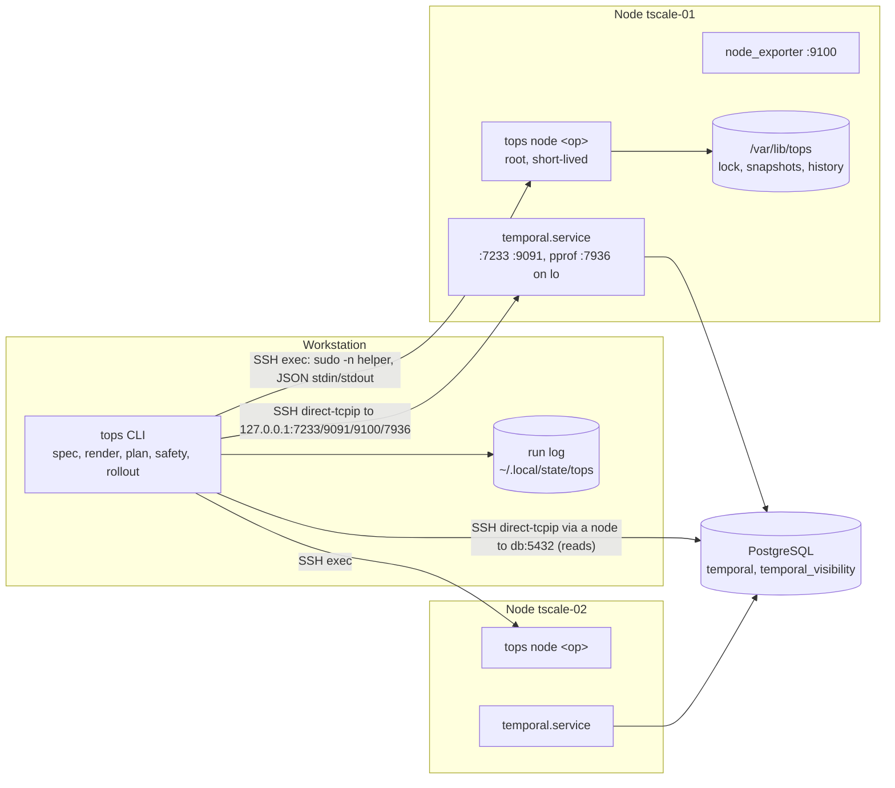

# tops TRD

Project: tops (Temporal Ops), `github.com/2SSK/tops`. Status: draft. Date: 2026-10-10.
Sibling docs: [PRD](prd.md) · [App flow](app-flow.md) · [Design brief](design-brief.md) ·
[Backend schema](backend-schema.md) · [Implementation plan](implementation-plan.md) · [Concepts](concepts.md)

This document says how tops is built. The PRD says what and why; when they disagree, the PRD wins and this
file is fixed. Facts marked "verified" were checked against the Temporal 1.31.3 source
(`go.temporal.io/server@v1.31.3`), its release assets, or the named module version.

## Constraints

| Constraint                                                                 | Source                    |
| -------------------------------------------------------------------------- | ------------------------- |
| One Go binary: the workstation CLI and the node helper                      | PRD D1                    |
| Nodes: Ubuntu 24.04, amd64 or arm64, reachable by SSH, passwordless sudo    | PRD non-goals, D9 (Q12)   |
| Workstation: Linux or macOS                                                 | PRD non-goals             |
| Port 22 only from the workstation; everything else through SSH forwarding   | PRD D4                    |
| No state file, no daemon, nothing running between invocations              | PRD D1, D2                |
| Two Temporal minors per release: 1.31 (current) and 1.30 (previous)         | PRD D13 (Q11)             |
| Go >= 1.26.8 (required by `go.temporal.io/server` v1.31.3, verified)        | go.mod of the server      |
| No compatibility layers; v2 changes the spec in place                       | AGENTS.md, PRD D7         |

## Architecture



| Component       | Runs where              | Does                                                                                          |
| --------------- | ----------------------- | --------------------------------------------------------------------------------------------- |
| CLI             | Workstation             | Loads spec and secrets, renders every node's files in memory, decides, orchestrates, prints   |
| SSH layer       | Workstation             | One `x/crypto/ssh` client per node per run: exec sessions for the helper, tunnels for TCP     |
| Node helper     | Node, as root via sudo  | `tops node <op>`: one typed operation per invocation (files, systemd, cgroups, iptables, journal, releases, schema tools, lock, snapshots). Exits when done |
| Temporal client | Workstation             | gRPC over a tunnel to each node's `127.0.0.1:7233`: health, admin, operator, workflow services |
| Metrics reader  | Workstation             | HTTP over tunnels to `:9091` and `:9100`; parsed with `expfmt`                               |
| Datastore reader| Workstation             | Read-only queries over a tunnel opened from a node to the datastore (v1: PostgreSQL)          |

Rules that follow from D1-D4:

- Decisions are made on the workstation. The helper executes and reports facts; it never decides whether
  a restart is safe.
- Writes to a datastore (create database, schema setup and migration) run the target version's
  `temporal-*-tool` on one node through the helper. Reads (exists? which schema version? holds a cluster?)
  run on the workstation over a tunnel. Both originate from a node, so the datastore's access list
  holds node addresses only.
- No shell output is parsed on the workstation. The only shell the workstation sends is a fixed upload
  command for the helper binary (see "Helper upload").

## Package layout

```
cmd/tops/main.go           wiring: root command, signal handling, error -> exit code
internal/cli/              cobra commands (one file per command), flags, confirmation, output mode
internal/spec/             cluster.yaml and secrets.env: types, load, defaults, offline Validate, version write-back
internal/profile/          embedded size profiles (profiles/*.yaml), host fit and shard headroom math
internal/topology/         node -> services it runs; expected ring members per service (the T6 seam)
internal/render/           embedded templates (templates/*.tmpl), per-node file set, golden tests
internal/plan/             desired vs live per node: file changes, drift, firewall delta, effect class, order
internal/safety/           every refusal rule as a pure function over spec + observed facts
internal/rollout/          apply, restart, upgrade, rollback, node add/remove, bootstrap: stage in parallel, change serially, gate
internal/gate/             wait for SERVING, ring membership and shard ownership after a change
internal/remote/           SSH clients, known_hosts, agent, helper upload, helper exec, tunnels
internal/wire/             helper request/response types; shared by remote (client) and helper (server)
internal/helper/           node-side operations behind `tops node <op>`
internal/cluster/          Temporal API over tunnels: health, DescribeCluster, DescribeHistoryHost, namespaces, workflows
internal/metrics/          scrape, parse, two-sample deltas, histogram quantiles
internal/audit/            layer verdicts and thresholds (port of tadm audit.sh)
internal/journal/          journal entries -> readable lines, merge by time, summary
internal/investigate/      UI URL parsing, workflow report
internal/roleprof/         CPU profile -> share per role
internal/datastore/        postgres (v1); cassandra and elasticsearch added in T6
internal/release/          release URLs, checksums.txt fetch, supported minors table
internal/term/             tables, colours, progress, prompts, JSON writer, error rendering
internal/runlog/           slog JSON run log in the user's state dir
internal/buildinfo/        version, commit, helper checksum
test/helper/               Dockerfile (Ubuntu 24.04 + systemd + sshd) for helper tests
test/e2e/                  e2e suite against the temporal-node-scale lab (build tag e2e)
```

Dependency direction: `cli -> rollout -> {plan, safety, gate, render} -> {spec, profile, topology}`;
`rollout -> remote, cluster, datastore`. `helper` imports only `wire`, `buildinfo` and standard or listed
libraries. `safety`, `plan`, `render`, `audit`, `journal`, `investigate`, `roleprof` do no I/O: they take
values and return values, which is what makes the 90% coverage target on safety and diff reachable.

Small interfaces where consumed (`rollout` defines them, fakes live in its tests):

```go
// internal/rollout
type Nodes interface {
	Facts(ctx context.Context, node string, req wire.FactsArgs) (wire.Facts, error)
	Write(ctx context.Context, node string, req wire.WriteArgs) (wire.WriteResult, error)
	Service(ctx context.Context, node string, req wire.ServiceArgs) (wire.UnitState, error)
	Lock(ctx context.Context, node string, req wire.LockArgs) (wire.LockResult, error)
}

type Cluster interface {
	Describe(ctx context.Context, via string) (cluster.View, error) // rings, shard count, stores, identity
	Shards(ctx context.Context, via string, historyHost string) (int, error)
	Serving(ctx context.Context, node string) (bool, error)
}
```

## Library choices

| Need                     | Choice                                                                 | Why / rejected                                                                                                                   |
| ------------------------ | ---------------------------------------------------------------------- | -------------------------------------------------------------------------------------------------------------------------------- |
| Commands, flags, help, completion | `github.com/spf13/cobra` v1.10 (+ `pflag`)                    | De-facto Go CLI framework; built-in bash/zsh/fish completion and `ValidArgsFunction` for node names. stdlib `flag` has no subcommands or completion; urfave/cli adds nothing over cobra here |
| SSH                      | `golang.org/x/crypto/ssh`, `.../ssh/agent`, `.../ssh/knownhosts`       | In-process: typed exit status, stdin/stdout per session, `Client.DialContext` for tunnels (verified in v0.58), one handshake per node per run. Shelling out to `ssh` would mean parsing output, `ControlMaster` sockets for speed, and per-platform differences in `ssh_config` |
| Temporal public API      | `go.temporal.io/api` (workflowservice, operatorservice) gRPC clients   | Namespaces, describe, history, task queues, counts. No SDK: tops starts no workflows and needs no worker machinery              |
| Temporal admin API       | `go.temporal.io/server/api/adminservice/v1`                            | `DescribeCluster` returns `membership_info.rings` (role, member_count, members), `history_shard_count`, `persistence_store`, `visibility_store`, `cluster_name`, `cluster_id`; `DescribeHistoryHost{host_address}` returns `shard_ids` (verified). This replaces `tdbg membership list-gossip | grep` and the `numshards_gauge` scrape in the scripts. The frontend serves it on 7233 (verified, `service/frontend/service.go`) |
| gRPC                     | `google.golang.org/grpc` with `grpc.WithContextDialer` -> `ssh.Client.DialContext` | Tunnelled connections without local listening ports; health via `grpc_health_v1` on service `temporal.api.workflowservice.v1.WorkflowService` (what the frontend sets SERVING on, verified) |
| Metrics parsing          | `github.com/prometheus/common/expfmt` (`NewTextParser(model.UTF8Validation)`, v0.72) | The reference parser. The zero-value `TextParser` is not usable in current versions (verified) |
| YAML                     | `go.yaml.in/yaml/v3` (v3.0.5)                                          | Maintained successor of `gopkg.in/yaml.v3`. `Decoder.KnownFields(true)` rejects unknown keys with line numbers; `yaml.Node` lets `upgrade` rewrite `temporal.version` while keeping comments |
| Spec validation          | Hand-written `Validate()` on typed structs, errors as `path: message`  | The rules are domain rules (immutables, headroom, address uniqueness, profile names) that JSON Schema cannot express. No validator tag library: one more DSL for ~40 rules |
| PostgreSQL reads         | `github.com/jackc/pgx/v5` with `pgconn.Config.DialFunc` over SSH      | Standard driver; dial hook makes the tunnel transparent. No `psql` on nodes                                                     |
| Unified diffs            | `github.com/aymanbagabas/go-udiff`                                     | Maintained port of the gopls diff. `pmezard/go-difflib` is unmaintained; `hexops/gotextdiff` is archived                         |
| Terminal output          | `github.com/charmbracelet/lipgloss` v1 (styles, `table`), `golang.org/x/term` | Width-aware tables with ANSI colour; `text/tabwriter` miscounts escape codes. lipgloss honours `NO_COLOR` and dumb terminals via its colour profile |
| Parallelism              | `golang.org/x/sync/errgroup` with `SetLimit`                           | Standard bounded fan-out with context cancellation                                                                              |
| systemd on nodes         | `github.com/coreos/go-systemd/v22/dbus`                                | Typed unit properties (ActiveState, MainPID, NRestarts, ExecMainStartTimestamp) and start/stop/restart/reload jobs with completion results; no `systemctl show` parsing |
| Journal                  | `journalctl -o json` exec'd by the helper, one JSON object per line    | `sdjournal` needs cgo and libsystemd; the export JSON is a stable format. The helper parses JSON, never text                     |
| Firewall                 | `iptables-restore`/`ip6tables-restore` (atomic chain load, as today) + `github.com/coreos/go-iptables` for `List`/`Exists` | Keeps the boot unit and the atomic replace of the scripts; go-iptables reads the live chain without hand-built argv |
| Clock sync               | `golang.org/x/sys/unix.Adjtimex` (`STA_UNSYNC`)                         | Same signal node_exporter's `node_timex_sync_status` uses; no D-Bus call to timedated                                           |
| CPU profiles             | `github.com/google/pprof/profile`                                      | Parses the server's `/debug/pprof/profile` output                                                                                |
| Tests                    | stdlib `testing`, `github.com/stretchr/testify` (assert/require), golden files with an `-update` flag | Table-driven tests as in the user's standards; no golden-file library needed                                |
| Release                  | GoReleaser, `actions/attest-build-provenance`, syft SBOM               | PRD D11                                                                                                                          |
| T6 only                  | `github.com/apache/cassandra-gocql-driver/v2` (Cassandra reads), `net/http` (ES `_cluster/health`) | Added when T6 needs them, not before                                                         |

Measured: a probe binary linking cobra, x/crypto/ssh, grpc, the public API, the admin service and expfmt
is 18.6 MB (`CGO_ENABLED=0 -trimpath -ldflags='-s -w'`, linux/amd64, 2026-10-10). The PRD limit is 40 MB;
CI fails the build above 35 MB.

## Spec, secrets and rendering

### Loading

1. `-f cluster.yaml` (default `./cluster.yaml`) is decoded into `spec.Cluster` with `KnownFields(true)`.
   Paths in the spec (`secrets`, `dynamicConfig`, `ssh.key`, `ssh.knownHosts`) resolve relative to the
   spec file's directory.
2. Defaults are applied in one function (`spec.Defaults`), never scattered.
3. `spec.Validate` returns every error, not the first: `nodes[1].address: 10.78.0.11 is also nodes[0]`.
4. `secrets.env` is read only after its mode is checked (0600, owned by the current user; refuse otherwise).
   Format: `KEY=VALUE`, `#` comments, no quoting and no `$` expansion. It is parsed by 15 lines in
   `internal/spec` on purpose: dotenv libraries expand `$VAR`, which would silently change passwords.
5. The dynamic config file is read and merged with the profile's `dynamicConfig` block; a key set in both
   is an error (kept from `reload-temporal.sh`).

Schema and every field: [backend-schema.md](backend-schema.md#cluster-spec-clusteryaml).

### Templates

- All node files are `text/template` files embedded with `//go:embed templates/*.tmpl` in `internal/render`.
  Templates are versioned with tops (PRD D3); the cluster repo cannot override them.
- tops templates use the delimiters `[[` and `]]`. Temporal's own config template syntax (`{{ env "X" }}`,
  sprig, enabled by `# enable-template` in the first 1 KB, verified in `common/config/loader.go`) passes
  through untouched.
- Values fixed at cluster creation that are not spec fields (`clusterMetadata.failoverVersionIncrement`,
  `initialFailoverVersion`, `enableGlobalNamespace`, the `[[ .Cluster ]]` cluster name) are template constants.
  Temporal stores them in `cluster_metadata_info` at first start; a golden test pins them so no tops release
  changes them.
- Values are written into `temporal.yaml` literally (addresses, shard count, pool sizes, broadcast address),
  so `plan` diffs show real values. Secrets are the exception: `temporal.yaml` references
  `{{ env "TOPS_PG_PASSWORD" }}` and the value lives only in `/etc/temporal/temporal.env` (0600). Temporal
  renders it at start. `temporal.yaml` therefore holds no secret and can be shown in full.
- Input to every template is one typed struct per node (`render.NodeInput`): spec, profile, node, peers,
  derived values. Templates do no lookups and contain no logic beyond `if`/`range`.
- Output: `render.FileSet` = ordered list of `{Path, Content, Mode, Owner, Group, Effect}`. `Effect` is
  the class the plan uses: `restart`, `hot-reload`, `firewall`, `nginx`, `ui-restart`, `host` (journald,
  rsyslog, packages), `version`, `none` (table under "Plan and apply").

Managed files and their effects: [backend-schema.md](backend-schema.md#files-tops-installs-on-a-node).

### Validation with the target binary

Kept from `reload-temporal.sh`, run before anything on the node changes, on every node, for every
`plan`, `apply`, `upgrade`, `bootstrap` and `node add`:

| Check                        | How (helper op `validate`)                                                                                                    | Fails when                                     |
| ---------------------------- | ----------------------------------------------------------------------------------------------------------------------------- | ---------------------------------------------- |
| Server config                | Write the rendered `temporal.yaml` as `production.yaml` in `/run/tops/<run-id>/render/`; run `<release>/temporal-server --config /run/tops/<run-id>/render --env production render-config` with an environment of exactly the rendered `temporal.env` plus `PATH` | Exit status != 0 (the command exits 1 with "Unable to load configuration", verified). Stdout is discarded: it prints the rendered config, password included |
| Dynamic config               | `<release>/temporal-server validate-dynamic-config <file>`                                                                      | Exit status != 0, or any `warning:` line (unknown key or wrong type; kept from the script) |
| Duplicate dynamic-config key | Workstation, before upload                                                                                                    | A key in both the cluster file and the profile |
| Firewall rules               | `iptables-restore --test --noflush` and `ip6tables-restore --test --noflush` on the rendered files                            | Exit status != 0                               |
| nginx                        | On `write`: `nginx -t` after writing; restore the previous files and fail if it rejects them (kept from `setup-nginx.sh`)    | Exit status != 0                               |
| systemd units                | `systemd-analyze verify` on the rendered unit files in the run dir                                                            | Exit status != 0                               |

`<release>` is `/opt/temporal/releases/<v>` of the target version. Version changes go through `upgrade`
only, so in `plan` and `apply` the target is the release already running. `plan` stages nothing: on a node
with no release yet (before `bootstrap` or `node add`), it prints `not validated: 1.31.3 not staged`, and
those commands stage before they validate.

## Workstation <-> SSH <-> helper protocol

### Connection

| Item              | Rule                                                                                                                          |
| ----------------- | ----------------------------------------------------------------------------------------------------------------------------- |
| Auth              | `ssh.key` if set (passphrase prompted on a TTY if encrypted), else `SSH_AUTH_SOCK` agent. No password auth                    |
| Host keys         | `knownhosts.New(ssh.knownHosts)`; unknown or changed key = refuse, printing the presented fingerprint and the `ssh-keyscan` line to verify. No trust-on-first-use. `HostKeyAlgorithms` is set from the known_hosts entries for that host, so a server that offers ECDSA first still verifies against a stored ed25519 key |
| Not read          | `~/.ssh/config`, `ProxyJump`, agent forwarding (never requested)                                                              |
| Sessions          | One client per node per run; each helper call is one `session.Run`; tunnels are `client.DialContext("tcp", "127.0.0.1:<port>")` |
| Keepalive         | `keepalive@openssh.com` every 15 s; 3 misses = node unreachable                                                              |
| Timeouts          | Dial 5 s; helper op default 60 s (stage 10 min, schema 10 min, journal follow unbounded)                                      |
| Preflight         | On first connect per run: `sudo -n true` must succeed (else refuse: "sudo asks for a password"); a tunnel to `127.0.0.1:22` must open (else refuse: "AllowTcpForwarding is off") |

### Helper upload

1. The workstation needs the linux binary for the node's arch (from `uname -m` in the first session).
   Same OS and arch as the workstation: its own executable. Otherwise: release asset
   `tops_<v>_linux_<arch>.tar.gz` from the GitHub release, verified against the release `checksums.txt`,
   cached in `${XDG_CACHE_HOME:-~/.cache}/tops/<v>/`. A development build on a different arch refuses
   ("build the helper with `make build-linux`").
2. Run `sudo -n /usr/local/lib/tops/<v>/tops node hello`. If it fails to start, or its reported sha256
   differs from the local binary, upload with this fixed command, binary on stdin:
   `sudo -n sh -c 'umask 022; d=/usr/local/lib/tops/<v>; mkdir -p "$d" && cat >"$d/tops.new" && chmod 0755 "$d/tops.new" && mv -f "$d/tops.new" "$d/tops"'`
   (`<v>` is validated against `^[0-9A-Za-z.+-]+$` before it is formatted in.)
3. Run `hello` again; the sha256 must match. The same upload command then removes helper directories beyond
   the newest 3 (`hello` itself never changes the node).

Development builds are versioned `0.0.0-dev+<sha12>`, so a rebuilt helper never reuses a stale path.

### Invocation

```
sudo -n /usr/local/lib/tops/<v>/tops node <op> [--stream]
stdin:  one JSON request object, then EOF (or kept open for streaming ops; EOF = cancel)
stdout: one JSON response object (unary) | NDJSON events then one final response (stream)
stderr: helper slog JSON lines; copied into the workstation run log with node=<name>
exit:   0 response.ok=true · 1 response.ok=false · 2 request could not be decoded
```

- The op name is on the command line so sudo's own log records what ran. Arguments are on stdin so
  secrets never appear in argv, `ps` or the sudo log.
- The helper is always the exact build of the workstation (checksum-matched). There is no protocol
  version and no negotiation.
- Helper ops are idempotent: re-running a `write` with the same content changes nothing and reports
  `changed: []`; `stage` skips a verified release; `service start` on an active unit is a no-op.
- Types, ops and examples: [backend-schema.md](backend-schema.md#node-helper-protocol).

### Ops (summary)

| Op          | Mutates | Used by                                    |
| ----------- | ------- | ------------------------------------------ |
| `hello`     | no      | every run                                  |
| `facts`     | no      | status, plan, apply, rollback, restart     |
| `validate`  | no (writes only under `/run/tops`) | plan, apply, upgrade, bootstrap |
| `stage`     | yes     | apply, upgrade, bootstrap, node add        |
| `lock`      | yes (`/var/lib/tops/lock`) | every mutating command  |
| `write`     | yes     | apply, upgrade, bootstrap, node add        |
| `restore`   | yes     | rollback                                   |
| `service`   | yes     | restart, apply, node add/remove, bootstrap |
| `schema`    | yes (datastore) | bootstrap, upgrade                 |
| `top`       | no      | top, status                                |
| `journal`   | no      | logs, investigate                          |
| `history`   | yes (append) | every mutating command; rollback list |

## Reading Temporal, rings, shards and metrics

All through tunnels to the node's loopback. A per-run `cluster.Conns` holds one `grpc.ClientConn` per node,
created lazily.

| Fact                        | Source                                                                                         | Notes |
| --------------------------- | ---------------------------------------------------------------------------------------------- | ----- |
| Frontend SERVING            | `grpc_health_v1.Health/Check{service: "temporal.api.workflowservice.v1.WorkflowService"}` on the node's own 7233 | Same as `temporal operator cluster health` |
| Ring membership per service | `AdminService.DescribeCluster` on each reachable node's frontend: `membership_info.rings[]` (role, members[].identity = `ip:port`) | Each node's view is read; the gate requires every view to agree. Identity ports: frontend 7233, history 7234, matching 7235, worker 7239. v2: frontend hosts only |
| Cluster identity            | Same call: `cluster_name`, `cluster_id`, `history_shard_count`, `persistence_store`, `visibility_store`, `server_version` | Immutables are checked against these |
| Shards per history host     | `AdminService.DescribeHistoryHost{host_address: "<ip>:7234"}` -> `len(shard_ids)`               | Exact ownership, not a gauge sample |
| Running binary              | Helper `facts`: `/proc/<MainPID>/exe` of `temporal.service`                                     | Compared with `/opt/temporal/current` and the spec version |
| Host limits (profile fit)   | Helper `hello`: effective cores = min(`nproc`, `cpuset.cpus.effective` and `cpu.max` of PID 1's cgroup); effective memory = min(`MemTotal`, `memory.max` of PID 1's cgroup) | On a VM PID 1 is in the root cgroup and the limits are the machine's. In a lab container they are the container's: `mem_limit` and `cpuset` count, `/proc/meminfo` (the workstation's) does not. A container without `mem_limit` reports the workstation's memory, so the memory fit check passes there |
| Resource use (`top`)        | Helper `top`: cgroup v2 files of the unit (path from `/proc/<MainPID>/cgroup`, not `ControlGroup`, so it also works under the lab's host cgroup namespace) + `memory_heap`, `num_goroutines` from :9091 | |
| Audit inputs                | `:9091/metrics` and `:9100/metrics` scraped twice, `--window` apart (default 15 s), all nodes in parallel | Metric names: [backend-schema.md](backend-schema.md#metrics-tops-reads) |
| Namespaces                  | `WorkflowService.ListNamespaces`, `DescribeNamespace`, `RegisterNamespace`, `UpdateNamespace`; running count via `CountWorkflowExecutions{query: ExecutionStatus="Running"}` | |
| Workflow report             | `DescribeWorkflowExecution`, `GetWorkflowExecutionHistory`, `DescribeTaskQueue` (workflow and activity), `DescribeNamespace`, `ListWorkflowExecutions{WorkflowId='…'}` (visibility row, any store), `AdminService.DescribeMutableState` (shard id, owning history host) | Replaces the script's SQL against `executions_visibility`; works unchanged on Elasticsearch in v2 |
| CPU profile                 | `GET http://127.0.0.1:7936/debug/pprof/profile?seconds=N` through a tunnel; pprof is enabled on loopback by the rendered config (`global.pprof: {port: 7936, host: 127.0.0.1}`, fields verified in `common/config/config.go`) | |

### Ring gate

Used by `restart`, `apply`, `upgrade`, `rollback`, `node add`, `node remove`.

**Before** touching node X (refuse if any fails; `--force` skips only this check, never with `-y`):

1. Every other spec node is reachable and SERVING.
2. In every reachable node's `DescribeCluster` view, each service ring X runs (v1: all four) contains every
   spec node other than X (X itself may be out: restarting a crashed node is allowed), and nothing outside
   the spec (an unknown member refuses the whole command).
3. The sum of `DescribeHistoryHost` shard counts over history members equals `shards`.

**After** changing node X, poll every 2 s until all hold, twice in a row 5 s apart, or the timeout
(default 3 min, `--timeout`) expires:

1. X is SERVING.
2. X is in every ring it should be in, in every node's view.
3. X owns > 0 shards; the cluster sum equals `shards`.

On timeout the rollout stops (exit 1), prints which condition failed, the last 20 error lines of X's journal,
and `tops rollback <apply-id>`. Nodes after X are not touched.

**v2 (T6, role topology).** `DescribeCluster` and `DescribeHistoryHost` are AdminService calls served by the
frontend, so rings and shards are read through the frontend hosts that are up; every other host is
checked by its unit state and by being in its rings in every frontend's view. The gate checks only the
rings X runs; shard conditions apply when X runs history. Restarting the last running frontend is refused
without `--force`: clients would have no frontend, and tops nothing to read the cluster through.

`bootstrap` starts Temporal in role stages, not spec order. Within a stage, nodes start one at a time in
spec order. An all-in-one node (v1) is in the first stage.

| Stage | Nodes                 | Gate after each start                                                                  |
| ----- | --------------------- | -------------------------------------------------------------------------------------- |
| 1     | runs `frontend`       | SERVING; in the frontend ring in every running frontend's view                          |
| 2     | runs `history`        | In the history ring; owns > 0 shards; sum over history members = `shards` (the first history host owns all) |
| 3     | runs `matching`       | In the matching ring                                                                    |
| 4     | runs `worker`         | In the worker ring (it starts system workflows through the frontends, so it goes last)  |
| 5     | `roles: []` (UI host) | ui-server answers on `127.0.0.1:8080`                                                   |

Not verified yet: that a frontend reports SERVING before any history host exists. T6.3 checks it first on
the R0 lab; if it does not, stage 1 gates on frontend ring membership and SERVING is checked after stage 2.

## Cluster lock

Per-node lease file `/var/lib/tops/lock`, taken on **all** spec nodes before any change (PRD Safety).

| Rule        | Detail                                                                                                                 |
| ----------- | ---------------------------------------------------------------------------------------------------------------------- |
| Acquire     | Nodes in spec order (a fixed order prevents two runs deadlocking). Create with `O_CREAT|O_EXCL`. If any node refuses, release the ones taken and refuse with holder, command and age |
| Lease       | `ttlSeconds: 120`; the workstation renews every 30 s on every node during the run (`lock renew`). Times are the node's clock |
| Release     | On success, failure and SIGINT (best effort). Release checks the run id: a run never releases someone else's lease    |
| Stale lease | `renewedAt + ttl` in the past = the holder died. It is shown as a warning and taken over; the interrupted apply id is printed so `plan` and `rollback list` can be read before continuing |
| Fencing     | Every mutating helper op (`write`, `restore`, `service`, `schema`, `stage`) checks that the node's lock names the request's `runId`, and refuses otherwise (`lock.lost`). A run whose renewal fails or finds another holder stops before its next op (exit 1). A workstation that slept past its lease therefore cannot resume writing over the run that took over |
| Not locked  | Read-only commands (`status`, `plan`, `top`, `audit`, `logs`, `investigate`, `ns list`, `targets`, `version`, `rollback list`) |

The lease answers PRD R3 without a separate `unlock` command (see Open points).

## Snapshots, history and rollback

- Every `write` and `restore` first copies the current content of every path it will change (files,
  `current` symlink target, absence) into `/var/lib/tops/snapshots/<apply-id>/`, content-addressed, 0700.
  Only nodes that change get a snapshot. Newest 10 kept per node (PRD).
- After the node finishes (success or failure), a history record is written:
  `/var/lib/tops/history/<apply-id>.json` with who, when, tops version, spec sha256, changes, result.
  Newest 100 kept.
- `/var/lib/tops/applied.json` holds the sha256 of every file as tops last wrote it. `plan` compares
  live vs `applied.json` to show drift (hand edits) separately from intended changes.
- `rollback <apply-id>` restores that snapshot on every node that has it, one node at a time with the ring
  gate. The restore itself is a `write` with a new apply id and its own snapshot, so
  `rollback <new-id>` undoes it. It switches the `current` symlink back (binary rollback) and never touches
  the schema: Temporal accepts a schema newer than the binary expects ("we only make backwards compatible
  schema changes", `common/persistence/schema/version.go`, verified).
- After a rollback the spec still describes the newer state; `rollback` ends by saying so and `plan` shows
  it as a pending change.

Layout and record shapes: [backend-schema.md](backend-schema.md#node-state-varlibtops).

## Plan and apply

`plan` = for each node in parallel: `facts` (live) + render (desired) + `validate` -> `plan.NodePlan`.

| Change class  | Includes                                                                                   | Applied by                                         |
| ------------- | ------------------------------------------------------------------------------------------ | -------------------------------------------------- |
| restart       | `temporal.yaml`, `temporal.env`, `temporal.service`, `profile.conf`                         | write, `daemon-reload` if a unit changed, rolling restart with the gate |
| hot-reload    | `dynamicconfig.yaml`                                                                       | write; Temporal polls it every 10 s                |
| firewall      | `firewall.rules`, `firewall6.rules`, `temporal-firewall.service`                           | write, restart `temporal-firewall` (atomic restore; established connections stay) |
| nginx         | nginx site and allow lists                                                                  | write, `nginx -t`, reload                           |
| ui-restart    | ui-server config, unit, release                                                             | write, restart `temporal-ui` (UI node only)         |
| host          | journald, rsyslog drop-ins, packages                                                        | write, restart that daemon                          |
| version       | `current` symlink                                                                           | refused in `apply`; only `upgrade` changes it (D5)  |

Order inside `apply`:

1. Load, validate, connect, `hello`, `facts`, render, `validate` on all nodes. Safety rules, persistence identity.
2. Print the plan; confirm (`-y` skips; no TTY and no `-y` = refuse).
3. Lock all nodes.
4. Stage in parallel (packages, releases already pinned; nothing restarts).
5. Firewall changes on all nodes in parallel first when peers are added (`node add`), last when removed.
6. Non-restarting classes (hot-reload, nginx, host, ui) in parallel.
7. Restart class: one node at a time, in spec order, skipping nodes without restart changes: gate before,
   write, restart, gate after. Stop at the first failure.
8. `ns ensure` when namespaces differ.
9. History records, release the lock, print the summary and the second-`plan` hint.

An interrupted apply leaves at most one node mid-change; re-running `apply` computes a fresh plan, which
contains only what is still different.

### Persistence identity

Temporal has no notion of "moving" a cluster between stores: a server pointed at another database or
keyspace with Temporal's schema finds no cluster metadata there and initialises a second, empty cluster with
the same name (without the schema it fails to start), while `DescribeCluster` still reports the same store
kind. tops checks identity against the store itself:

| Spec change                                                | Check (before anything is written)                                                                   | Refusal                    |
| ---------------------------------------------------------- | ---------------------------------------------------------------------------------------------------- | -------------------------- |
| `persistence` kind                                          | `DescribeCluster.persistence_store`, `visibility_store`                                             | `refused.immutable`        |
| `cassandra.keyspace`                                        | The keyspace in the live `temporal.yaml` on every node (`facts` content)                              | `refused.immutable`        |
| `cassandra.datacenter`, `cassandra.replicationFactor`       | `system_schema.keyspaces` replication of the live keyspace. An RF change is `ALTER KEYSPACE` + a full repair, which is the datastore operator's job | `refused.immutable` |
| `elasticsearch.index`                                       | The index in the live `temporal.yaml`                                                                 | `refused.immutable`        |
| `postgres.host/port`, `cassandra.hosts`, `elasticsearch.url` | Through the new address: `cluster_metadata_info` holds the live `cluster_name` and `cluster_id` (decoded from the row's `data` blob with Temporal's `persistence.ClusterMetadata` proto); for ES, the index exists | `refused.store_identity` |

A change that passes (the same cluster reached at a new address, a new Cassandra host added to `hosts`) is
an ordinary restart-class change.

## Upgrade and schema migration

`tops upgrade <version>` (T4). Supported versions come from `internal/release` (D13: 1.30.x and 1.31.x for
tops 1.x).

| Step | Does                                                                                                                                       | Refuses / stops when                                         |
| ---- | ------------------------------------------------------------------------------------------------------------------------------------------ | ------------------------------------------------------------ |
| 1    | Read live versions (all nodes) and schema versions (datastore reader)                                                                      | Nodes on more than two different versions; target is a downgrade; target skips a minor; target not supported by this tops |
| 2    | Ask "a backup of the datastore exists?" (`-y` also needs `--backup-confirmed`)                                                              | Not confirmed                                                |
| 3    | Lock; `stage` the target release on all nodes in parallel; render with the target; `validate` with the target binary on every node         | Download or checksum fails; validation fails                 |
| 4    | Schema: on the first node, `temporal-sql-tool update-schema --schema-name postgresql/v12/temporal` and `.../visibility` with the target release. Schemas are embedded in the tool binaries in 1.31.3 (verified, `schema/embed.go`, `--schema-name`), so the source-tarball download of `install-temporal.sh` is dropped. Credentials via `SQL_PASSWORD` in the child's environment | Tool exit != 0 (nothing restarted yet; old binaries keep running on the new schema) |
| 5    | Rolling: per node, gate, `write` (`current` -> target + rendered files), restart, gate                                                     | First node not healthy: stop, print `tops rollback <apply-id>` |
| 6    | Rewrite `temporal.version` in `cluster.yaml` via `yaml.Node` (comments kept)                                                               | -                                                            |

Re-running the same `upgrade` after a stop resumes: staged releases are skipped, `update-schema` at the
target is a no-op, nodes already on the target are not restarted.

Target schema versions: [backend-schema.md](backend-schema.md#temporal-persistence).

## Non-functional requirements

### Performance

| Operation                                  | Target (3 nodes, LAN, helper already uploaded) | How it is met                                                    |
| ------------------------------------------ | ---------------------------------------------- | ---------------------------------------------------------------- |
| `tops status`                              | < 3 s                                          | Parallel per node: one SSH handshake, one `facts`, gRPC over tunnels |
| `tops plan` (no-op)                        | < 10 s (PRD)                                   | Parallel; `facts` returns content only for files whose hash differs; one `validate` per node |
| `tops audit`                               | window + < 3 s                                 | Two parallel scrapes                                             |
| Helper upload (first run per version)      | < 5 s per node on LAN                          | One stream of ~19 MB                                             |
| Fresh lab to healthy cluster (`bootstrap`) | < 5 min (PRD), downloads included              | Parallel staging; serial first start                             |
| Rolling restart, per node                  | Bounded by Temporal (drain 30 s + shard acquisition); tops adds < 5 s polling overhead | 2 s poll, 5 s stability   |

### Safety and idempotency

- Every rule in the PRD Safety table is a function in `internal/safety` with a table-driven unit test and an
  e2e test that triggers it (PRD G3).
- `plan` is pure reading. Running `apply` twice with an unchanged spec makes no change and no restart the
  second time.
- No partial file writes: the helper writes to a temp file in the same directory, `fsync`s, then renames.
- Every mutating op is preceded by a snapshot; no change is made on a node the plan did not list.

### Error model

- Errors are wrapped with context at each layer (`fmt.Errorf("stage %s on %s: %w", v, node, err)`).
- Errors that reach the user are `*term.UserError{Code, What, Why, Fix}`: what happened, why, what to do.
  The code is stable (`refused.ring_incomplete`, `ssh.host_key_unknown`, …) and appears in `--json`.
  Catalogue: [design-brief.md](design-brief.md#errors).
- Per-node failures are collected, not swallowed: a parallel phase reports every node's result.

### Exit codes

| Code | Meaning                                                              | Commands                         |
| ---- | -------------------------------------------------------------------- | -------------------------------- |
| 0    | Success; for `plan`: no changes                                      | all                              |
| 1    | Failed while running (SSH, Temporal, helper op, rollout stopped)     | all                              |
| 2    | `plan`: changes pending                                              | plan                             |
| 3    | Refused by a safety rule or the lock; nothing was changed            | mutating commands, `plan`        |
| 4    | Invalid input: usage, spec, secrets                                  | all                              |
| 5    | Ran fine and found the cluster unhealthy (a failed check, a red layer) | status, audit, ns list         |
| 130  | Interrupted (SIGINT); lock released, current node finished or left as reported | all                    |

### Logging (slog)

- tops logs every run as JSON to `${XDG_STATE_HOME:-~/.local/state}/tops/runs/<run-id>.jsonl` (PRD D15);
  newest 100 runs kept. Attributes: `run_id`, `apply_id`, `cmd`, `cluster`, `node`, `op`, `duration_ms`,
  `err`. Helper stderr lines are copied in with `node`.
- `--debug` also writes slog text to stderr.
- Secrets are a `secret.Value` type whose `LogValue()` and `String()` return `***`; it only marshals its real
  value inside `wire` requests.
- No Prometheus endpoint (D15). The per-node history is the audit trail.

## Security

| Topic             | Decision                                                                                                                   |
| ----------------- | -------------------------------------------------------------------------------------------------------------------------- |
| Sudo model        | The SSH user has passwordless sudo; the helper runs as root (D9, assumes Q12). A restricted sudoers rule is not offered: whoever can upload and run the helper is root. Every mutating run leaves a history record on each changed node, and sudo logs the op name |
| Host identity     | Strict known_hosts; no TOFU; mismatch refuses with both fingerprints                                                       |
| Agent             | Agent used for auth only; never forwarded                                                                                  |
| Secrets at rest (workstation) | `secrets.env`, mode 0600, untracked (Q3: sops deferred). `validate` refuses other modes                       |
| Secrets in transit | Inside the SSH channel only: helper request bodies on stdin. Never in argv, never in the SSH session environment        |
| Secrets on nodes  | Only `/etc/temporal/temporal.env` (0600 root, read by systemd) and snapshot copies of it (0700 dirs). Schema tools get passwords via their documented env vars (`SQL_PASSWORD`, `CASSANDRA_PASSWORD`, `ES_PWD`) in the child process environment |
| Secrets in output | Diffs mask the values of secret keys in `temporal.env` (`~ TOPS_PG_PASSWORD=…`); other keys show values; history records store hashes only; `render-config` stdout is discarded |
| Binaries          | Temporal, CLI and UI tarballs: the workstation fetches the release `checksums.txt` over TLS and passes the expected sha256; the node downloads and verifies before extracting. Releases are root-owned, `go-w` |
| tops releases     | GoReleaser checksums, SBOM and GitHub build provenance; `gh attestation verify` documented in the README                   |
| Network           | tops never widens `access.*`; the workstation needs no firewall rule (D4). Plain gRPC on 7233 for clients stays (PRD R8, mTLS deferred) |
| Service sandbox   | `temporal.service` keeps the scripts' hardening (`NoNewPrivileges`, `ProtectSystem=strict`, `ProtectHome`, `PrivateTmp`, `ReadWritePaths=/var/lib/temporal`); `temporal-ui.service` uses `DynamicUser=yes` |

## Observability of what tops manages

tops does not deploy monitoring (D8). It contributes:

- `tops targets` (file-SD JSON with `job`, `cluster`, `node`; `role` in v2) so Prometheus cannot drift from the spec.
- Loopback pprof on every node for `tops profile`.
- Health endpoints: `/health` on :80 (nginx -> `127.0.0.1:7243/api/v1/system-info`, kept from the scripts).

## T6 extension points (named now, built in T6)

v1 code must keep each of these in one place so v2 changes a seam, not every package (PRD R6). None of the
v2 types or fields exist before T6.

| Seam                         | v1 behaviour (single place)                                            | T6 change                                                                                       |
| ---------------------------- | ---------------------------------------------------------------------- | ----------------------------------------------------------------------------------------------- |
| `topology.Services(node)`    | Returns frontend, history, matching, worker for every node             | Returns `node.roles`; empty for a UI-only host                                                  |
| Ring gate                    | Iterates `Services(X)`; reads every node's frontend                    | Rings read from frontend hosts only; shard check only when X runs history (N2, "Ring gate")     |
| Bootstrap order              | Spec order; node 1 owns all shards first                                | Role stages frontend → history → matching → worker → UI host (N2)                               |
| Unit rendering               | `ExecStart=… start` (all four, the server default, verified `temporal.DefaultServices`) | `--service <role>` per role in `roles`                                  |
| Profile lookup               | `spec.profile` -> profile                                              | `node.profile` (top-level `profile` removed, D7); size-named lab profiles added (N3, N4)       |
| Shard headroom               | Over all nodes                                                         | Over history nodes only                                                                         |
| Datastore                    | `datastore/postgres`, chosen by `persistence.postgres` in one `switch` | Add `datastore/cassandra` (keyspace, schema 1.13, `system.local` per host, quorum) and `datastore/elasticsearch` (template, index, `_cluster/health`). The `switch` becomes the only kind dispatch; no interface until two kinds exist |
| Persistence identity         | Kind; store identity for `postgres.host/port`                          | Keyspace, DC, RF, index fixed; identity through new Cassandra hosts or ES URL (N1)              |
| Firewall render              | Peers (every node), clients, monitors, admins, healthchecks            | Peers = nodes with roles (N7); clients rule only on frontend hosts, with the UI host added; port 80 only where nginx runs; a `roles: []` host gets no `TEMPORAL_INPUT` chain (its other services, e.g. Prometheus, are not tops') |
| nginx                        | Every node: `/health` → `127.0.0.1:7243`; `/` → UI on `ui.node`         | `/health` only on frontend hosts (7243 is the frontend's); nginx only on frontend hosts and the UI host (N6) |
| node_exporter                | Every node                                                             | Nodes with roles only                                                                           |
| `targets`                    | Labels `job`, `cluster`, `node`                                        | Adds `role` (one target group per node, `role` = comma-joined roles); `roles: []` hosts emit no target (N6) |
| UI placement                 | `ui.node` must run Temporal; UI dials `127.0.0.1:7233`                 | `ui.node` may have no roles; then `ui.temporalAddress` is required                              |

## Open points (assumed; flagged to the PRD owner)

| # | Point                                                                                                     | Assumption here                                                                 |
| - | --------------------------------------------------------------------------------------------------------- | ------------------------------------------------------------------------------- |
| 1 | `cluster` must equal Temporal's `clusterMetadata.currentClusterName`; namespaces are bound to it and it cannot change on a live cluster. The bash template hard-codes `active` | `cluster` is the Temporal cluster name. Adopting the bash lab needs `cluster: active`; `tscale-lab` is used from the first `bootstrap` after `make reset` |
| 2 | The PRD has no way to clear a lock left by a dead workstation                                             | Leases with TTL (above), no `unlock` command                                     |
| 3 | `upgrade -y` would skip the backup question                                                               | `-y` also requires `--backup-confirmed`                                          |
| 4 | Q2 (UI binary): verified. `temporalio/ui-server` v2.54.1 publishes `ui-server_2.54.1_linux_{amd64,arm64}.tar.gz` with checksums | ui-server under systemd, config `/etc/temporal-ui/production.yaml`, bound to 127.0.0.1:8080 |
| 5 | v2 UI-only host (role-scale's monitor also runs Prometheus/Grafana): a `TEMPORAL_INPUT … DROP` chain there would cut them off | Resolved: no chain, no peers rule, no targets on a `roles: []` host ("T6 extension points", N6, N7) |
